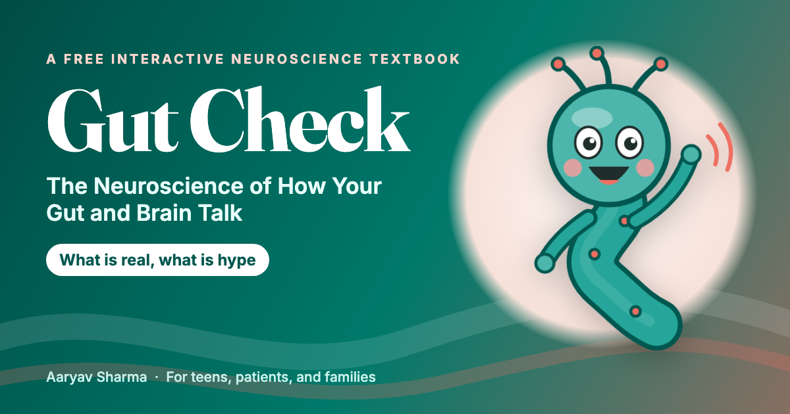

# Gut Check: The Neuroscience of How Your Gut and Brain Talk

**What is real, what is hype.** A free, interactive neuroscience textbook for teens, patients, and families about the gut-brain axis: how the gut's own nervous system, the vagus nerve, gut microbes, and the immune system talk to the brain, and what that means for stress, pain, anxiety, depression, and conditions like Crohn's disease, ulcerative colitis, IBS, and celiac disease.

**Read it here: https://aaryavvatts-lab.github.io/gut-brain-textbook/**



## What makes it different

- **The Hype Meter.** Popular gut-brain claims get a visible evidence grade: Strong, Moderate, Preliminary, or Hype. Every study is labeled as mouse or human, correlation or cause.
- **20 interactive MicroSims** built with p5.js, each with a note on what the model leaves out.
- **The patient and family side.** Every chapter has a fictional At the Bedside case that includes mood, stress, sleep, and school, plus sidebars for families and for teens living with a gut condition.
- **An open claims dataset.** Every graded claim in the book (60 so far) is published as JSON and CSV, with a searchable [Claim Explorer](https://aaryavvatts-lab.github.io/gut-brain-textbook/claims-explorer/) and charts, so teachers and students can reuse it.
- **Real data, shown visually.** Charts built only from verified numbers (IBD and mood, IBS prevalence under different criteria, trial results), plus a diagram of the five gut-to-brain routes.
- **Free and open** under CC BY-NC-SA 4.0.

## What's inside

| | |
|---|---|
| Chapters | 20, in 5 parts |
| Interactive MicroSims | 20, plus a learning graph viewer |
| Concepts in the learning graph | 337 |
| Quiz questions | 200 (10 per chapter), plus a 50-question mock exam |
| Curated references | 239, plus inline links to the studies named in the text |
| Glossary terms | 337 |
| FAQ questions | 80 |
| Words in the chapters | about 221,000 |
| Appendices | Mock exam, glossary, teacher guide, club kit, pilot study kit, questions to ask your doctor, corrections log |
| Open data | `docs/data/hype-meter-claims.json` and `.csv` (graded claims), `docs/learning-graph/learning-graph.csv` (337 concepts) |

## How it was checked

Every chapter went through separate layers: a verified-source dossier before writing, a writer's fact log, an independent fact-check, an expert subject edit and currency pass (current as of October 2026), and a plain-language edit guarded by a script that proves no facts changed. Every PubMed and PMC link was confirmed through NCBI's official APIs. See [How This Book Was Made](https://aaryavvatts-lab.github.io/gut-brain-textbook/methods/) for exactly who decided what and how AI was used, the [Accuracy and Corrections](https://aaryavvatts-lab.github.io/gut-brain-textbook/accuracy/) page for the corrections log, and [Impact and Reviews](https://aaryavvatts-lab.github.io/gut-brain-textbook/impact/) for outside reviews and classroom use as they happen.

This book has not yet been reviewed by an outside physician. Expert reviewers are welcome: see [CONTRIBUTING.md](CONTRIBUTING.md).

## Not medical advice

This book is for education only. It cannot diagnose anything and never tells readers to start, stop, or change a medicine, diet, or supplement. The people in the cases are fictional. If you are in crisis in the US, call or text 988.

## Build it yourself

```bash
pip install -r requirements.txt
mkdocs serve
```

Then open http://127.0.0.1:8000/gut-brain-textbook/. Before contributing, make sure `mkdocs build --strict` passes with no warnings.

## Author and credits

Written by **Aaryav Sharma** ([ORCID 0009-0006-3333-0809](https://orcid.org/0009-0006-3333-0809)), author of [*From Neuron to Bedside*](https://aaryavvatts-lab.github.io/neuroscience-textbook/). Built with Claude Code and [Dan McCreary's intelligent-textbook skills](https://github.com/dmccreary/ibook-skills), [MkDocs Material](https://squidfunk.github.io/mkdocs-material/), and [p5.js](https://p5js.org/).

## License

[CC BY-NC-SA 4.0](LICENSE.md). Please [cite the book](CITATION.cff) if you use it.
