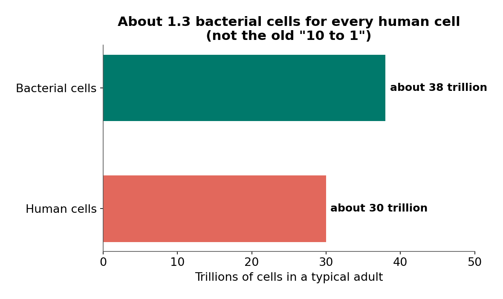
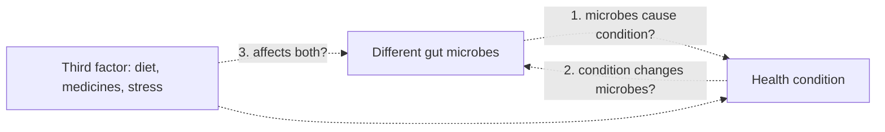

# Chapter 3: Meet the Microbiome

## Summary

Your colon is home to tens of trillions of bacteria, roughly as many bacterial cells as human cells in your whole body. This chapter introduces the gut microbiota and microbiome: who lives there, how a newborn's community forms (and how birth and feeding shape it), how a healthy community keeps harmful bacteria from taking over, and what happens when antibiotics knock it down. You will also learn how scientists read a microbiome using DNA sequencing, why germ-free mice are both powerful and misleading, and why no one has yet defined a single "healthy microbiome." These tools, especially telling correlation from causation, will come back in almost every chapter that follows.

## Concepts Covered

1. Microorganism
2. Gut Microbiota
3. Microbiome
4. Bacterial Strain
5. Commensal Bacteria
6. Pathogen
7. Microbial Diversity
8. Dysbiosis
9. Bacteria-to-Human Cell Ratio
10. Microbiome Development
11. Birth Mode and Microbes
12. Human Milk Oligosaccharides
13. Colonization Resistance
14. Antibiotic Disruption
15. 16S rRNA Sequencing
16. Metagenomic Sequencing
17. Animal Model
18. Germ-Free Mouse
19. Correlation vs Causation
20. Defining a Healthy Microbiome

## Prerequisites

- [Chapter 1: The Brain in Your Belly (and Why That Phrase Is Misleading)](../01-brain-in-your-belly/index.md), especially the digestive tract, the gut-brain axis, and the Hype Meter.
- [Chapter 2: The Vagus Highway](../02-vagus-highway/index.md), for how signals travel between the gut and the brain.

!!! mascot-welcome "Let's meet the neighbors"
    { class="mascot-admonition-img" }
    My nerve endings live right next to trillions of microbes, so I'm curious about them too. Microbes are behind some of the most exciting gut-brain research, and also some of the biggest hype online. This chapter gives you the vocabulary and the evidence skills to tell which is which.

## 3.1 Riya's Antibiotics and a Number That Turned Out to Be Wrong

Riya had a stubborn skin infection on her leg last spring, and her doctor prescribed a course of antibiotics. At her next visit with Dr. Alvarez, her pediatric gastroenterologist, Riya mentioned that her stomach had been a little off during those ten days. Dr. Alvarez nodded. "Antibiotics kill the bacteria causing an infection," she said, "but they also hit the helpful bacteria living in your gut, your microbiome. Most of the time it bounces back. Let's keep an eye on it, since you have Crohn's." (Riya is a fictional 16-year-old with Crohn's disease who appears throughout this book.)

That night, Riya searched "microbiome" and found the same fact on page after page: your body contains ten bacterial cells for every human cell, so you are "only 10% human." It sounds impressive. It's also wrong. In 2016, three scientists at the Weizmann Institute of Science in Israel, [Ron Sender, Shai Fuchs, and Ron Milo](https://pubmed.ncbi.nlm.nih.gov/26824647/), carefully redid the math and found that the ratio is much closer to one to one. A number repeated for decades, on websites, in textbooks, and in talks, didn't hold up when someone checked it.

Meanwhile, Riya's friend Sam had his own microbiome encounter. His older cousin posted a video unboxing a home "gut test kit" that promised to reveal "what your microbes say about your mood." Sam rolled his eyes, but he was curious. Can a stool sample really tell you that? We'll come back to that question in Section 3.10.

## 3.2 A Rainforest in Your Colon

Picture a rainforest. Thousands of kinds of plants, insects, birds, and fungi live together. Some compete for sunlight, some eat each other's leftovers, and some depend on each other completely. No single species is "the rainforest," and two rainforests on different continents can look very different but both be healthy. A storm or a fire can knock the forest back, and it can regrow, though sometimes not exactly the same way.

Your gut, especially your colon, is a crowded ecosystem like that, made of living things too small to see.

A **microorganism** (or microbe) is a living thing too small to see without a microscope, such as a bacterium, an archaeon, a single-celled fungus like yeast, or a single-celled parasite. Viruses are often grouped with microbes too, although they are not cells. Most microorganisms are harmless to people, and many are essential.

Scientists use two related words that people often mix up. A 2020 expert panel led by [Gabriele Berg](https://pubmed.ncbi.nlm.nih.gov/32605663/) proposed clear definitions and recommended keeping the two terms separate:

- The **gut microbiota** is the community of living microorganisms that live in the digestive tract: the bacteria, archaea, fungi, and other microbes themselves.
- The **microbiome** is the microbiota plus its "theater of activity": the microbes' genes, the molecules they make, and the environment they live in. In everyday talk, people often say "microbiome" when they mean just the microbes, and this book sometimes does too when the difference doesn't matter.

Here is a quick way to keep them straight: the microbiota is the cast of characters, and the microbiome is the whole play, including the script (their genes) and what they do on stage (the molecules they make).

Almost all gut bacteria live in the colon (large intestine), where food moves slowly and there is little oxygen. The stomach is too acidic for most bacteria, and the small intestine moves contents through too quickly for huge populations to build up. Many colon bacteria are anaerobes, meaning they grow without oxygen, and many have picky needs, which is one reason they can be hard to grow in a lab.

## 3.3 How Many Microbes? The Bacteria-to-Human Cell Ratio

The **bacteria-to-human cell ratio** is the number of bacterial cells in a person's body divided by the number of human cells. Here is the careful version of the fact, used throughout this book:

> A typical adult has roughly 38 trillion bacterial cells and 30 trillion human cells, about 1.3 to 1. The old "10 to 1" figure is wrong.

Sender, Fuchs, and Milo published [their full estimate](https://pubmed.ncbi.nlm.nih.gov/27541692/) in 2016 in the journal *PLoS Biology*, using a "reference man," a standard 70-kilogram adult used in calculations. They estimated about 38 trillion bacteria (written \( 3.8 \times 10^{13} \)) and about 30 trillion human cells (\( 3.0 \times 10^{13} \)). They also found that all those bacteria weigh only about 0.2 kilograms in total, because bacterial cells are tiny.

$$ \frac{38 \text{ trillion bacteria}}{30 \text{ trillion human cells}} \approx 1.3 $$

*Source: Sender, Fuchs, and Milo 2016, PLOS Biology. Estimates for a reference adult (20 to 30 years old, about 70 kg); the old "10 to 1" figure is wrong.*

Several details make this number more interesting than a single ratio:

- **Most of the bacteria are in the colon.** The colon holds nearly all of them; other body sites add comparatively few.
- **Most of your human cells are blood cells.** About 90% of human cells by count belong to the blood-forming lineage, mostly red blood cells, which are small and extremely numerous.
- **The ratio moves.** The authors estimate an uncertainty of about 25%, and the number varies from person to person. Even a single bowel movement removes a quarter to a third of the bacteria in the colon, which noticeably shifts the ratio for a while.
- **It counts bacteria only.** The microbiome also includes archaea, fungi, and viruses, which aren't in the 1.3 figure.

So you are not "90% bacteria." You are a roughly even partnership. That's still a huge number: tens of trillions of living cells that aren't you, mostly packed into one organ.

!!! mascot-thinking "Even famous numbers need checking"
    { class="mascot-admonition-img" }
    The "10 to 1" figure was repeated for decades because it sounded cool, not because anyone kept re-checking it. When you see a striking number, ask, "Who measured this, and how?" Even a US government project page still showed the old figure when this book's editors checked it in 2026.

The archived [NIH Human Microbiome Project web page](https://commonfund.nih.gov/hmp) still said in October 2026 that microbial cells outnumber human cells "by about ten to one." The project itself did good science, but its page shows how long an outdated number can live online.

## 3.4 Who Lives There? Strains, Commensals, and Pathogens

Gut bacteria are classified like other living things, from big groups down to small ones. In adults, two large groups (phyla) usually dominate: Bacteroidetes and Firmicutes, with smaller amounts of others, according to the [2018 Bonaz review](https://pubmed.ncbi.nlm.nih.gov/29467611/). (Scientists recently renamed these groups Bacteroidota and Bacillota. This book uses the older names because most of the research it describes uses them.)

Below the level of species, there's an important finer level. A **bacterial strain** is a genetic variant within a single bacterial species: strains of the same species share most of their genes but differ in some, which can change what they do. The classic example is *Escherichia coli* (*E. coli*). The [US Centers for Disease Control and Prevention (CDC)](https://www.cdc.gov/ecoli/about/index.html) explains that most *E. coli* are harmless and are part of a healthy intestinal tract, but some kinds can make people sick with diarrhea, urinary tract infections, pneumonia, and other illnesses. Same species name, very different behavior. That's why researchers and careful product labels name the strain, not just the species.

Most of your gut bacteria are neighbors you get along with. **Commensal bacteria** are bacteria that normally live on or in the body without causing harm, and often provide benefits, such as helping digest fiber or crowding out harmful microbes. A **pathogen** is a microorganism that can cause disease. Some pathogens cause disease in almost anyone they infect. Others, often called opportunists, live quietly in small numbers and cause trouble mainly when the normal community is disturbed or the body's defenses are down.

| Term | What it means | Example from this chapter |
|---|---|---|
| Commensal bacteria | Normal residents that usually cause no harm and often help | Most *E. coli* strains; fiber-fermenting Bacteroides |
| Pathogen | A microbe that can cause disease | Disease-causing *E. coli* strains |
| Opportunist | Usually harmless in small numbers; can cause disease when the community is disrupted | *C. difficile* after antibiotics (Section 3.8) |

The line between these categories isn't always fixed. The same species can be a quiet resident in one person and a problem in another, depending on the strain, its numbers, and what else is living nearby.

## 3.5 Microbial Diversity: Many Kinds, Mixed Evenly

Two forests can have the same number of trees but very different variety: one might be 99% pine, the other a mix of fifty kinds of trees. Ecologists care about both how many kinds there are and how evenly they're mixed.

**Microbial diversity** is a measure of how many different kinds of microbes live in a community (richness) and how evenly their numbers are spread out (evenness). One common measure is the Shannon diversity index, which goes up when there are more kinds of microbes and when no single kind dominates:

$$ H = -\sum_{i} p_i \ln p_i $$

Here \( p_i \) is the fraction of the community made up of species \( i \). You don't need to calculate it by hand. Just remember that a community split evenly among many species has a high \( H \), and a community dominated by one species has a low \( H \).

The Human Microbiome Project, funded by the NIH Common Fund from 2007 to 2016, mapped the microbes of healthy volunteers. Its [2012 summary paper in *Nature*](https://pubmed.ncbi.nlm.nih.gov/22699609/) described the wide range of community types found in healthy people. A 2012 review by [Lozupone and colleagues](https://pubmed.ncbi.nlm.nih.gov/22972295/) adds that the gut microbiota is immensely diverse, varies between individuals, and can fluctuate over time, especially during disease and early development.

That individuality matters. In a 2011 study, [Dethlefsen and Relman](https://pubmed.ncbi.nlm.nih.gov/20847294/) followed the gut bacteria of three adults over 10 months and found that differences between people were the biggest source of variation in their samples. Each person's community wobbled from day to day but stayed close to its own stable average for months.

Is more diversity always better? Often, in adults, lower diversity shows up alongside certain diseases. But "more is better" is too simple, as you'll see in the next section: healthy breastfed babies normally have *low* diversity.

## 3.6 Microbiome Development: The First Year of Life

**Microbiome development** is the process by which a newborn's gut, which starts with very few microbes, is colonized and changes over the first years of life toward a more stable, adult-like community. It's a bit like a newly cleared field: the first plants to arrive are fast-growing pioneers, and over time the community becomes richer and more stable.

### Birth mode

The first microbes a baby meets depend partly on how the baby is born. **Birth mode and microbes** refers to the way a baby's delivery (vaginal birth or cesarean section, also called C-section) shapes which microbes first colonize the newborn.

The first study to show this clearly was small. In 2010, [Dominguez-Bello and colleagues](https://pubmed.ncbi.nlm.nih.gov/20566857/) sampled 10 newborns. Babies born vaginally first carried microbes that resembled their mother's vaginal microbes, while babies born by C-section first carried microbes like those found on skin. Because only 10 babies were studied, this was a starting point, not the final word.

Much larger studies followed. In 2019, [Shao and colleagues](https://pubmed.ncbi.nlm.nih.gov/31534227/) analyzed 1,679 stool samples from 596 full-term babies born in UK hospitals and found that in the first weeks of life, C-section babies showed disrupted transfer of their mothers' *Bacteroides* strains and more colonization by hospital-associated bacteria. In the TEDDY study of 903 children in the US and Europe, published in 2018 by [Stewart and colleagues](https://pubmed.ncbi.nlm.nih.gov/30356187/), birth-mode differences were present early but became less important over time, and breastfeeding had a bigger effect on how the microbiome matured.

A 2015 Swedish study by [Bäckhed and colleagues](https://pubmed.ncbi.nlm.nih.gov/25974306/) also found that C-section babies' microbes resembled their mothers' less in early life.

### Breastfeeding and human milk oligosaccharides

Human milk contains something surprising: sugars the baby can't digest. **Human milk oligosaccharides** (HMOs) are a family of complex sugar molecules found in large amounts in human milk that the baby can't digest, which instead feed certain beneficial gut bacteria, such as *Bifidobacterium*. A 2012 review by [Lars Bode](https://pubmed.ncbi.nlm.nih.gov/22513036/) explains that HMOs were first discovered as a "bifidus factor," food for helpful bacteria. HMOs may also act as decoys that keep some pathogens from sticking to the gut lining. Bode is careful to note that most of that evidence comes from lab, animal, or association studies, and that randomized trials are needed to confirm the benefits in babies.

So breast milk feeds the baby and also feeds selected microbes. That's why exclusively breastfed babies tend to have a gut community dominated by a few milk-loving groups. A 2018 meta-analysis by [Ho and colleagues](https://pubmed.ncbi.nlm.nih.gov/30301893/), combining data from 684 infants in several countries, found that exclusively breastfed infants had *lower* diversity in their first 6 months than other infants. That's normal. Bäckhed's study also found that what most pushed the infant microbiome toward an adult-like state was stopping breastfeeding, more than starting solid food.

!!! hype-strong "Hype Meter: "C-section babies start life with different gut microbes""
    
StrongModeratePreliminaryHype

    **Verdict: Strong (for early differences).** Large human studies, including a UK study of 596 newborns and the 903-child TEDDY study, confirm that birth mode changes which microbes colonize a baby in the first weeks and months. These differences shrink over the first year or so, and breastfeeding has a larger effect on maturation. Claims that C-section birth causes lifelong disease *through* the microbiome are a different matter: the studies in this chapter don't show that, so any long-term health claim is Preliminary at best.
    **What would change the grade:** Long-term studies that follow children for years and test whether early microbe differences actually cause later health differences, while accounting for the reasons a C-section was needed, would tell us whether the long-term claims hold up.

!!! families "For families"
    Many parents feel guilty after a C-section or when breastfeeding doesn't work out, especially after reading microbiome headlines. The evidence shows early differences in babies' microbes, but those differences fade over the first year, and the research doesn't show that birth mode or formula feeding "ruins" a child's microbiome. Babies are born by C-section and fed formula for good medical and personal reasons. If you have questions about your own child, a pediatrician is the right person to ask, not a test kit or a headline.

## 3.7 Colonization Resistance: A Full Parking Lot

Imagine a parking lot so full that a newcomer can't find a space. A healthy gut community works a bit like that. When the space and food are already taken by residents, an invader has a hard time settling in.

**Colonization resistance** is the ability of the normal gut microbiota to prevent harmful microbes from settling in and multiplying, by competing for space and nutrients, making substances that block invaders, and stimulating the body's defenses. A 2013 review by [Buffie and Pamer](https://pubmed.ncbi.nlm.nih.gov/24096337/) describes how commensal bacteria in mice and humans help protect against infections, including dangerous bacteria that resist many antibiotics, such as *Clostridioides difficile* (*C. difficile*), and how certain groups of commensal bacteria can restore protection after antibiotics in animal experiments.

Colonization resistance is one of the clearest examples of the microbiota helping us. It explains why a disturbed community can open the door to infection, which brings us to antibiotics.

## 3.8 Antibiotic Disruption

Antibiotics are among the most important medicines ever developed; they save lives by killing the bacteria that cause infections. But most antibiotics can't tell the bacteria causing an infection from the bacteria living peacefully in your colon. **Antibiotic disruption** is the change in the gut microbiota caused by antibiotics: a loss of bacterial numbers and diversity, shifts in which groups dominate, and a recovery afterward that is often fast but not always complete.

How big is the effect, and how complete is recovery? Two human studies give a picture.

In the 2011 Dethlefsen and Relman study, three adults each took two short courses of the antibiotic ciprofloxacin over 10 months. Within 3 to 4 days of starting the drug, each person's gut community lost diversity and shifted in makeup. About a week after each course ended, the communities began returning toward their starting state, but the return was often incomplete. By the end of the study, every person's community had stabilized, but in a state somewhat different from where it began. The responses also differed between people and even between the two courses in the same person.

In 2018, a Danish-led team (first author [Albert Palleja](https://pubmed.ncbi.nlm.nih.gov/30349083/)) gave 12 healthy young men a 4-day course of three powerful "last-resort" antibiotics at once, then followed their gut bacteria for 6 months using metagenomic sequencing (Section 3.10). Right after the antibiotics, some opportunist bacteria bloomed, while *Bifidobacterium* species and butyrate-producing bacteria dropped. The communities recovered to near their starting makeup within about 1.5 months. But 9 common species that every man carried before treatment were still undetectable in most of the men after 180 days.

Let's apply the six questions from [Chapter 1, Section 1.13](../01-brain-in-your-belly/index.md#113-how-to-read-a-gut-brain-claim-six-questions) to this study.

!!! claim-box "How to read a gut-brain claim: the 2018 antibiotic recovery study"
    | Question | This study |
    |---|---|
    | Mouse or human? | Human: 12 healthy young men in Denmark. No women, children, older adults, or people with illnesses. |
    | Correlation or cause? | Cause, within each person. The researchers gave the antibiotics on purpose and compared each man's microbes before and after. There was no untreated comparison group, but the sudden changes right after the antibiotics make the drugs the very likely cause. |
    | How many? | 12 people, with stool samples at several time points. Small, but deeply analyzed with metagenomic sequencing. |
    | How long? | 6 months of follow-up after a 4-day course. That's long for this kind of study, but it can't say what happens over years. |
    | Who paid for it? | Mainly the Novo Nordisk Foundation Center for Basic Metabolic Research (an independent center at the University of Copenhagen partly funded by the Novo Nordisk Foundation), plus Danish research councils and diabetes groups. The authors declared no competing interests. |
    | Is something being sold? | No. The antibiotics used are hospital drugs, and no product was promoted. |

The conclusion: in healthy young men, the gut community was resilient to a short, very strong antibiotic course, but recovery was not perfect, and a few species seemed to be lost for months. These were unusual "last-resort" antibiotics given together, so the results may not match a typical course of one antibiotic for an ear or sinus infection. And the study didn't measure whether the lost species mattered for health.

Antibiotics can also open the door to a dangerous opportunist. According to [the CDC](https://www.cdc.gov/c-diff/about/index.html), *C. difficile* is a bacterium that causes diarrhea and inflammation of the colon and is estimated to cause almost half a million infections in the United States each year. People are up to 10 times more likely to get it while taking an antibiotic and during the month after finishing one. This is colonization resistance in reverse: when the normal residents are knocked down, *C. difficile* can take over.

!!! hype-hype "Hype Meter: "One round of antibiotics ruins your microbiome forever""
    
StrongModeratePreliminaryHype

    **Verdict: Hype (as stated).** Human studies show that antibiotics quickly reduce gut diversity, and that recovery can be incomplete, with a few species missing for months in some people. But the same studies show that most of the community regrows within weeks to a couple of months in healthy adults. "Ruins forever" turns a real, modest, long-lasting change into a scare, and it can push people to avoid antibiotics they need.
    **What would change the grade:** A careful version, "antibiotics can leave small, lasting changes in the gut microbiota," is well supported (Moderate to Strong). Long-term studies showing that those lasting changes harm health would strengthen the case for caution, which doctors already practice by prescribing antibiotics only when needed.

!!! mascot-warning "Don't skip antibiotics you need"
    { class="mascot-admonition-img" }
    Microbiome research is a reason to use antibiotics wisely, not a reason to refuse them. Untreated bacterial infections can be dangerous, so if you're worried about your microbiome, talk to your doctor instead of stopping a prescription early.

## 3.9 Trying It Yourself: The Microbiome Balance

The simulation below is a cartoon gut community with 24 made-up species in five groups. Each dot stands for a small share of the community, the bar shows each group's share, and the chart tracks the diversity index over time. Opportunists (tomato red) are held in check by everyone else, which is colonization resistance in action.

#### Diagram: Microbiome Balance
<iframe src="../../sims/ch03-microbiome-balance/main.html" height="682px" width="100%" scrolling="no"></iframe>

[Open the Microbiome Balance fullscreen](../../sims/ch03-microbiome-balance/main.html){ .md-button .md-button--primary }

MicroSim specification: Microbiome Balance

Type: microsim
**sim-id:** ch03-microbiome-balance 
**Library:** p5.js 
**Status:** Implemented 
**Bloom Level:** Apply 
**Bloom Verb:** predict 
**Learning Objective:** The learner will predict how an antibiotic course and a change in diet shift the diversity and makeup of a gut bacterial community, and explain why recovery is often partial and differs between people.

**Canvas:** 560 px drawing area plus 120 px controls (iframe 682 px); responsive down to about 320 px wide, where the panels stack.

**Controls:** Start/Pause, Reset (same starting person), New person (a different random starting community), Give antibiotic course (5 illustrative days), Diet select (Fiber-rich, varied plants; Low-fiber, high-sugar).

**Rules:** 24 species in 5 groups: fiber fermenters (Bacteroides-type), butyrate producers, Bifidobacteria, other commensals, and opportunists. Each group has a few abundant species and several rare ones. Commensals grow toward their own niche size; opportunists are held down by the size of the commensal community (colonization resistance). Antibiotics kill commensals quickly and opportunists slowly, so opportunists bloom for a while; each commensal species differs a little in how hard the drug hits it. Any species that falls below a "lost" threshold disappears and can't return on its own, so recovery is partial. A low-fiber diet shrinks the niches of rare fiber specialists most, shifting the community toward a few groups and lowering diversity modestly; returning to fiber restores species that are still present.

**Feedback:** Dot field, stacked composition bar with percentages, diversity line chart with antibiotic days shaded, and a panel showing the day, diversity index, species present out of 24, and a message explaining what just happened.

**Provenance:** Section 3.8 (Dethlefsen and Relman 2011; Palleja et al. 2018), Section 3.7 (Buffie and Pamer 2013). The diet behavior is a simplified illustration, not drawn from a study in this chapter. Species, rates, and diversity values are illustrative.

First, predict: what will happen to the diversity index during an antibiotic course, and will it return to exactly where it started? Then press **Give antibiotic course**. Watch the opportunists bloom as the commensals shrink, then watch the commensals regrow and push the opportunists back down. Check the "Species present" count when the line levels off. Did any species disappear for good?

Next, press **New person** and give the same antibiotic course. Does this person lose the same number of species? Finally, reset and switch the diet to **Low-fiber, high-sugar** for a couple of months of simulated time, then switch back. Notice that the diet change shifts the makeup of the community more than it changes diversity, and that the change reverses when fiber returns, because no species was lost.

!!! model-limits "What this model leaves out"
    - A real gut has hundreds of species and many more strains, plus archaea, fungi, and viruses, not 24 made-up species in five groups.
    - Real antibiotics differ a lot: each one hits different bacteria, and effects vary by drug, dose, and person. The sim uses one generic course, and its opportunist bloom and species losses are rough cartoons.
    - Real people pick up new microbes from food, other people, and the environment, so lost species can sometimes return; the sim doesn't allow that.
    - The sim ignores the immune system, the gut lining, medicines other than antibiotics, and the person's health.
    - Days, rates, diversity values, and the size of the diet effect are made up; they show patterns, not predictions for any real person.

## 3.10 Reading a Microbiome: 16S and Metagenomic Sequencing

For most of the history of microbiology, scientists studied bacteria by growing them in dishes. But many gut microbes are anaerobes with picky needs, and they're hard to grow. A 2019 study by [Strandwitz and colleagues](https://pubmed.ncbi.nlm.nih.gov/30531975/) noted that, at the time, an estimated 23 to 65% of species in the human gut had never been grown in the lab. So researchers turned to reading DNA instead.

There are two main approaches, and you'll see both in research papers.

**16S rRNA sequencing** is a method for identifying bacteria in a sample by reading the DNA of one marker gene, the 16S ribosomal RNA gene, which all bacteria have and which differs between groups. It works like reading the barcode on a product: you can tell roughly what's on the shelf and how much of each, but not what each product can do. It is fast and relatively cheap, but it often can't tell apart closely related species or strains, and it only covers bacteria and archaea.

**Metagenomic sequencing** (also called shotgun metagenomics) is a method that reads fragments of *all* the DNA in a sample, from every organism present, so researchers can identify microbes in more detail and see which genes, and so which possible functions, are present. A 2017 review by [Quince and colleagues](https://pubmed.ncbi.nlm.nih.gov/28898207/) says shotgun metagenomics has transformed microbiology. It's like reading every page of every book in a library instead of just the titles. The TEDDY study used both methods, and the Palleja antibiotic study used metagenomics.

| | 16S rRNA sequencing | Metagenomic sequencing |
|---|---|---|
| What it reads | One marker gene | All DNA in the sample |
| Everyday comparison | Reading product barcodes | Reading every page in the library |
| Tells you | Which groups of bacteria are present, and in what proportions | Species and often strains, plus which genes (possible functions) are present |
| Limits | Less detail; usually can't see genes or functions | More expensive; needs more computing; genes present doesn't mean genes active |

Both methods share a big limit: a stool sample shows what's leaving the colon, not exactly what's living along the whole gut wall. A 2018 review of best practices by [Knight and colleagues](https://pubmed.ncbi.nlm.nih.gov/29795328/) stresses that choices about how samples are collected, stored, and analyzed can change the results.

This brings us back to Sam's cousin and the home gut test kit. These tests usually use one of the methods above on a stool sample, then send a report full of colorful charts, scores, and sometimes food or supplement suggestions.

!!! hype-hype "Hype Meter: "A home microbiome test can tell you what to eat to improve your mood""
    
StrongModeratePreliminaryHype

    **Verdict: Hype.** The sequencing itself can be real science, but a 2024 international consensus statement by dozens of microbiome experts ([Porcari and colleagues](https://pubmed.ncbi.nlm.nih.gov/39647502/), *Lancet Gastroenterology & Hepatology*) concluded that evidence for using gut microbiome tests in clinical care is scarce, and that direct-to-consumer tests are sold without agreed regulation or any proven clinical value. No one has defined what a "healthy" microbiome looks like (Section 3.11), so there is no validated standard to compare your sample to, and no trials show that following a kit's advice improves mood.
    **What would change the grade:** Validated reference ranges for specific microbiome features, plus randomized trials showing that test-guided diet changes improve a specific health outcome compared with general advice, could move a specific test up.

## 3.11 Dysbiosis and Defining a Healthy Microbiome

You'll often read that a disease is linked to "dysbiosis." **Dysbiosis** is a term for a change in the gut microbiota away from its usual makeup that is thought to be harmful, such as lower diversity, loss of beneficial groups, or overgrowth of potentially harmful ones. It's a useful word, but scientists warn that it's slippery.

The problem is in the definition. To say a microbiome has gone "wrong," you need to know what "right" looks like. **Defining a healthy microbiome** is the scientific challenge of identifying which features of a gut microbial community reliably support health, and what their normal ranges are, given that healthy people's microbiomes differ greatly. A 2016 review by [Lloyd-Price, Abu-Ali, and Huttenhower](https://pubmed.ncbi.nlm.nih.gov/27122046/) describes cataloguing the features of the microbiome that support health as an essential first step that is still underway. So far, no one has defined a single "healthy microbiome," and two healthy people can have very different communities, just like two healthy rainforests.

A 2020 essay by [Harald Brüssow](https://pubmed.ncbi.nlm.nih.gov/31448542/) lists more problems. Many studies that compare people with a disease to people without it are too small, and some reported "dysbiosis" patterns don't repeat in other studies. Even the most advanced statistics explain only a small share of why microbiomes differ between people. And there's a circular trap: if we define dysbiosis as "the microbiome people with this disease have," we can't then use dysbiosis to explain the disease.

!!! living-with "If you're going through this"
    If you have a gut condition or needed several rounds of antibiotics, it's easy to worry that you've "broken" your microbiome, especially after scrolling past posts about it. Remember that gut communities are resilient, that no one has defined a single healthy microbiome to measure yourself against, and that your care team treats your actual symptoms and test results, not a stool-test score. If you have questions about your microbiome and your condition, write them down and bring them to your next appointment.

## 3.12 Animal Models, Germ-Free Mice, and Correlation vs Causation

How do scientists test whether microbes *cause* something, rather than just showing up alongside it? Often, they start with animals.

An **animal model** is a non-human animal, such as a mouse or rat, used to study a biological process or disease because it shares important features with humans and can be studied in ways that aren't possible in people. Animal models let researchers control diet, genes, and environment, and run experiments that would be unethical in humans. The catch is that mice aren't small people: they eat differently, have different gut anatomy, and carry different microbes.

The most powerful microbiome model is the **germ-free mouse**, a mouse raised in a sterile isolator from birth so that it has no microorganisms at all, in or on its body, which lets researchers add specific microbes and watch what changes. A 2016 review by [Luczynski and colleagues](https://pubmed.ncbi.nlm.nih.gov/26912607/) calls germ-free mice some of the most persuasive evidence that gut microbes affect the brain and behavior. A classic example: in 2004, [Sudo and colleagues](https://pubmed.ncbi.nlm.nih.gov/15133062/) found that germ-free mice had an exaggerated stress-hormone response, and that giving them gut bacteria early in life partly corrected it, but giving bacteria later didn't. (Chapter 7 returns to this study.)

But the same Luczynski review warns that growing up germ-free causes permanent differences in how the brain and body develop. A germ-free mouse isn't a normal mouse minus its microbes; it's a different animal in many ways. And no human lives germ-free. So germ-free results suggest what microbes *can* do, not what they *do* in people.

!!! mascot-encourage "This part is tricky, and it matters"
    { class="mascot-admonition-img" }
    Correlation versus causation is the single most useful idea in this whole book, and it takes practice. If it feels confusing now, that's normal. You'll use it in nearly every chapter, and it gets easier each time.

**Correlation vs causation** is the distinction between two things happening together (a correlation, or association) and one thing actually producing the other (causation). Most microbiome studies in people are correlations: they find that people with a condition have different gut microbes. There are at least three ways that can happen:

1. **The microbes help cause the condition.** This is the exciting possibility.
2. **Reverse causation: the condition changes the microbes.** Diarrhea, inflammation, and changes in eating during illness all reshape the gut community.
3. **A third factor (a confounder) changes both.** Diet, medicines (including antibiotics), stress, sleep, and where someone lives can all affect both the microbes and the condition.

Researchers try to test cause with experiments. One common design is to transplant gut microbes from people with a disease into germ-free mice or rats and see whether the animals develop disease-like features. But a 2020 review in *Cell* by [Walter and colleagues](https://pubmed.ncbi.nlm.nih.gov/31978342/) raised a warning. In their systematic review, 95% of published studies of this kind (36 of 38) reported that the disease-like trait transferred to the animals, and many then made causal claims about human disease. The authors argued that such a high success rate is implausible and overstates the microbiome's role in human disease. When almost every experiment "works," it may mean the method is biased, not that the microbes always matter.

Back to Riya. Studies find that people with Crohn's disease, on average, have different gut microbes than people without it. Riya now knows to ask: did the microbes help cause the disease, did the inflammation and medicines change the microbes, or both? Researchers think it's likely a two-way street, which Chapters 9 and 11 explore.

## At the Bedside: Diarrhea During a Course of Antibiotics

!!! note "Meet the patient (fictional)"
    Leah is 15 and plays club soccer. She had a sinus infection that didn't clear up, so her doctor prescribed an antibiotic. On day 4 she starts having loose stools a few times a day, with mild cramps. She has no fever and no blood in her stool, and she's still eating and drinking. Her mom calls the doctor's office, and Leah privately worries that she has "ruined" her gut bacteria forever.

**What the doctor checks:** The nurse asks how many loose stools Leah is having, whether there is fever, blood or mucus in the stool, severe belly pain or tenderness, signs of dehydration (dizziness, very little urine, a dry mouth), and whether she has had antibiotics or *C. difficile* before. Because her symptoms are mild and she has none of these warning signs, the doctor decides she doesn't need tests right now but gives clear instructions to call back if anything changes.

**Connecting the signals:** The antibiotic is killing the bacteria causing Leah's sinus infection, but it's also knocking down commensal bacteria in her colon. With fewer residents, her gut handles food and fluid differently, and colonization resistance is weaker for a while. That's the "antibiotic disruption" pattern from Section 3.8 and the sim.

**Diagnosis:** Mild antibiotic-associated diarrhea.

**Why it happens:** Antibiotics can't tell harmful bacteria from helpful ones. As the commensal community shrinks and shifts, the colon's normal work changes, and opportunists have more room. In most healthy people, the community regrows over the following weeks. The more serious version is *C. difficile* infection, which the CDC links to antibiotics: people are up to 10 times more likely to get it during and in the month after taking one. Warning signs that need a prompt call to a doctor include fever, many watery stools a day, stomach tenderness or pain, loss of appetite, nausea, blood in the stool, or diarrhea that continues after the antibiotic ends.

**The mind-body side:** Leah's biggest worry isn't the diarrhea; it's the idea that she has permanently damaged her body. The doctor explains that gut communities usually recover well, that the infection needed treatment, and that a few days of loose stools is a common, temporary side effect. The doctor also notes that worry can make the gut feel worse, and that it's fine to tell her coach she needs easy bathroom access for a few days.

**Treatment today:** For mild antibiotic-associated diarrhea, the doctor's plan is usually to keep drinking fluids and to finish the antibiotic as prescribed unless the doctor changes it. If the diarrhea is severe or warning signs appear, the doctor may test for *C. difficile* and may switch or stop the antibiotic. Leah shouldn't stop the medicine or add products on her own; any change is the doctor's call.

**What's new in research:** For adults whose *C. difficile* infection keeps coming back, doctors now have microbiome-based medicines. On April 26, 2023, [the FDA approved Vowst](https://www.fda.gov/news-events/press-announcements/fda-approves-first-orally-administered-fecal-microbiota-product-prevention-recurrence-clostridioides), a fecal microbiota product (made from donated human stool) taken by mouth as capsules, to prevent *C. difficile* infection from coming back in adults 18 and older after antibiotic treatment for recurrent infection. In its placebo-controlled trial, the infection came back within 8 weeks in 12.4% of people taking Vowst versus 39.8% taking placebo. An earlier product, Rebyota (given rectally), was approved for the same use in November 2022. **Evidence grade: Strong** for that specific use in adults. Neither product is approved for children, for a first *C. difficile* infection, or for any mental-health condition.

??? question "Your turn: reason through a variation"
    Leah's teammate Jordan took the same antibiotic a month ago. Now, three weeks after finishing it, he has many watery stools a day, a fever, and belly tenderness. Should he treat this as the same mild, temporary side effect? Why or why not?

    **Answer:** No. Jordan's symptoms started after the antibiotic ended and include fever, frequent watery stools, and tenderness, which are warning signs. The CDC notes the risk of *C. difficile* stays raised for about a month after an antibiotic, and its symptoms include fever, diarrhea, and stomach tenderness. Jordan should contact a doctor promptly so they can check for *C. difficile* or another cause.

*This is a fictional teaching case. It is not medical advice. If you or someone you know has symptoms like these, talk to a doctor.*

## Common Misconceptions

**Myth:** All bacteria are bad, so fewer bacteria in your body is better.  
**Reality:** Most gut bacteria are commensals that cause no harm, and many help, for example by fermenting fiber and by crowding out pathogens (colonization resistance). Only some bacteria, and some strains, cause disease.

**Myth:** Bacteria outnumber your human cells 10 to 1, so you're only 10% human.  
**Reality:** A careful 2016 estimate found about 38 trillion bacteria and 30 trillion human cells in a typical adult, about 1.3 to 1. The old "10 to 1" figure is wrong.

**Myth:** There is one healthy microbiome, and a test can tell you if yours matches it.  
**Reality:** Healthy people have very different gut communities, and scientists haven't defined a single healthy microbiome. Experts say direct-to-consumer microbiome tests have no proven clinical value.

**Myth:** If something happens in germ-free mice, it happens in people.  
**Reality:** Germ-free mice grow up with permanent developmental differences, and mice differ from humans in diet, anatomy, and microbes. Germ-free results show what microbes *can* do in mice; human studies are needed to know what they do in people.

**Myth:** If people with a disease have different microbes, the microbes caused the disease.  
**Reality:** That's a correlation. The disease or its treatments could have changed the microbes, or a third factor such as diet or medicines could affect both. Showing cause takes experiments, and even mouse transplant experiments can overstate cause.

## Your Gut Check

Test yourself. Try each one before you open the answer.

??? question "1. Claim Check: "Your gut bacteria outnumber your cells 10 to 1. That means your microbes are really in charge of your mood. Take our 30-strain probiotic to take back control!""
    **Grade: Hype.** The first claim is wrong: the best estimate is about 1.3 bacteria per human cell, not 10. Even a true ratio wouldn't show that microbes control mood; that's a separate question, and the strongest evidence for microbe effects on behavior comes from germ-free mice, which don't translate directly to people. The ad also ends with a product, which is a reason to read twice as carefully. A careful version would say: "Your gut contains roughly as many bacterial cells as human cells, and researchers are studying whether and how they affect the brain."

??? question "2. Predict: Sam takes a 10-day antibiotic course for strep throat. Predict what happens to the diversity of his gut bacteria during the course and over the next two months."
    During the course, diversity should drop and the makeup of his community should shift, with some groups shrinking and some opportunists growing, as in the Dethlefsen and Palleja studies. After the course, most of the community should regrow over weeks, with diversity returning close to where it started. But recovery may not be perfect: a few species might stay missing for months, and the exact pattern will differ from other people's.

??? question "3. Explain: Why are people more likely to get C. difficile infection during and after a course of antibiotics?"
    Normally, the commensal bacteria in the colon provide colonization resistance: they take up space and nutrients and make it hard for *C. difficile* to multiply. Antibiotics knock down many of those commensals, so *C. difficile* has room to grow and make people sick. The CDC says people are up to 10 times more likely to get it while taking an antibiotic and in the month after.

??? question "4. Apply: A study finds that teens with anxiety have lower gut microbial diversity than teens without anxiety. List three possible explanations."
    First, lower diversity might contribute to anxiety (microbes affecting the brain). Second, reverse causation: anxiety could change eating, sleep, and gut movement, which then change the microbes. Third, a confounder: something like diet, a recent antibiotic, poor sleep, or a medicine could affect both anxiety and microbes. The study alone can't tell these apart; an experiment or a long-term study tracking the order of changes would help.

**5. Read the data.** In the 2018 Palleja study (Section 3.8), researchers followed 12 healthy young men after a 4-day course of three antibiotics. Here are key findings from the published abstract:

| Measure | Finding |
|---|---|
| Number of participants | 12 healthy men |
| Antibiotic course | 4 days, 3 antibiotics together (meropenem, gentamicin, vancomycin) |
| Right after treatment | Opportunist bacteria bloomed; *Bifidobacterium* and butyrate producers dropped |
| Time to near-baseline makeup | About 1.5 months |
| Common species still undetectable in most men at 180 days | 9 |

??? question "5. What does this data show, and what can't it show?"
    It shows that in healthy young men, the gut community largely recovered within about 1.5 months after a strong antibiotic course, but some species stayed missing for at least 6 months. It can't tell us whether the same happens in women, children, older adults, or people with gut diseases, or after a typical single antibiotic, because all 12 participants were similar and got an unusual three-drug course. It also can't show whether losing those 9 species affected health. A helpful follow-up would study a more varied group taking common antibiotics and measure health outcomes as well as microbes.

## Exercises

### Remember

1. What is the difference between the gut microbiota and the microbiome?

??? note "Answer"
    The gut microbiota is the community of microorganisms living in the gut. The microbiome is the microbiota plus their genes, the molecules they make, and the environment they live in.

2. According to Sender, Fuchs, and Milo (2016), about how many bacterial cells and human cells does a typical adult have?

??? note "Answer"
    About 38 trillion bacterial cells and about 30 trillion human cells, a ratio of about 1.3 to 1.

### Understand

3. Explain why exclusively breastfed babies having lower gut diversity is not a sign of an unhealthy microbiome.

??? note "Answer"
    Human milk oligosaccharides feed a few groups of milk-loving bacteria, such as *Bifidobacterium*, so the infant community is dominated by those groups. This is a normal stage of microbiome development; diversity rises after breastfeeding stops. "More diversity is better" doesn't apply to healthy infants.

4. Explain how colonization resistance protects against infection, using a comparison of your own.

??? note "Answer"
    The normal residents of the colon use up space and nutrients and make substances that block invaders, so a newcomer like *C. difficile* struggles to settle in. One comparison: a full parking lot leaves no space for a newcomer's car. When antibiotics empty the lot, invaders can park.

### Apply

5. Use the Microbiome Balance sim. Give an antibiotic course to three different "new people" and record the lowest diversity index, the diversity index 100 days later, and the number of species lost for each. Describe what's the same and what differs, and connect your results to the Dethlefsen and Relman finding that responses differed between people.

6. A friend's younger brother was born by C-section, and the friend says, "That's why he gets sick more. His microbiome was ruined at birth." Use the evidence in Section 3.6 to write a kind, accurate reply.

### Analyze

7. Compare a 16S rRNA sequencing study and a metagenomic sequencing study of the same stool samples. What questions could the metagenomic study answer that the 16S study couldn't? What would both still be unable to tell you?

8. Walter and colleagues found that 36 of 38 studies transplanting human gut microbes into germ-free rodents reported that a disease-like trait transferred. Analyze why such a high success rate might make scientists more skeptical, not less.

### Evaluate

9. A company advertises: "Our microbiome test compares your gut to the healthy microbiome and gives you a personalized plan." Evaluate this claim using the concepts of defining a healthy microbiome, 16S versus metagenomic sequencing, and the 2024 expert consensus statement.

10. Judge this headline: "Antibiotics permanently destroy gut bacteria, study finds," written about the Palleja 2018 study. What does the headline get right, what does it get wrong, and how would you rewrite it?

### Create

11. Design a study to test whether a common antibiotic used for teen ear or sinus infections changes gut diversity, and whether diversity fully recovers. Describe who you'd include, what you'd measure and when, what comparison group you'd use, and how you'd handle diet as a possible confounder.

12. Create a one-page "Microbiome myths vs facts" handout for a middle-school health class, covering at least four ideas from this chapter (for example, the bacteria-to-human cell ratio, commensals and pathogens, antibiotics, and home test kits), each with a one-sentence evidence grade.

## Key Takeaways

- The gut microbiota is the community of microbes in your gut; the microbiome adds their genes, molecules, and environment. Most gut bacteria live in the colon.
- A typical adult has roughly 38 trillion bacterial cells and 30 trillion human cells, about 1.3 to 1. The old "10 to 1" figure is wrong.
- Most gut bacteria are commensals. Strains of the same species can behave very differently, and pathogens or opportunists can take advantage when the community is disturbed.
- Birth mode, breastfeeding, and human milk oligosaccharides shape a baby's first microbes; early birth-mode differences are real but fade over the first year or so.
- A healthy community provides colonization resistance. Antibiotics cause fast drops in diversity; most of the community recovers within weeks to months, but recovery can be incomplete and varies between people.
- Scientists read microbiomes with 16S rRNA sequencing (one marker gene) or metagenomic sequencing (all DNA). No single healthy microbiome has been defined, and home tests have no proven clinical value.
- Germ-free mice and other animal models show what microbes can do, but they don't translate directly to people, and most human microbiome findings are correlations, not proof of cause.

!!! mascot-celebration "You've met the neighbors!"
    { class="mascot-admonition-img" }
    You can now count the microbes correctly, track how they settle in and bounce back, and spot when a study shows correlation instead of cause. Next, in Chapter 4, we'll see how the gut's immune system acts like a sense organ that can change how you feel.
