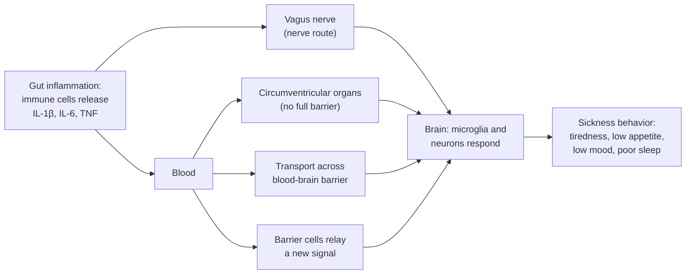

# Chapter 4: The Immune System as a Sense Organ

## Summary

Your immune system does more than fight germs. It constantly samples what is in your gut, decides what is safe and what is dangerous, and reports back to the brain using chemical messengers called cytokines. This chapter tours the gut's border wall (the lining, its mucus, and the seals between cells), the immune tissue that samples what you swallow, and the alarm system of inflammation. It then follows immune messages to the brain by four routes, meets the brain's own immune cells, and explains why being sick makes you tired, hungry for nothing, and low. Finally, it grades the evidence linking inflammation to depression and busts the popular claim that "70% of your immune system is in your gut."

## Concepts Covered

1. Innate Immunity
2. Adaptive Immunity
3. Intestinal Epithelium
4. Mucus Layer
5. Tight Junction
6. Gut-Associated Lymphoid Tissue
7. Pattern Recognition Receptor
8. Inflammation
9. Cytokine
10. Interleukin-6
11. Tumor Necrosis Factor
12. Interleukin-1 Beta
13. Regulatory T Cell
14. Immune-to-Brain Signaling
15. Circumventricular Organ
16. Microglia
17. Neuroinflammation
18. Sickness Behavior

## Prerequisites

- [Chapter 1: The Brain in Your Belly (and Why That Phrase Is Misleading)](../01-brain-in-your-belly/index.md) for the gut wall layers and the Hype Meter
- [Chapter 2: The Vagus Highway](../02-vagus-highway/index.md) for afferent (upward) vagus signals and the brainstem
- [Chapter 3: Meet the Microbiome](../03-meet-the-microbiome/index.md) for gut microbes, germ-free mice, and correlation vs causation

!!! mascot-welcome "Why being sick feels the way it does"
    { class="mascot-admonition-img" }
    Every time you've had the flu and wanted nothing but your bed, your immune system was talking to your brain, and I carried some of those messages myself. This chapter explains that conversation, which matters most for people like Riya, whose gut inflammation can make them exhausted and low. It also gives you the tools to see through one of the most repeated numbers on the internet. Let's check what the gut is really telling the brain!

## 4.1 Why Does Riya Feel So Drained?

Last winter, Sam caught the flu two days before a cross-country meet. He had a fever, his muscles ached, and food sounded disgusting. What surprised him most was his mood. He didn't want to text anyone, his favorite shows seemed boring, and he slept twelve hours and still woke up tired. "I felt like a different person," he told Riya when he came back to school. (Sam and Riya are fictional students who appear throughout this book.)

Riya knew exactly what he meant. During a Crohn's flare, the same fog settles over her: deep tiredness, no appetite, a heavy, flat mood, and a wish to skip orchestra and hide in her room. For a long time she worried that this meant she was lazy or "being dramatic." At her last visit, her pediatric gastroenterologist, Dr. Alvarez, told her something that changed how she saw it: "That tiredness is not a character flaw. Inflammation in your gut sends signals to your brain, and your brain responds by making you want to rest." This chapter is about those signals. They are real and measurable, and scientists have a name for what they do: sickness behavior.

!!! living-with "If you're going through this"
    If inflammation leaves you wiped out, you are not imagining it and you are not weak. Fatigue is one of the most common symptoms people with inflammatory bowel disease report, and it deserves to be taken as seriously as pain or diarrhea. Tell your care team when tiredness or low mood shows up, even if your gut symptoms seem mild, because there are often things they can check and help with. It's also okay to tell teachers or coaches, "My condition can make me very tired some days."

## 4.2 A Security System That Also Sends Reports

Before any technical words, picture a large airport. At every gate, security officers check what comes through. They know the look of normal luggage, and they react fast to anything suspicious. Some officers are generalists who respond to anything odd; others are specialists trained to recognize one particular threat. When something goes wrong, they don't only deal with it at the gate. They radio headquarters, and headquarters changes how the whole airport runs: flights slow down, extra staff are called in, and announcements go out.

Your immune system works a lot like that. Its cells sit at the body's borders, especially the gut, sample what arrives, sort harmless from harmful, and respond. And, like the officers radioing headquarters, they send chemical reports to the brain that change how you feel and act.

That is why this chapter calls the immune system a "sense organ." Your eyes detect light; the immune system detects microbes, damaged cells, and danger signals. A 2021 review in the journal *Science* by [Agirman, Yu, and Hsiao](https://pubmed.ncbi.nlm.nih.gov/34822299/) describes both the brain and the gut as key sensory organs, with immune cells constantly surveying their surroundings and signaling inflammation across the gut-brain axis. "Sense organ" is a way of thinking, not an official category in anatomy books, but it captures something true: the immune system gathers information about your inner world and passes it on.

## 4.3 Two Teams: Innate and Adaptive Immunity

Biology classes usually split the immune system into two teams that work together. The open textbook *Anatomy and Physiology 2e* from OpenStax describes them this way.

**Innate immunity** is the fast, general part of the immune system that you are born with. It responds within minutes to hours to broad signs of trouble, such as pieces of bacterial walls or chemicals released by damaged cells, and it reacts the same way each time. Physical barriers like skin and the gut lining, plus cells such as macrophages ("big eaters" that swallow microbes) and neutrophils, are part of this team.

**Adaptive immunity** is the slower but highly specific part of the immune system, run by white blood cells called lymphocytes (T cells and B cells). It learns to recognize particular invaders, takes days to ramp up the first time, and keeps a memory, so it responds faster the next time. B cells can become plasma cells, which make antibodies, proteins that latch onto a specific target.

| Feature | Innate immunity | Adaptive immunity |
|---|---|---|
| Speed | Minutes to hours | Days the first time, faster later |
| What it recognizes | Broad patterns shared by many microbes | One specific target |
| Memory | No | Yes |
| Example cells | Macrophages, neutrophils, dendritic cells | T cells, B cells, plasma cells |
| Airport comparison | Generalist officers | Specialist officers |

The two teams constantly hand off information. Dendritic cells, for example, are innate cells that grab samples of microbes and carry them to lymphoid tissue, where they "show" those samples to T cells and start an adaptive response. You'll see that hand-off happen in the gut in Section 4.5.

## 4.4 The Gut's Border Wall

Food and microbes in the gut tube are separated from your blood and tissues by a lining only one cell thick, the surface of the mucosa you met in [Chapter 1](../01-brain-in-your-belly/index.md).

Think of a castle wall with three parts: a muddy moat in front, a wall of tightly fitted stones, and mortar sealing the cracks between the stones.

**Intestinal epithelium** is the single layer of cells that lines the inside of the intestine and forms the barrier between the gut's contents and the body. Most of these cells (enterocytes) absorb nutrients. Others, called goblet cells, make mucus, and a few release hormones or antimicrobial chemicals. In the castle picture, the epithelium is the wall of stones. OpenStax describes the colon lining as a single layer of column-shaped cells made mostly of absorptive cells and goblet cells.

**Mucus layer** is the slippery gel, made mostly of large proteins called mucins, that coats the intestinal epithelium and keeps most microbes at a distance. It is the moat. In 2008, [Johansson, Hansson, and colleagues](https://pubmed.ncbi.nlm.nih.gov/18806221/) showed in **mice** that the colon's mucus has two layers: a dense inner layer, firmly attached to the lining, that bacteria could not get into, and a looser outer layer where bacteria live. Mice bred without the main mucus protein (called Muc2) had bacteria touching their gut lining and went on to develop colon inflammation. That is mouse evidence that the moat matters.

**Tight junction** is a seal made of proteins that links neighboring epithelial cells near their top edge and controls what can slip through the gaps between them. OpenStax describes tight junctions as the connection type that most tightly separates the cells' top surfaces from the rest of the tissue. In the castle picture, tight junctions are the mortar. They are not completely watertight; they let water and some small molecules pass, and the body can loosen or tighten them. (Chapter 6 covers "intestinal permeability" and the popular "leaky gut" claim in detail. For now, just know that the seal is adjustable, not a solid wall.)

| Barrier part | Castle comparison | What it does |
|---|---|---|
| Mucus layer | Moat | Keeps most microbes away from the lining |
| Intestinal epithelium | Wall of stones | One-cell-thick lining that absorbs food and blocks invaders |
| Tight junctions | Mortar between stones | Seal the gaps between lining cells; adjustable |
| Immune cells beneath | Guards behind the wall | Sample, sort, and respond to anything that gets through |

!!! mascot-tip "Inside the tube is outside the body"
    { class="mascot-admonition-img" }
    Here's a mental trick I use: imagine a donut. The hole goes right through the donut but isn't part of the dough. Your gut tube is the donut hole, so the barrier between it and your body has a huge job.

## 4.5 Sampling Stations: Gut-Associated Lymphoid Tissue

A border wall that blocked everything would be useless; you need to absorb food and get along with trillions of helpful microbes (Chapter 3). So the gut has built-in sampling stations, places where immune cells deliberately take small samples of what is in the gut and decide whether to react.

**Gut-associated lymphoid tissue** (GALT) is the collection of immune tissue in the gut wall where immune cells sample what we swallow and organize responses. A 2021 review of human GALT by [Mörbe and colleagues](https://pubmed.ncbi.nlm.nih.gov/33753873/) lists its main parts: the Peyer's patches of the lower small intestine (the ileum), the appendix, and many small, scattered clusters called isolated lymphoid follicles. The authors note that much of what we know comes from mice.

Peyer's patches are dome-shaped clusters of immune cells. OpenStax explains that they sit mostly in the last part of the small intestine and contain special lining cells called M cells (microfold cells), which pick up material from inside the gut and pass it to immune cells waiting underneath. Dendritic cells can also open tight junctions briefly and poke probes between lining cells to sample microbes, then carry what they find to nearby lymphoid follicles, where T cells inspect it. If a response is needed, the result is often a kind of antibody called IgA that is released into the gut.

Riya's Crohn's disease affects the end of her small intestine, the same region where Peyer's patches cluster. Treat that as an interesting overlap, not an explanation; scientists are still working out why Crohn's so often involves this area.

### The "70%" number

You have probably seen the claim that "70% of your immune system is in your gut." It appears in ads, wellness posts, and even some textbooks. In 2023, [a team led by Ron Sender and Ron Milo](https://pubmed.ncbi.nlm.nih.gov/37871201/) at the Weizmann Institute of Science published the most careful count yet, in the journal *PNAS*. They estimated that a reference adult's immune system contains about 1.8 trillion cells, weighing about 1.2 kilograms (about 2.6 pounds). Then they asked where those cells live.

The answer: the gut holds about 70% of the body's antibody-making plasma cells, but only about 3% of all immune cells. The popular claim that "70% of your immune system is in your gut" is not supported. Most of the body's lymphocytes live elsewhere, mainly in lymph nodes and the spleen. The same 2023 count found about 5% of lymphocytes in the gut, and an earlier cross-species review by [Ganusov and De Boer](https://pubmed.ncbi.nlm.nih.gov/17964854/) (2007) had already estimated only 5% to 20%.

So where did 70% come from? It likely mixes up two different things: the share of one cell type (plasma cells) and the share of the whole immune system. One widely cited 2008 review states the 70% figure without giving a count behind it. The gut really is a major immune site, and the biggest home of antibody-making cells. It just isn't 70% of everything.

!!! mascot-thinking "70% of what?"
    { class="mascot-admonition-img" }
    When I see a percentage, my first question is "70% of what?" Seventy percent of plasma cells and 70% of all immune cells sound alike, but the careful count shows they differ by more than twentyfold.

!!! hype-hype "Hype Meter: "70% of your immune system lives in your gut""
    
StrongModeratePreliminaryHype

    **Verdict: Hype.** The most systematic count of human immune cells (Sender et al., 2023) found that the gut holds about 3% of all immune cells and about 5% of lymphocytes. What is true is that about 70% of antibody-making plasma cells are in the gut. The popular version turns a fact about one cell type into a claim about the whole system, often to sell a gut supplement.
    **What would change the grade:** A new, careful whole-body count by a different method that found most immune cells in the gut. The 2023 count and the earlier 2007 review point the opposite way, so this is unlikely.

## 4.6 Spotting Trouble and Sounding the Alarm

How does an immune cell know that something is dangerous? It doesn't recognize every microbe by name. Instead, the innate team watches for shapes that are common to many microbes but absent from your own healthy cells, like a security scanner that flags any object with the outline of a blade.

A **pattern recognition receptor** (PRR) is a protein on or inside an immune cell (and some other cells, including gut lining cells) that recognizes molecular patterns shared by many microbes, such as pieces of bacterial cell walls or the whip-like tails called flagella, and also molecules released by stressed or damaged cells. OpenStax describes PRRs as receptors that probably evolved before the adaptive immune system. The best-known family is the Toll-like receptors (TLRs). When a PRR detects a match, it switches on genes in the cell that start the alarm.

That alarm is inflammation. **Inflammation** is the body's protective response to infection or injury, in which blood vessels widen and become leakier, immune cells rush in, and the area becomes warm, red, swollen, and painful. OpenStax lists those four classic signs (heat, redness, pain, and swelling), notes that "loss of function" is sometimes added as a fifth, and points out that inflammation can start from tissue injury alone, without any infection.

Inflammation is not the enemy; it is how a cut heals and a stomach bug gets cleared. Problems arise when it is too strong, in the wrong place, or doesn't switch off, as in inflammatory bowel disease (Chapter 9). So the immune system needs brakes as well as an accelerator.

One important brake is the **regulatory T cell** (Treg), a type of T cell whose job is to calm down or suppress other immune responses, helping to prevent the immune system from attacking the body's own tissues or harmless things like food and friendly microbes. OpenStax notes that regulatory T cells carry marker proteins called CD25 and FOXP3, that they are the most recently discovered T cell type, and that exactly how they work is still being studied. What is clear is that they suppress other T cell responses. Researchers are very interested in how gut microbes might help train Tregs, but much of that work has been done in mice.

!!! families "For families"
    It's easy to think of the immune system as something to "boost," but a teen with Crohn's disease or ulcerative colitis has an immune system that is already too active in the gut. That's why many of their medicines calm the immune system down rather than pumping it up. If relatives suggest "immune-boosting" supplements, it helps to explain this gently and suggest that any product be checked with the teen's care team first, since some can interact with treatment.

## 4.7 Cytokines: The Immune System's Text Messages

Once the alarm is raised, immune cells need to coordinate. They do it with chemical messages.

A **cytokine** is a small protein that cells release to send signals to other cells, especially to coordinate immune responses and inflammation. OpenStax describes cytokines as signaling molecules that let cells communicate over short distances, changing what the receiving cell does. Think of them as text messages: short, fast, and capable of telling the receiver to do something very different. Some cytokines turn inflammation up (pro-inflammatory cytokines) and others turn it down (anti-inflammatory cytokines).

A 2008 review by [Robert Dantzer and colleagues](https://pubmed.ncbi.nlm.nih.gov/18073775/) in *Nature Reviews Neuroscience* names the main pro-inflammatory cytokines that act on the brain during infection: interleukin-1 (alpha and beta), tumor necrosis factor-alpha, and interleukin-6. You'll meet all three throughout this book.

Dantzer's review also explains that pro-inflammatory cytokines drive the whole-body side of inflammation: fever, changes in how the body uses fuel, and the liver's production of "acute phase" proteins. One of those liver proteins is C-reactive protein (CRP), which OpenStax describes as an early defense protein made in the liver. CRP is easy to measure in a blood sample, so doctors and researchers use it as a general marker of inflammation.

**Interleukin-1 beta** (IL-1β) is a pro-inflammatory cytokine released by activated innate immune cells, such as macrophages, early in an immune response. It helps coordinate local and whole-body inflammation and is one of the main cytokines linked to sickness behavior.

**Interleukin-6** (IL-6) is a pro-inflammatory cytokine released during inflammation that travels in the blood and helps produce whole-body effects such as fever and the liver's acute phase response. Because IL-6 and CRP are easy to measure in blood, they show up in many human studies of inflammation and mood.

**Tumor necrosis factor** (TNF, often written TNF-alpha) is a pro-inflammatory cytokine, made by immune cells such as macrophages, that drives and sustains inflammation in tissues. Despite its odd name, its everyday job is coordinating inflammation. TNF matters a lot in gut medicine: drugs that block it, called anti-TNF biologics, are a mainstay of treatment for Crohn's disease. The first, infliximab, was approved by the FDA for Crohn's disease in 1998 and for ulcerative colitis in 2005. (Riya's biologic is one of several types of IBD medicine; Chapter 9 covers them.)

| Cytokine | Main sources | Some jobs | Why it matters in this book |
|---|---|---|---|
| Interleukin-1 beta (IL-1β) | Macrophages and other innate cells | Early alarm, local and whole-body inflammation | Strongly tied to sickness behavior |
| Interleukin-6 (IL-6) | Immune cells during inflammation | Fever, liver's acute phase response (including CRP) | Common blood marker in human mood studies |
| Tumor necrosis factor (TNF) | Macrophages and other immune cells | Drives and sustains inflammation in tissues | Target of anti-TNF drugs for Crohn's disease |

The key point for the gut-brain axis: these messengers don't stay at the scene. Dantzer's review explains that cytokines made in the body also act on the brain to cause the behavioral symptoms of sickness. So how does a protein made in your gut wall get its message into your head?

## 4.8 How Immune Messages Reach the Brain

The brain is protected by the blood-brain barrier, a tightly sealed layer of blood vessel cells that blocks most large molecules in the blood from entering brain tissue. (Chapter 5 covers it in detail.) Cytokines are fairly large proteins, so for a long time many people assumed the brain was simply sealed off from the immune system. It isn't.

**Immune-to-brain signaling** is the set of pathways by which messages from the immune system, especially cytokines, reach the brain and change its activity. A 2007 review by [Ning Quan and William Banks](https://pubmed.ncbi.nlm.nih.gov/17604598/) listed four main routes. Most of the detailed evidence for each route comes from animal experiments, but together they are well accepted.

1. **The nerve route.** Cytokines released in the gut or belly activate sensory nerve fibers, especially those of the vagus nerve, which carry the alarm up to the brainstem. You met these upward (afferent) vagus signals in [Chapter 2](../02-vagus-highway/index.md). Experiments in rats by Lisa Goehler and colleagues showed that immune cells near vagus nerve fibers release chemicals that activate those fibers. This is the fastest route.
2. **The leaky-window route.** A few small brain areas have no full blood-brain barrier, so blood-borne signals can reach brain tissue there.
3. **The transport route.** Some cytokines are carried across the blood-brain barrier by transport systems. A 2005 review by [Banks](https://pubmed.ncbi.nlm.nih.gov/15777248/), based largely on animal studies, stresses that not all cytokines are transported and that transport rates differ.
4. **The relay route.** The cells that make up the barrier have receptors for cytokines. When cytokines bind on the blood side, barrier cells release their own signals (such as prostaglandins, the chemicals that fever reducers block) on the brain side.

The "leaky windows" in route 2 have a name. A **circumventricular organ** is one of several small brain regions located around the fluid-filled spaces (ventricles) deep in the brain that lack a complete blood-brain barrier, letting them sample the blood directly. A 2017 review by [Kaur and Ling](https://pubmed.ncbi.nlm.nih.gov/28177105/) describes them as midline structures around the third and fourth ventricles, defined by their lack of a blood-brain barrier. Dantzer's review adds that macrophage-like cells in the circumventricular organs have Toll-like receptors, so they can detect microbe patterns in the blood and make cytokines that then spread into nearby brain tissue.

!!! mascot-encourage "Four routes, one message"
    { class="mascot-admonition-img" }
    Four routes can feel like a lot, so try remembering them as nerve, window, carrier, and relay. You don't need every detail; the big idea is that the brain has several back doors for hearing about inflammation, and I'm the fastest one.

### The brain talks back

The conversation runs both ways. In 2002, [Kevin Tracey](https://pubmed.ncbi.nlm.nih.gov/12490958/) described what he called the "inflammatory reflex" in the journal *Nature*. In animal experiments, signals traveling down the vagus nerve reduced the release of pro-inflammatory cytokines, meaning the nervous system can turn inflammation down in real time. In 2025, the FDA approved an implanted vagus nerve stimulator, [the SetPoint System](https://www.accessdata.fda.gov/cdrh_docs/pdf24/P240039B.pdf), for adults with moderate to severe rheumatoid arthritis who didn't respond to biologic or targeted drugs. It is not approved for Crohn's disease, IBS, or anxiety.

## 4.9 The Brain's Own Immune Cells: Microglia

**Microglia** are the brain's resident immune cells, a type of macrophage that lives permanently in the brain and spinal cord, constantly surveying its surroundings, clearing debris, pruning connections between neurons, and responding to injury or infection. If the blood-brain barrier is the airport fence, microglia are the security staff who live inside the terminal. Dantzer's review describes them as calmer than macrophages elsewhere in the body, but able to make pro-inflammatory cytokines when stimulated. (For a refresher on glia, the brain's non-neuron cells, see [From Neuron to Bedside, Chapter 1](https://aaryavvatts-lab.github.io/neuroscience-textbook/chapters/01-neurons-and-glia/).)

Microglia have an unusual origin. Most immune cells are constantly replaced by new cells from the bone marrow. But in 2010, [Florent Ginhoux and colleagues](https://pubmed.ncbi.nlm.nih.gov/20966214/) used a method called fate mapping in **mice** to show that adult microglia come from early precursor cells formed in the embryo, before the bone marrow even exists, and that they settle in the brain and maintain themselves.

Microglia may also listen, indirectly, to gut microbes. In 2015, [Daniel Erny and colleagues](https://pubmed.ncbi.nlm.nih.gov/26030851/) found that **germ-free mice** (raised with no microbes at all, as you learned in Chapter 3) had immature microglia that responded poorly to infection. Giving the mice short-chain fatty acids, chemicals that gut bacteria make from fiber, helped restore them. This is mouse evidence, and no person lives germ-free.

!!! hype-preliminary "Hype Meter: "Your gut bacteria control your brain's immune cells""
    
StrongModeratePreliminaryHype

    **Verdict: Preliminary.** In mice, the complete absence of gut microbes left microglia immature, and microbial chemicals (short-chain fatty acids) helped them recover (Erny et al., 2015). Whether normal differences in human gut microbes change human microglia in a meaningful way has not been shown. "Control" overstates even the mouse results, which show influence, not command.
    **What would change the grade:** Human studies, for example brain imaging or tissue studies linking specific microbial chemicals to microglial activity, ideally followed by trials that change those chemicals and track brain immune markers.

### Neuroinflammation

When microglia and other brain cells switch into an alarm state, scientists call it neuroinflammation. **Neuroinflammation** is inflammation within the brain or spinal cord, involving activated microglia and other glia releasing cytokines and other inflammatory chemicals. It ranges from a brief, helpful response during an infection to a long-lasting state seen in conditions like multiple sclerosis.

Measuring neuroinflammation in living people is hard, because no one can take a sample of a healthy person's brain. One approach uses PET scans with a tracer that sticks to a protein called TSPO, which rises in activated microglia. In 2015, [Elaine Setiawan, Jeffrey Meyer, and colleagues](https://pubmed.ncbi.nlm.nih.gov/25629589/) in Toronto scanned 20 people during a major depressive episode and 20 healthy volunteers. TSPO signal was about 26% to 33% higher in three brain regions in the depressed group, and higher signal in one region went with more severe depression. That is human evidence, but it is a small study that shows a correlation, not cause, and TSPO is an imperfect marker.

## 4.10 Sickness Behavior: A Strategy, Not a Weakness

Now we can return to Sam's flu and Riya's flare.

**Sickness behavior** is the coordinated set of changes in mood and behavior that occurs during infection or inflammation, including tiredness, sleepiness, loss of appetite, reduced interest in people and activities, trouble concentrating, and low mood, driven by immune signals acting on the brain. Dantzer's review describes it plainly: sick people tire easily, ignore food and drink, lose interest in the world around them, sleep poorly in fragments, and feel low and irritable.

It is easy to see this as simple weakness. In 1988, the veterinary scientist [Benjamin Hart](https://pubmed.ncbi.nlm.nih.gov/3050629/) argued something different. Reviewing the research on sick animals and people, he proposed that sickness behavior is not a breakdown but an organized, evolved strategy that helps fever fight viral and bacterial infections. One way to picture it: by lying low, the body puts its effort into the fight. The idea is widely accepted, though parts of it are still theory. In this view, sickness behavior is less like a car running out of gas and more like a driver deciding to pull over.

Humans show it in experiments too. In 2010, [Naomi Eisenberger, Michael Irwin, and colleagues](https://pubmed.ncbi.nlm.nih.gov/20719303/) at UCLA randomly assigned 39 healthy adults to receive either a placebo or a low dose of endotoxin, a piece of bacterial cell wall that safely triggers a short burst of inflammation. Compared with the placebo group, the endotoxin group reported a bigger drop in mood, and brain scans showed less activity in a reward area (the ventral striatum) while they waited for a chance to win money. Because people were randomly assigned, this was an experiment that tested cause: inflammation, by itself, lowered mood and dulled the brain's reward response for a few hours.

Inflammatory bowel disease shows the same pattern over a longer timescale. A 2022 meta-analysis by [D'Silva and colleagues](https://pubmed.ncbi.nlm.nih.gov/34216824/), combining 20 studies of adults with IBD, found that about 47% reported fatigue overall. Fatigue was reported by about 72% of people with active disease and 47% of people in remission. Sleep problems, anxiety, depression, and anemia (low red blood cells) were the risk factors most often linked to it, so inflammation is not the only cause.

!!! mascot-warning "Sick, not lazy"
    { class="mascot-admonition-img" }
    A common mistake is to call illness fatigue "all in your head." It does involve your head, since your brain produces the feeling, but it is triggered by real immune signals you can measure in the blood. "In the brain" and "imaginary" are not the same thing.

## 4.11 From Sickness to Low Mood: Is Inflammation Behind Depression?

If a few hours of inflammation lowers mood, what happens when inflammation lasts for months? Dantzer's 2008 review suggested that when immune activation continues without stopping, as in long infections, cancer, or autoimmune diseases, immune signaling to the brain can deepen sickness and lead to symptoms of depression in vulnerable people. Several kinds of human evidence support a link.

**People with depression have higher inflammation markers, on average.** A 2020 meta-analysis by [Osimo and colleagues](https://pubmed.ncbi.nlm.nih.gov/32113908/) combined 107 studies including 5,166 people with depression and 5,083 people without. The depressed groups had higher average levels of CRP, IL-6, TNF, and other markers. But this is an average shift across groups. Many people with depression have normal inflammation levels, and the study can't say which came first.

**Giving people a cytokine can trigger depression.** A cytokine called interferon alfa was once used at high doses to treat some cancers and hepatitis, and depression was a common side effect. In a 2001 trial published in the *New England Journal of Medicine*, [Dominique Musselman, Andrew Miller, and colleagues](https://pubmed.ncbi.nlm.nih.gov/11274622/) randomly assigned 40 people with melanoma (a skin cancer) who were about to start interferon to take an antidepressant or a placebo first. Over the first 12 weeks, depression developed in 2 of 18 people in the antidepressant group (11%) and 9 of 20 in the placebo group (45%). The placebo group shows how often a cytokine treatment alone led to depression.

**Blocking a cytokine helps some people, not all.** This is the most interesting test, and it uses the same drug class as many Crohn's treatments. We look at it closely in the box below.

**Inflammatory diseases come with more depression symptoms.** In adults with IBD, a [2021 meta-analysis of 77 studies](https://pubmed.ncbi.nlm.nih.gov/33721557/) (30,118 patients) found symptoms of anxiety in 32.1% and symptoms of depression in 25.2%, higher during active disease. (Those are questionnaire scores, not diagnoses, and Chapter 11 explores why living with a chronic illness also affects mood in ways that have nothing to do with cytokines.)

In 2013, [Charles Raison, Andrew Miller, and colleagues](https://pubmed.ncbi.nlm.nih.gov/22945416/) at Emory University tested whether blocking TNF could treat depression. They enrolled 60 adults whose depression had not improved enough with standard treatment and randomly assigned them, double-blind, to three infusions of the anti-TNF drug infliximab or a placebo over a 12-week trial. Overall, infliximab did no better than placebo. But the effect depended on inflammation at the start. In people with high CRP (above 5 mg/L), symptoms tended to improve more with infliximab; in people with low CRP, they tended to improve more with placebo. In an exploratory look at the high-CRP group, 8 of 13 people on infliximab (62%) responded, compared with 3 of 9 on placebo (33%), a difference that could still have been chance.

!!! claim-box "How to read a gut-brain claim: the 2013 infliximab depression trial"
    | Question | This study |
    |---|---|
    | Mouse or human? | Human: 60 adults with treatment-resistant major depression. |
    | Correlation or cause? | Cause can be tested, because it was a randomized, double-blind, placebo-controlled trial. The main result was no overall effect; the high-inflammation finding came from a smaller subgroup analysis, which is weaker. |
    | How many? | 60 people (30 per group); only 22 had high CRP, so the subgroup was tiny. |
    | How long? | 12 weeks, with infusions at weeks 0, 2, and 6. |
    | Who paid for it? | The National Institute of Mental Health and Centocor Ortho Biotec Services, the company that made infliximab, which also supplied the drug and placebo free of charge; plus NIH research-center grants. |
    | Is something being sold? | Not to the public in this paper, but the drug's maker helped fund it. Infliximab is approved for Crohn's disease, ulcerative colitis, and other inflammatory diseases, not for depression. |

The conclusion: anti-TNF treatment does not work for depression in general. It might help a subset of people with high inflammation, but that idea needs a larger trial designed to test it. This is a good example of science getting more precise. Instead of "inflammation causes depression," the better statement is "inflammation may contribute to depression in some people."

!!! hype-moderate "Hype Meter: "Inflammation causes depression""
    
StrongModeratePreliminaryHype

    **Verdict: Moderate.** The link is real and repeated: people with depression have higher average inflammation markers (107 studies, more than 10,000 people), experimental inflammation lowers mood in healthy adults, and cytokine treatments can trigger depression. But not every depressed person is inflamed, an anti-TNF drug did not treat depression overall, and depression has many causes, including genes, stress, and life events. "Inflammation can contribute to depression in some people" is Moderate; "inflammation causes depression" as a blanket rule overstates it.
    **What would change the grade:** Large randomized trials showing that lowering inflammation reliably improves depression in people chosen for high inflammation would move it toward Strong. Repeated failures in such trials would move it down.

## 4.12 Loops: How Inflammation, Sleep, Stress, and Mood Feed Each Other

So far we've followed a one-way street: gut inflammation sends cytokines to the brain, and the brain produces sickness behavior. Real life has loops.

Think of a microphone placed too close to a speaker. A small sound goes into the microphone, comes out louder from the speaker, goes back into the microphone, and comes out louder still, until you hear a painful squeal. That is a reinforcing feedback loop: the output feeds back into the input. Several links in the gut-brain story can work this way.

- **Inflammation disturbs sleep.** Dantzer's review notes that sleep during illness is often fragmented. In the 2022 IBD meta-analysis, sleep disturbance was one of the factors most often linked to fatigue.
- **Poor sleep goes with more inflammation.** A 2016 meta-analysis by [Irwin, Olmstead, and Carroll](https://pubmed.ncbi.nlm.nih.gov/26140821/) combined 72 studies with more than 50,000 adults. Sleep disturbance was linked to slightly higher CRP and IL-6. The links were small, they were mostly correlations, and short experiments that deprived people of sleep did not consistently raise these markers, so cause is uncertain.
- **Stress raises some cytokines.** A 2007 meta-analysis by [Steptoe, Hamer, and Chida](https://pubmed.ncbi.nlm.nih.gov/17475444/) combined 30 laboratory studies in which people did stressful tasks, like public speaking. Blood levels of IL-6 and IL-1β went up afterward. Chapter 7 covers stress and the gut in depth.
- **Stress may go with gut flares.** In a year-long study of 704 people with IBD in Manitoba, Canada, high perceived stress was linked to a higher chance of a symptom flare over the next few months, an association measured by questionnaire that doesn't prove stress raises gut inflammation ([Bernstein and colleagues](https://pubmed.ncbi.nlm.nih.gov/20372115/), 2010; Chapter 7 looks at this study closely).
- **Low mood and fatigue can feed stress,** by making it harder to keep up with school and friends.

Put these together and you get a loop: gut inflammation raises cytokines, cytokines worsen sleep and mood, and poor sleep and stress may push inflammation a little higher.

The good news is that loops have more than one place to intervene. Treating gut inflammation is the biggest lever for someone like Riya, but better sleep or stress management might also loosen the loop, which is part of why care teams look at the whole person. The simulation below lets you play with a simplified version.

#### Diagram: Cytokine Feedback Loop
<iframe src="../../sims/ch04-cytokine-feedback-loop/main.html" height="612px" width="100%" scrolling="no"></iframe>

[Open the Cytokine Feedback Loop fullscreen](../../sims/ch04-cytokine-feedback-loop/main.html){ .md-button .md-button--primary }

MicroSim specification: Cytokine Feedback Loop

Type: microsim
**sim-id:** ch04-cytokine-feedback-loop 
**Library:** p5.js 
**Status:** Implemented 
**Bloom Level:** Understand (with Analyze) 
**Bloom Verb:** explain 
**Learning Objective:** The learner will explain immune-to-brain signaling as a feedback loop (gut inflammation, cytokines, brain and microglia, sleep, mood, and stress) and analyze how breaking one link weakens the whole loop.

**Canvas:** 470 px drawing area plus 140 px controls (iframe 612 px); responsive down to about 320 px wide.

**Controls:** Start/Pause, Reset; link menu (no link broken; treat gut inflammation; protect sleep; manage stress); Gut inflammation slider (0 to 10, default 2); Sleep slider (4 to 10 hours, default 8); Life stress slider (0 to 10, default 3).

**Rules:** Six nodes on a ring (gut inflammation, cytokines, brain and microglia, sleep problems, low mood and fatigue, stress), each with a level from 0 to 1. Each frame, every node moves 3% of the way toward its slider input plus the weighted levels of the nodes that feed it (forward weights 0.25 to 0.8; feedback weights from sleep problems and stress 0.2 to 0.3; stress feeds back to both cytokines and gut inflammation). Sleep input rises as hours fall below 9. Loop strength = average of the cytokine, brain, sleep, and mood levels x 100. "Treat gut inflammation" cuts the gut input to 30%; "Protect sleep" and "Manage stress" shrink that node's input and cut its outgoing arrows to 15%.

**Feedback:** A status line says whether the loop is quiet (under 25), building (25 to 55), or strong (over 55), and what the chosen link-break did. Red arrows are forward signals; purple arrows are feedback.

**Provenance:** Routes and sickness behavior from Dantzer 2008 and Quan and Banks 2007; sleep link from Irwin 2016; stress-to-cytokine link from Steptoe 2007; stress-to-gut link from Bernstein 2010 (an association with symptom flares). All weights and numbers are illustrative teaching values.

Press **Start** with the default settings and watch the arrows. Then drag **Gut inflammation** up to 8, as in a flare. The cytokine node brightens first, then the brain, then sleep and mood, and the loop meter climbs. Now drop **Sleep** to 5 hours and raise **Life stress**: notice that the loop gets stronger even though you didn't touch the gut slider again, because the feedback arrows push extra signal back into the start of the loop.

Finally, try the link menu (it starts on **No link broken**). Treating gut inflammation drops the loop the most, but protecting sleep or managing stress also shrinks it. Ask yourself: why does breaking any single link weaken the whole loop? And why might a person feel better after treatment, but not all the way better, if stress and sleep are still pushing on the loop?

!!! model-limits "What this model leaves out"
    - The six boxes stand for huge, messy systems; real immune signaling involves dozens of cytokines, many cell types, and hormones like cortisol.
    - All weights and numbers are made-up teaching values. The real sleep-inflammation and stress-inflammation links are small and partly uncertain in human studies.
    - The model treats every person the same. In reality genes, medicines, diet, age, and life circumstances change how strong each link is.
    - It shows only reinforcing feedback; the body also has calming loops, such as regulatory T cells and the vagus nerve's inflammatory reflex.
    - Low mood in a chronic illness also comes from pain, worry, missed activities, and stigma, not only from cytokines.

## At the Bedside: Two Kinds of Tired

!!! note "Meet the patient (fictional)"
    Maya is 15 and a sophomore. In January she wakes up with a fever of 102°F, a sore throat, body aches, and a cough. By day two she is sleeping most of the day, barely eating, ignoring texts from friends, and crying over small things. Her dad, who knows Riya's family, asks the doctor, "Is it normal for the flu to make her this down?"

**What the doctor checks:** Maya's pediatrician asks when the symptoms started, who else at school has been sick, and whether she can keep fluids down. The exam checks her temperature, breathing, throat, and signs of dehydration. A quick nasal swab test confirms influenza.

**Connecting the signals:** The flu virus infects cells in Maya's airways. Pattern recognition receptors detect the virus and trigger inflammation, and immune cells release cytokines such as IL-1β, IL-6, and TNF. Those messages reach her brain through nerves, the circumventricular organs, and the blood-brain barrier, and the brain responds with fever, sleepiness, low appetite, and low mood.

**Diagnosis:** Influenza with typical sickness behavior.

**Why it happens:** Sickness behavior is the brain's response to immune signals (Section 4.10). It is temporary because the flu is a short infection: once the virus is cleared, cytokine levels fall and the brain's response fades.

**The mind-body side:** The doctor reassures Maya and her dad that feeling sad, irritable, and uninterested during the flu is a well-known effect of inflammation on the brain, not a sign of weakness. The doctor also asks them to call back if the low mood is severe or continues after her other symptoms clear up, since that would need its own check.

**Treatment today:** For most healthy teens, care for the flu means rest, fluids, and treatment for fever and aches as advised by the doctor or pharmacist. [The CDC](https://www.cdc.gov/flu/treatment/index.html) explains that prescription antiviral medicines work best when started within two days after symptoms begin, and doctors decide who should get them, especially people at higher risk.

**What's new in research:** Scientists are testing whether the vagus nerve's inflammatory reflex can be used to treat inflammatory gut disease. In a 2016 pilot study by [Bonaz and colleagues](https://pubmed.ncbi.nlm.nih.gov/26920654/), 7 adults with active Crohn's disease received an implanted vagus nerve stimulator; 2 were withdrawn because their disease worsened, and 5 improved toward remission over 6 months. **Evidence grade: Preliminary.** The study was tiny and had no comparison group, and vagus nerve stimulation is not approved for Crohn's disease.

??? question "Your turn: reason through a variation"
    Three weeks later, Riya has a Crohn's flare. She feels tired, has no appetite, and her mood is low, much like Maya with the flu. But her flare lasts weeks, and even after her gut symptoms improve, some tiredness hangs on. Using this chapter, explain what is similar and what is different between the two cases.

    **Answer:** Both involve the same basic pathway: inflammation releases cytokines that signal the brain and produce sickness behavior. The difference is time and source. Maya's inflammation comes from a short virus infection that clears; Riya's comes from her own immune system attacking her gut, which can last longer and return. Longer immune signaling may deepen fatigue and low mood, and after the flare, other parts of the loop (poor sleep, stress, worry about the next flare, anemia) can keep fatigue going. That's why Riya should tell Dr. Alvarez about lingering tiredness, so her care team can look for causes like anemia, poor sleep, or low mood that can be treated.

*This is a fictional teaching case. It is not medical advice. If you or someone you know has symptoms like these, talk to a doctor.*

## Common Misconceptions

**Myth:** The brain is completely sealed off from the immune system.  
**Reality:** The blood-brain barrier blocks many molecules, but immune messages still reach the brain through the vagus nerve, circumventricular organs, transport of some cytokines, and signals relayed by barrier cells. The brain also has its own immune cells, the microglia.

**Myth:** Inflammation is always bad.  
**Reality:** Inflammation is how the body fights infection and heals injuries. It becomes harmful when it is too strong, in the wrong place, or doesn't switch off, as in inflammatory bowel disease.

**Myth:** The tiredness of illness is "all in your head" or a sign of laziness.  
**Reality:** Sickness behavior is triggered by real immune signals acting on the brain. In a randomized experiment, a dose of endotoxin lowered mood in healthy adults within hours. The feeling is created by the brain, but it is caused by the body.

**Myth:** Boosting your immune system is always a good thing.  
**Reality:** The immune system works best when it is balanced. In conditions like Crohn's disease, it is already too active, and treatment often calms it down. Regulatory T cells exist precisely to keep immune responses in check.

**Myth:** 70% of your immune system is in your gut.  
**Reality:** The gut holds about 70% of the body's antibody-making plasma cells, but only about 3% of all immune cells, according to a careful 2023 count.

## Your Gut Check

Test yourself. Try each one before you open the answer.

??? question "1. Claim Check: "Since 70% of your immune system lives in your gut, this probiotic will supercharge your immunity!""
    **Grade: Hype.** The starting fact is wrong: the 2023 count by Sender and colleagues found only about 3% of all immune cells in the gut, though about 70% of antibody-making plasma cells are there. "Supercharging" immunity also isn't automatically good, since an overactive immune system causes problems like inflammatory bowel disease. And the post sells a product without showing any trial evidence for it. A careful version would say: "The gut is home to most of your antibody-making plasma cells and is an important immune site."

??? question "2. Predict: Sam has a stomach virus with fever and vomiting. He also has a big chemistry test in three days. Predict how his mood and focus might change during the illness, and through which pathway."
    Sam will probably feel tired, unmotivated, and low, and have trouble concentrating while he is sick. The virus triggers inflammation in his gut, and cytokines such as IL-1β, IL-6, and TNF signal his brain through the vagus nerve and the blood, producing sickness behavior. Since his test anxiety already affects his gut, the stress of the upcoming test might add to the loop. Once the infection clears, the sickness behavior should fade, so asking the teacher about a makeup test would be reasonable.

??? question "3. Explain: Why do scientists call the circumventricular organs 'windows' between the blood and the brain?"
    Circumventricular organs are small brain areas around the ventricles that lack a complete blood-brain barrier. Molecules in the blood, including signals of inflammation and microbe patterns, can reach brain tissue there directly. Immune-like cells in these areas can respond by making cytokines that spread into nearby brain tissue, so they act like windows where the brain can sense what is happening in the blood.

??? question "4. Apply: A 17-year-old with ulcerative colitis says, 'My gut is calm now, so why am I still exhausted? I must be lazy.' Using the feedback loop and the fatigue data in this chapter, what would you tell them?"
    Fatigue is common even in remission: in the 2022 meta-analysis, about 47% of adults with IBD in remission reported it. Other parts of the loop, such as poor sleep, stress, low mood, and anemia, can keep fatigue going after inflammation settles. That doesn't mean laziness. The best step is to tell their care team, who can check for treatable causes like anemia, sleep problems, or depression.

**5. Read the data.** In the 2013 infliximab trial (Raison et al., *JAMA Psychiatry*), researchers looked at people who started with high inflammation (CRP above 5 mg/L) and counted how many had at least a 50% drop in depression scores:

| Group (high CRP only) | People | Responded | Response rate |
|---|---|---|---|
| Infliximab | 13 | 8 | 62% |
| Placebo | 9 | 3 | 33% |

??? question "5. What does this data show, and what can't it show?"
    It shows a hint that blocking TNF might help depression in people with high inflammation, since the response rate was almost twice as high with infliximab. But it can't prove that, because only 22 people were in this subgroup, the difference could easily be chance (the authors report it wasn't statistically significant), and this was an exploratory subgroup analysis, while the trial's main result found no overall benefit. It also can't tell us about teens, since everyone was an adult. A helpful follow-up would be a larger trial that enrolls only people with high CRP from the start and compares infliximab with placebo.

## Exercises

### Remember

1. Name the three parts of the gut's barrier described in Section 4.4, from the gut contents inward.

??? note "Answer"
    The mucus layer, the intestinal epithelium (the one-cell-thick lining), and the tight junctions that seal the gaps between lining cells. Immune cells wait just beneath.

2. List the three pro-inflammatory cytokines that this chapter links to sickness behavior.

??? note "Answer"
    Interleukin-1 beta (IL-1β), interleukin-6 (IL-6), and tumor necrosis factor (TNF).

### Understand

3. Explain the difference between innate and adaptive immunity, using the airport security comparison.

??? note "Answer"
    Innate immunity is like the generalist officers who react fast to anything suspicious using broad patterns, with no memory. Adaptive immunity is like specialists trained for one specific threat: slower the first time, very precise, and able to remember the threat so they respond faster next time.

4. In your own words, explain why Benjamin Hart described sickness behavior as a strategy rather than a weakness.

??? note "Answer"
    Hart argued that the changes of sickness, like resting, eating less, and pulling back from activities, are not a breakdown but organized, evolved behaviors that help fever fight infection. So the behavior is like choosing to pull over, not just running out of fuel.

### Apply

5. A wellness influencer says, "Your brain is protected by the blood-brain barrier, so gut inflammation can't affect your mood." Use the four routes of immune-to-brain signaling to explain what is wrong with this argument, and give it a Hype Meter grade.

6. Using the MicroSim, set gut inflammation to 8 and record the loop strength with each option in the link menu. Rank the options from biggest to smallest effect, then explain what the ranking means and why the model's numbers can't be used to choose a real treatment.

### Analyze

7. Compare the 2010 endotoxin study and the 2020 Osimo meta-analysis. For each, answer at least three of the six questions. Which is better at showing cause, and which tells you more about everyday people with depression?

8. Riya feels exhausted during a flare and partly exhausted after it. Analyze the cytokine feedback loop to identify at least three different links that could be keeping her tired after the flare, and for each, suggest what kind of information her care team might want.

### Evaluate

9. A headline reads: "Arthritis drug cures depression!" based on the 2013 infliximab trial. Evaluate the headline using the claim-box in Section 4.11 and write a more accurate one-sentence headline.

10. Should this textbook keep calling the immune system a "sense organ"? Write a paragraph weighing how the metaphor helps and how it might mislead, using at least two pieces of evidence from this chapter.

### Create

11. Design a study to test whether improving sleep reduces inflammation markers in teens with IBD in remission. Describe your groups, how you would assign people, what you would measure, how long it would last, and what result would support your hypothesis.

12. Create a short explainer (under 150 words) that a teen with Crohn's disease could share with friends to explain why inflammation can make them tired and low, without blaming themselves and without exaggerating the science.

## Key Takeaways

- The immune system acts like a sense organ: it samples microbes and danger signals at the body's borders and reports to the brain. Innate immunity is fast and general; adaptive immunity is slower, specific, and has memory.
- The gut's barrier has three parts: a mucus layer, a one-cell-thick intestinal epithelium, and adjustable tight junctions. Gut-associated lymphoid tissue, including Peyer's patches, samples what you swallow.
- The gut holds about 70% of the body's antibody-making plasma cells, but only about 3% of all immune cells. The "70% of your immune system" claim is Hype.
- Pattern recognition receptors trigger inflammation, a protective response that is harmful when it doesn't switch off. Regulatory T cells act as brakes.
- Cytokines such as IL-1β, IL-6, and TNF reach the brain through nerves (especially the vagus), circumventricular organs, transport across the blood-brain barrier, and relays from barrier cells. Microglia, the brain's own immune cells, respond.
- Sickness behavior (tiredness, low appetite, withdrawal, low mood) is a real, brain-driven response to inflammation, shown experimentally in humans. Fatigue is common in IBD, even in remission.
- Inflammation can contribute to depression in some people (Moderate), but it is not the cause of all depression, and feedback loops with sleep and stress mean there is more than one place to intervene.

!!! mascot-celebration "You decoded the immune system's messages!"
    { class="mascot-admonition-img" }
    You can now trace a cytokine from an inflamed gut all the way to a tired, low feeling in the brain, and you know why "70%" deserves a skeptical look. Next, in Chapter 5, we'll take on the most famous gut-brain number of all: the claim that 90% of your serotonin is made in your gut.
