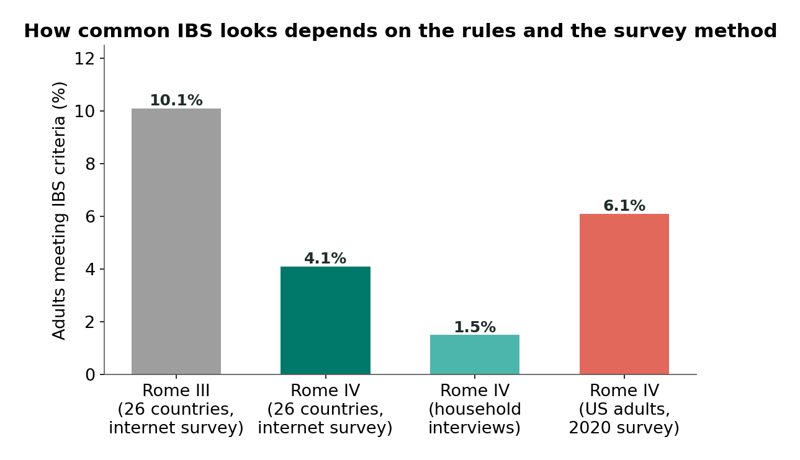

# Chapter 10: IBS and Disorders of Gut-Brain Interaction

## Summary

Irritable bowel syndrome (IBS) causes real, recurring belly pain and changes in bowel habits, yet the usual tests come back normal. This chapter explains why: IBS is a disorder of gut-brain interaction, a problem with how the gut and brain communicate, not with visible damage. Following Sam, you'll learn how doctors diagnose IBS from a pattern of symptoms using the Rome criteria (Rome IV, used in most research, and Rome V, the current version published in 2026), why alarm features always need checking, and why a "positive diagnosis" can replace years of testing. You'll also grade the evidence for the main treatments, including the low-FODMAP diet, cognitive behavioral therapy, gut-directed hypnotherapy, low-dose gut-brain neuromodulators, and peppermint oil, and learn why IBS trials show such a large placebo response.

## Concepts Covered

1. Gut-Brain Interaction Disorder
2. Structural vs Functional Disease
3. Irritable Bowel Syndrome
4. Rome IV Criteria
5. IBS Subtypes
6. Functional Dyspepsia
7. Post-Infection IBS
8. Alarm Features
9. Positive Diagnosis Strategy
10. FODMAP
11. Low-FODMAP Diet
12. Cognitive Behavioral Therapy
13. Gut-Directed Hypnotherapy
14. Gut-Brain Neuromodulator
15. Peppermint Oil
16. Placebo Response

## Prerequisites

- [Chapter 2: The Vagus Highway](../02-vagus-highway/index.md) (how signals travel between gut and brain)
- [Chapter 7: Stress and the Gut](../07-stress-and-the-gut/index.md) (how stress changes gut movement and sensitivity)
- [Chapter 8: Pain, Sensitivity, and the Gut](../08-pain-and-sensitivity/index.md) (visceral hypersensitivity and central sensitization)
- [Chapter 9: Inflammatory Bowel Disease](../09-inflammatory-bowel-disease/index.md) (what structural gut inflammation looks like, for comparison)

!!! mascot-welcome "When every test says normal"
    { class="mascot-admonition-img" }
    This is Sam's chapter, and it's about one of the most common gut conditions in the world. If you've ever been told "your tests are fine" while you still hurt, this chapter is for you. I carry a lot of the messages in this story, so it's a little personal for me too.

## 10.1 Sam's Year of "Normal"

The first time it happened, Sam was 14 and standing at the start line of a cross-country race. Cramps twisted low in his belly, and he barely made it to the porta-potty before the gun. He figured it was nerves. But it kept happening: before races, before big tests, and sometimes for no clear reason at all. Some weeks he had diarrhea, and other weeks he couldn't go for days. The pain usually eased after a bowel movement, and then it came back. (Sam is a fictional student who appears throughout this book.)

Over the next year, Sam had blood tests, stool tests, and a test for celiac disease. Everything came back "normal." Each time, he felt more confused, and a little embarrassed. A relative suggested it was "all in his head." His best friend Riya, who has Crohn's disease, told him to keep pushing for answers. Finally, at 15, a pediatric gastroenterologist sat down with him and said something he never forgot: "Your gut and brain aren't communicating well. That's real, it has a name, and we can treat it." The name was irritable bowel syndrome. This chapter explains what that doctor meant.

## 10.2 A Smoke Alarm Set Too Sensitive

Start with an everyday comparison. Imagine a smoke alarm in a kitchen. One kind of problem is a real fire: something is burning, and you can see the damage. A different kind of problem is an alarm set too sensitive. It goes off when you make toast. Nothing is burning, but the alarm is loud and the stress is real. You don't fix the oversensitive alarm with a fire extinguisher. You fix it by adjusting the alarm and the wiring that connects it to the control panel.

Crohn's disease and ulcerative colitis (Chapter 9) are like the real fire: there is inflammation and damage that tests can see. IBS is more like the oversensitive alarm. The gut tissue looks normal, but the signaling system that connects the gut, its nerves, and the brain is set differently, so normal amounts of gas, stretch, or movement can trigger pain and changes in bowel habits.

This idea has a name. A **gut-brain interaction disorder** is a condition in which gut symptoms come from problems in how the gut and brain communicate and process signals, such as increased gut sensitivity and altered gut movement, rather than from visible damage or inflammation. Doctors usually use the plural, "disorders of gut-brain interaction," shortened to DGBI. They are common: in the Rome Foundation Global Epidemiology Study of 73,076 adults in 33 countries ([Sperber and colleagues](https://pubmed.ncbi.nlm.nih.gov/32294476/), 2021), more than 40% of people who answered internet surveys met the criteria for at least one of these disorders.

These conditions used to be called "functional gastrointestinal disorders." That older word points to an important distinction. The idea of **structural vs functional disease** separates conditions in which tests show a physical abnormality, such as inflammation, ulcers, a tumor, or a blockage (structural disease), from conditions in which the organ looks normal on standard tests but doesn't work normally (functional disease). IBD is structural. IBS has been called functional.

The problem is that many people heard "functional" as "fake" or "imaginary." [The National Institute of Diabetes and Digestive and Kidney Diseases (NIDDK)](https://www.niddk.nih.gov/health-information/digestive-diseases/irritable-bowel-syndrome/definition-facts) now says that functional GI disorders are what doctors call disorders of gut-brain interactions, which are related to problems with how the brain and gut work together. And when the Rome Foundation released its newest criteria, Rome V, in 2026, it said it had minimized "functional" terminology in favor of more physiologically accurate language. Some names, like functional dyspepsia, keep the word for now.

!!! mascot-thinking "Normal tests are not the same as nothing wrong"
    { class="mascot-admonition-img" }
    A colonoscopy can show ulcers, but it can't show how strongly a nerve fires or how loudly the brain "turns up" a gut signal. When tests that look for damage come back normal, that rules out damage. It doesn't rule out a real problem with signaling.

## 10.3 What Is Irritable Bowel Syndrome?

**Irritable bowel syndrome** (IBS) is a common disorder of gut-brain interaction marked by recurring belly pain linked to bowel movements and changes in how often stool happens or how it looks, without visible damage or disease in the digestive tract. NIDDK describes IBS as a group of symptoms that occur together, including repeated belly pain and changes in bowel movements, which may be diarrhea, constipation, or both. Other symptoms can include bloating, a feeling of not having finished a bowel movement, and whitish mucus in the stool.

NIDDK says IBS can be painful but doesn't lead to other health problems or damage the digestive tract. IBS does not turn into IBD, and it does not cause cancer. It does, however, affect daily life. The symptoms tend to come and go over years.

### What goes wrong?

There's no single cause, and different factors matter for different people. A 2020 review in *The Lancet* by [Black, Drossman, Talley, Ruddy, and Ford](https://pubmed.ncbi.nlm.nih.gov/33049221/) lists several mechanisms that seem to work together:

- **Two-way gut-brain dysregulation.** Signals between the gut and brain, through the vagus nerve, spinal nerves, and stress hormones (Chapters 2 and 7), are out of balance.
- **Visceral hypersensitivity.** The gut's sensory nerves, and the brain's processing of their signals, are turned up, so normal stretch feels painful (Chapter 8). NIDDK puts it simply: some people with IBS feel pain when a normal amount of gas or stool is in the gut.
- **Altered motility.** Food and stool may move too fast (leading to diarrhea) or too slowly (leading to constipation).
- **Microbiome and immune changes.** Studies find shifts in gut microbes and small changes in the gut's immune activity. These are mostly correlations, and their importance is still debated.

NIDDK lists factors that are more common in people with IBS and may play a role: stressful or difficult early life events, anxiety and depression, bacterial infections of the gut, food intolerances, and genes.

### How common is IBS?

How many people have IBS depends on which criteria you use, so the numbers always need a label. By Rome IV criteria, 6.1% of US adults had IBS in a national online survey of 88,607 people done in May and June 2020 ([Almario and colleagues](https://pubmed.ncbi.nlm.nih.gov/37595647/), 2023). The authors noted that earlier US estimates were 4.7% to 5.3%, and they asked whether the COVID-19 pandemic, during which the survey ran, might have pushed the number up. Worldwide, by Rome IV criteria, about 4.1% of adults had IBS in internet surveys across 26 countries (Sperber and colleagues, 2021). In the same study, the older Rome III criteria gave 10.1%. The people were the same; only the rules changed. IBS is more common in women than in men.

*Source: Sperber et al. 2021, Gastroenterology (Rome Foundation Global Epidemiology Study); Almario et al. 2023, Gastroenterology (US survey). Different rules and survey methods give very different numbers.*

In the Almario survey, the most common subtype was IBS with mixed bowel habits (33.9% of people with IBS), the type Sam has. You'll learn what the subtypes mean in Section 10.4.

## 10.4 The Rome Criteria: Diagnosing From a Pattern

Because IBS doesn't leave visible damage, doctors diagnose it mainly from a pattern of symptoms. The standard rules come from the [Rome Foundation](https://theromefoundation.org/rome-v/), an international group of experts that has published criteria for disorders of gut-brain interaction since the 1990s. Each new edition updates the rules based on new evidence.

### Rome IV: the version behind the research

The **Rome IV criteria** are the 2016 set of symptom-based diagnostic rules from the Rome Foundation for disorders of gut-brain interaction. For IBS in adults, they require:

1. **Recurrent belly pain, on average at least 1 day a week in the last 3 months,**
2. **linked to two or more of these three features:**
    - related to bowel movements (the pain changes with them),
    - a change in how often stool happens,
    - a change in how stool looks (its form),
3. **with the criteria met for the last 3 months, and symptoms that started at least 6 months before diagnosis.**

Most published IBS research, including the 6.1% US figure and the 4.1% worldwide figure, used Rome IV. That's why you'll keep seeing "by Rome IV criteria" in this book.

Kids and teens have their own version. For children and teens aged 4 to 18, the Rome IV IBS criteria require belly pain at least 4 days a month over at least 2 months, linked to one or more of the same three features, and symptoms that can't be fully explained by another medical condition after appropriate evaluation. In a child who also has constipation, the pain must not go away when the constipation is treated (if it does, the problem is constipation, not IBS).

[Rome V (2026)](https://theromefoundation.org/rome-v-criteria/) keeps the 4 days a month, the 2 months, and the rule that another condition must not fully explain the symptoms, and adds that the pain comes and goes, is the main symptom, and doesn't happen only during menstrual periods. The Rome V pediatric paper also notes that a disorder of gut-brain interaction can exist alongside another condition that causes gut symptoms.

!!! note "Rome V update (2026)"
    **What changed.** Rome V was published in the journal *Gastroenterology* in its May 2026 issue (see the [Rome V bowel disorders paper](https://pubmed.ncbi.nlm.nih.gov/41713703/) and the [overview of the Rome V process](https://pubmed.ncbi.nlm.nih.gov/42031435/)), and the [Rome V book](https://theromefoundation.org/rome-v/) began shipping on June 1, 2026. It is now the current version. More than 140 experts from 27 countries worked on it. For adult IBS, Rome V requires **recurrent, but not continuous, abdominal pain or discomfort, on average at least 3 days a month in the last 3 months**, linked to two or more of the same three features, with the same timing rule (symptoms starting at least 6 months before diagnosis). As a supporting point, it adds that the pain or discomfort shouldn't be related only to menstrual periods. Rome V also separates strict research criteria from more flexible clinical criteria for everyday care, and minimizes the word "functional."
    **Why it matters.** "Discomfort" and "3 days a month" bring back ideas from the older Rome III, so more people with milder symptoms will qualify. In a 2026 UK survey of 1,275 adults with self-reported IBS (Staller and colleagues), 59.0% met Rome IV and 70.0% met Rome V, and people meeting Rome V had milder symptoms on average. Prevalence numbers based on Rome V will take years to build up, so for now, most numbers you read still come from Rome IV.

### IBS subtypes

Not everyone with IBS has the same bowel habits, and the type matters because some medicines help one type and worsen another. **IBS subtypes** are categories of IBS based on a person's main stool pattern on days with abnormal bowel movements: IBS with constipation, IBS with diarrhea, IBS with mixed bowel habits, and IBS that doesn't fit any of these. Doctors judge stool form with the Bristol Stool Form Scale, a chart of seven stool types from hard lumps (types 1 and 2) to watery (types 6 and 7).

The table below summarizes the four subtypes, following the rules on the Rome Foundation's criteria page.

| Subtype | Rule (on days with abnormal bowel movements) |
|---|---|
| IBS-C (constipation) | More than 25% hard or lumpy (types 1 to 2), fewer than 25% loose (types 6 to 7) |
| IBS-D (diarrhea) | More than 25% loose or watery, fewer than 25% hard or lumpy |
| IBS-M (mixed) | More than 25% hard or lumpy and more than 25% loose or watery |
| IBS-U (unclassified) | Meets IBS criteria but doesn't fit the other three patterns |

Sam has IBS-M: some weeks are mostly diarrhea, others mostly constipation.

!!! mascot-tip "Pain is the anchor"
    { class="mascot-admonition-img" }
    Here's how I remember the IBS criteria: pain is the anchor, and it has to be linked to the bowel, through timing, frequency, or form. Bloating or diarrhea without that recurring, bowel-linked pain usually points to a different disorder of gut-brain interaction.

## 10.5 Other Disorders of Gut-Brain Interaction

IBS is the best known, but the Rome criteria describe dozens of disorders of gut-brain interaction, from the esophagus to the anus. Two more are worth knowing.

### Functional dyspepsia

**Functional dyspepsia** is a disorder of gut-brain interaction of the upper gut, defined by bothersome fullness after meals, feeling full too early, or pain or burning in the upper belly (just below the breastbone), with no structural disease found to explain the symptoms, including on an upper endoscopy. That's the Rome IV wording; Rome V keeps the name and very similar criteria. Like IBS, the symptoms must have been present for the last 3 months, starting at least 6 months before diagnosis. People with functional dyspepsia often also have IBS, which makes sense if the underlying problem is how the gut and brain process signals, not damage in one spot.

### Post-infection IBS

Sometimes IBS has a clear starting point. **Post-infection IBS** is IBS that develops after a bout of infectious gastroenteritis (a "stomach bug" or food poisoning caused by bacteria, viruses, or parasites), in a person who didn't have IBS before. A 2017 meta-analysis by [Klem and colleagues](https://pubmed.ncbi.nlm.nih.gov/28069350/) combined 45 studies following 21,421 people after infectious enteritis. About 10.1% had IBS 12 months later, and the risk of IBS was about 4 times higher in the year after an infection than in people who hadn't had one. Women, people with more severe infections, people who took antibiotics during the illness, and people with anxiety or depression were at higher risk.

These were observational studies, so they show strong links rather than proving every step of the mechanism. Still, post-infection IBS is some of the clearest human evidence that a physical event in the gut, not just stress, can start IBS. It is also a reminder that body and mind both shape who develops it.

## 10.6 Making the Diagnosis: Alarm Features and the Positive Diagnosis Strategy

How does a doctor know it's IBS and not something else, like IBD or celiac disease? For a long time, many doctors treated IBS as a "diagnosis of exclusion": rule out every other disease with test after test, and call whatever's left IBS. That's partly why Sam had a year of tests.

### Alarm features

The first step is checking for warning signs. **Alarm features** are symptoms, signs, or history that suggest a disease other than IBS, such as inflammation, bleeding, or cancer, and that call for further medical evaluation. NIDDK lists symptoms that may point to a health problem other than IBS, and says doctors also ask about family history:

- anemia (too few red blood cells)
- bleeding from the rectum, or bloody or black, tarry stools
- unplanned weight loss
- a family history of celiac disease, colon cancer, or inflammatory bowel disease

When an alarm feature is present, doctors look further, often with blood tests, stool tests, or a colonoscopy, even if the symptoms otherwise fit IBS. Riya's story in Chapter 9 included weight loss and anemia, two alarm features that pointed toward Crohn's disease.

### The positive diagnosis strategy

When there are no alarm features, the American College of Gastroenterology (ACG) suggests a different approach. A **positive diagnosis strategy** is an approach in which a clinician diagnoses IBS confidently from its typical symptom pattern (using the Rome criteria), a careful history and physical exam, the absence of alarm features, and a small number of targeted tests, instead of ordering every possible test to rule out all other diseases first. The ACG's [2021 IBS guideline](https://pubmed.ncbi.nlm.nih.gov/33315591/), its first for IBS, suggests a positive diagnostic strategy over a strategy of exclusion, so that people can start the right treatment sooner. The same guideline suggests a blood test for celiac disease and a fecal calprotectin stool test (the inflammation "smoke detector" from Chapter 9) for people whose IBS symptoms include diarrhea, to rule out celiac disease and IBD.

So a positive diagnosis is not a guess. It is a confident diagnosis based on a recognizable pattern, plus a few smart checks. Think of how a doctor diagnoses a migraine: mostly from the pattern of the headaches, not from a brain scan for everyone.

!!! mascot-warning "A checklist can't diagnose you"
    { class="mascot-admonition-img" }
    The Rome criteria look simple, so it's tempting to check the boxes and diagnose yourself or a friend. Please don't. Matching the pattern isn't enough without a clinician's history, exam, alarm-feature check, and the right tests, because conditions like IBD and celiac disease can look similar at first.

## 10.7 Try the Criteria: The Rome Criteria Explorer

The MicroSim below turns the Rome criteria into an interactive checklist. "Pain days per month" is how many days in a typical month the person has belly pain. "Months since start" is how long ago the symptoms began. The three checkboxes are the three bowel-related features, and the Alarm menu adds a warning sign. All the profiles are fictional, and the sim is for learning only: it cannot diagnose anyone.

#### Diagram: Rome Criteria Explorer
<iframe src="../../sims/ch10-rome-criteria-explorer/main.html" height="772px" width="100%" scrolling="no"></iframe>

[Open the Rome Criteria Explorer fullscreen](../../sims/ch10-rome-criteria-explorer/main.html){ .md-button .md-button--primary }

MicroSim specification: Rome Criteria Explorer

Type: microsim
**sim-id:** ch10-rome-criteria-explorer 
**Library:** p5.js 
**Status:** Implemented 
**Bloom Level:** Apply 
**Bloom Verb:** apply, classify 
**Learning Objective:** The learner will apply the symptom-based Rome criteria for IBS to fictional profiles, compare Rome IV (2016), Rome V (2026), and the Rome IV child and teen criteria, and recognize that alarm features require medical evaluation regardless of the checklist.

**Canvas:** 540 px drawing area plus 230 px controls (iframe 772 px); responsive to about 380 px wide.

**Controls:** Version select (Rome IV adults, Rome V adults, Rome IV children and teens 4 to 18); Profile select (Sam, Dana, Marcus, Leah, Omar, or Custom); Alarm select (none, blood in stool, unplanned weight loss, anemia, family history of colon cancer, IBD, or celiac disease); checkboxes for the three bowel features and for continuous pain; sliders for pain days per month (0 to 30) and months since start (0 to 24).

**Rules:** Rome IV adults: pain 4 or more days a month (simplified from at least 1 day a week), 2 or more features, onset 6 or more months ago. Rome V adults: pain or discomfort 3 or more days a month, not continuous, 2 or more features, onset 6 or more months ago. Child and teen: pain 4 or more days a month, 1 or more features, present 2 or more months. Any alarm feature shows a "needs medical evaluation" message.

**Feedback:** A permanent banner says the tool cannot diagnose. Each criterion shows a check or a cross, a result box names what is missing, and on wide screens a panel compares all three versions for the same profile.

**Provenance:** Rome Foundation Rome IV and Rome V criteria pages; NIDDK IBS diagnosis page (alarm features).

Start with Rome IV and the Sam profile: all three checks are green. Then choose **Dana**, who has pain only 3 days a month. She doesn't meet Rome IV, but switch the version to **Rome V** and she does. That one change, from "1 day a week" to "3 days a month," is a big reason Rome V will count more people as having IBS.

Next try **Marcus**, whose pain is there all day, every day. He meets Rome IV but not Rome V, because Rome V says IBS pain comes and goes; constant pain points toward a different disorder. Finally, try **Omar**. He meets the symptom criteria, but he has blood in his stool, an alarm feature. The checklist can't overrule a warning sign.

!!! model-limits "What this model leaves out"
    - Real diagnosis needs a clinician: a full history, a physical exam, a check for alarm features, and targeted tests. A checklist alone can never diagnose anyone.
    - The sim simplifies "at least 1 day a week on average" to "4 or more days a month," and it assumes the symptoms were present for the last 3 months.
    - It shows only a few alarm features; doctors consider others, along with age, medicines, and recent infections.
    - It doesn't assign IBS subtypes (which need stool-form records) or include Rome V's new, more flexible clinical criteria.
    - The child and teen version shown is Rome IV, and it skips two of its rules: another condition must not fully explain the symptoms, and in a child with constipation the pain must not go away when the constipation is treated. Rome V's pediatric criteria keep 4 days a month and 2 months, but add that the pain comes and goes, is the main symptom, and doesn't happen only during periods.

## 10.8 Treating IBS: Calming the Gut and the Gut-Brain Conversation

There's no single cure for IBS, but many treatments help, and the best plan usually combines several. NIDDK lists changes to what you eat and other lifestyle changes (such as physical activity, sleep, and reducing stress where possible), medicines, and mental health therapies. The British Society of Gastroenterology's 2021 guideline, built on careful analyses of trials, describes IBS as a disorder of gut-brain interaction and organizes treatment around that idea. Children and teens have their own guideline: a 2025 joint guideline from the European and North American pediatric gastroenterology societies reviewed 86 trials and noted major gaps in the evidence for young people. Most of the numbers below come from adult trials.

Here are the treatments in this chapter's concept list, with what the evidence shows. (As always, this is for learning. Treatment choices are for a person and their care team.)

### The low-FODMAP diet

Some carbohydrates are hard for the small intestine to absorb. A **FODMAP** is a type of short-chain carbohydrate that is poorly absorbed in the small intestine and quickly fermented by gut bacteria; the name stands for fermentable oligosaccharides, disaccharides, monosaccharides, and polyols. When FODMAPs reach the colon, bacteria ferment them, making gas, and they also draw water into the bowel. In most people that causes little trouble. In a gut with turned-up sensitivity, the extra stretch can hurt. NIDDK lists foods containing FODMAPs, including some fruits (such as apples and pears), some vegetables (such as onions and garlic), milk products, wheat and rye products, honey, and sweeteners ending in "-ol," such as sorbitol.

The **low-FODMAP diet** is a structured, short-term eating plan, best done with a dietitian, in which a person first cuts back on high-FODMAP foods for a few weeks and then adds them back one group at a time to find which ones trigger symptoms, so the long-term diet can be as broad as possible. NIDDK describes the same shape: try it for a few weeks, and if symptoms improve, slowly add FODMAP foods back.

The evidence is fairly good for the first phase. The ACG's 2021 guideline recommends a limited trial of a low-FODMAP diet to improve overall IBS symptoms. A 2022 network meta-analysis by [Black, Staudacher, and Ford](https://pubmed.ncbi.nlm.nih.gov/34376515/) combined 13 randomized trials with 944 patients and ranked the low-FODMAP diet first among the diets studied for overall symptoms. But the authors noted that most trials were run in specialist clinics and didn't study the reintroduction and personalization phases, which are the parts meant for real life.

!!! hype-hype "Hype Meter: "Low-FODMAP should be a forever diet""
    
StrongModeratePreliminaryHype

    **Verdict: Hype.** The low-FODMAP diet is designed as a short elimination phase followed by reintroduction, so that people end up avoiding only the foods that bother them. The trials that support it (13 trials, 944 patients in the 2022 meta-analysis) mostly tested short elimination periods, not lifelong restriction. Cutting out many foods for good can make eating stressful, make family meals and cultural foods harder, and limit the variety of foods (and fiber) that gut microbes use.
    **What would change the grade:** Long-term trials showing that permanent strict restriction works better and is safe compared with reintroduction and personalization. No such evidence exists.

### Brain-gut behavioral therapies

Because IBS involves the gut-brain conversation, therapies that work on the brain's side of that conversation can help the gut. These are sometimes called brain-gut behavioral therapies. They are not a sign that the problem is "all in your head." They're a way to retune the alarm system.

**Cognitive behavioral therapy** (CBT) is a structured, skills-based form of talk therapy that helps people notice and change unhelpful thought patterns and behaviors, such as catastrophizing about symptoms or avoiding activities, which can reduce symptoms and their impact. In IBS, CBT often teaches people to break the loop in which worry about symptoms raises stress, stress raises gut sensitivity, and sensitivity raises symptoms and worry (Chapter 7).

**Gut-directed hypnotherapy** is a type of hypnotherapy in which a trained therapist guides a person into a deeply relaxed, focused state and uses suggestions and imagery aimed at calming the gut and changing how gut sensations are processed. It isn't stage hypnosis, and the person stays in control. Courses usually involve several sessions.

How well do these therapies work? A 2020 network meta-analysis by [Black and colleagues](https://pubmed.ncbi.nlm.nih.gov/32276950/) combined 41 randomized trials with 4,072 adults. CBT (both self-guided and face-to-face) and gut-directed hypnotherapy had the largest evidence base and helped more people improve than control treatments. A 2024 analysis of 42 trials and 5,220 participants ([Goodoory and colleagues](https://pubmed.ncbi.nlm.nih.gov/38777133/)) found that several brain-gut behavioral therapies also improved belly pain specifically, with none clearly better than the others. Both teams warned that many trials had a high risk of bias, so the benefits may be overestimated. For children and teens, the [2025 ESPGHAN/NASPGHAN guideline](https://pubmed.ncbi.nlm.nih.gov/40444524/) recommends hypnotherapy (based on moderate-certainty evidence) and CBT (based on low-certainty evidence) as treatment options.

!!! hype-moderate "Hype Meter: "Gut-directed hypnotherapy helps IBS""
    
StrongModeratePreliminaryHype

    **Verdict: Moderate.** In a 2020 network meta-analysis of 41 randomized trials (4,072 adults), gut-directed hypnotherapy was one of the therapies with the best evidence for improving IBS symptoms, along with CBT, and a 2024 analysis of 42 trials found it also helped belly pain. These are real human trials. But many had a high risk of bias, it's hard to "blind" people to whether they're getting hypnotherapy, and the authors said the benefits may be overestimated. The ACG suggests gut-directed psychotherapy for IBS.
    **What would change the grade:** Larger, well-designed trials with strong control conditions and long follow-up, including in teens, could move it up to Strong. Trials showing the benefit disappears against a good placebo-like control would move it down.

### Gut-brain neuromodulators

Some medicines act on the nerves and brain circuits that process gut signals. A **gut-brain neuromodulator** is a medicine that acts on the nervous system's processing of gut signals, often a low dose of a medicine first developed as an antidepressant, used to reduce gut pain and change gut movement in disorders of gut-brain interaction. The best studied are tricyclic antidepressants (TCAs). This confuses a lot of people. In IBS, TCAs are used at low doses as gut-brain neuromodulators, not to treat depression. A doctor prescribing one isn't saying the person is depressed. The medicine is turning down pain signaling.

A 2026 network meta-analysis by [Khasawneh and colleagues](https://pubmed.ncbi.nlm.nih.gov/42362221/) combined 68 randomized trials with 6,694 adults. Another class of medicines called SNRIs ranked first, but based on only six small trials; TCAs ranked second, based on 15 trials with 1,519 people. The authors rated the overall certainty of the evidence as low or very low for most comparisons. Guidelines differ in how strongly they back TCAs. The ACG's 2021 guideline gives them a strong recommendation for overall IBS symptoms, while the American Gastroenterological Association's [2022 guideline](https://pubmed.ncbi.nlm.nih.gov/35738725/) for IBS with diarrhea includes TCAs among several options, with a conditional recommendation.

### Peppermint oil

**Peppermint oil** is an oil from the peppermint plant, usually taken in coated capsules that release it in the intestine, that relaxes gut smooth muscle and is used to ease IBS symptoms such as pain and cramping. It works somewhat like the antispasmodic medicines that relax gut muscle. A 2022 meta-analysis by [Ingrosso and colleagues](https://pubmed.ncbi.nlm.nih.gov/35942669/) combined 10 randomized trials with 1,030 patients. Peppermint oil did better than placebo for overall symptoms and belly pain, but side effects were more common than with placebo, and the authors rated the quality of the evidence as very low.

On this book's scale, that makes it Preliminary: it may help some people, but the trials behind it are low quality, so the size of the benefit is uncertain. Being sold at a drugstore doesn't make a product right for everyone, so it's still a good idea to ask a doctor first.

The table below compares the treatments we just covered.

| Treatment | What it targets | Evidence highlight | Our read |
|---|---|---|---|
| Low-FODMAP diet (with reintroduction) | Gas and stretch from fermented carbohydrates | 13 trials, 944 patients; ranked first among diets | Good for short-term relief; reintroduction understudied |
| Cognitive behavioral therapy | Thought and behavior loops that amplify symptoms | Among the best-studied therapies (41 trials total) | Moderate; trials at risk of bias |
| Gut-directed hypnotherapy | Gut sensations and how the brain processes them | Among the best-studied therapies | Moderate |
| Low-dose TCAs (neuromodulators) | Pain signaling in nerves and brain | Ranked second in a 68-trial analysis (15 TCA trials) | Moderate; low certainty |
| Peppermint oil | Gut smooth muscle spasm | 10 trials, 1,030 patients | Preliminary; very low quality, more side effects |

## 10.9 The Placebo Response: Why IBS Trials Are Tricky

Every IBS treatment claim runs into the same problem. In drug trials, a lot of people who get the fake pill feel better too.

The **placebo response** is the improvement in symptoms that people experience after receiving an inactive treatment (a placebo), caused by things like expectations, attention and care, the natural ups and downs of symptoms, and changes in how the brain processes body signals. It doesn't mean the person "was faking." Expectations and attention can really change pain processing, the same brain systems that IBS involves. Part of the response also comes from symptoms naturally swinging back toward average over time.

How big is it in IBS? A 2021 meta-analysis by [Bosman and colleagues](https://pubmed.ncbi.nlm.nih.gov/33765447/) looked at 73 randomized drug trials in adults with IBS. Among people given placebo, 27.3% reported overall improvement, and 34.4% reported improvement in belly pain. That's why a new treatment must beat placebo in a controlled trial, not just help "a lot of people." If a supplement ad says "70% of users felt better," your next question should be: compared with what?

One unusual study pushed the idea further.

!!! claim-box "How to read a gut-brain claim: the 2010 open-label placebo trial in IBS"
    | Question | This study |
    |---|---|
    | Mouse or human? | Human. 80 adults with IBS (70% women, average age 47) at one academic center in Boston. |
    | Correlation or cause? | Tests cause, partly. People were randomly assigned to open-label placebo pills (they were told the pills were inactive) or to no treatment, with the same amount of attention from the staff. Neither group was blinded, which a pill-versus-no-pill design can't do. |
    | How many? | Small: 37 in the placebo group and 43 in the no-treatment group. Some outcome data were missing at the end (about 13%). |
    | How long? | Short: 3 weeks. |
    | Who paid for it? | Mostly grants from the US National Center for Complementary and Alternative Medicine (part of NIH), plus a gift from the Bernard Osher Foundation. One author had consulted for drug companies that had no relationship to the study. |
    | Is something being sold? | No product. The placebo pills weren't for sale. |

In this trial by [Kaptchuk and colleagues](https://journals.plos.org/plosone/article?id=10.1371/journal.pone.0015591), published in 2010, people were told honestly that the pills were "like sugar pills" and were given a hopeful explanation of how placebos can work. At 3 weeks, 59% in the placebo group reported adequate relief of their IBS symptoms, compared with 35% in the no-treatment group. The open-label placebo group also scored better on global improvement and symptom severity.

What should you conclude? It's a small, short, single-center study without blinding, so it's a reason for curiosity, not a new treatment. But it shows something important about IBS: how symptoms are explained and how care is delivered can change how people feel. That's consistent with a gut-brain disorder, and it's exactly why treatment claims need placebo-controlled trials.

## 10.10 Is IBS "Just Anxiety"?

Sam has test anxiety, and his IBS flares before tests and races. So is his IBS just anxiety in disguise? A lot of people believe this, and hearing it can make patients feel dismissed.

!!! hype-hype "Hype Meter: "IBS is just anxiety""
    
StrongModeratePreliminaryHype

    **Verdict: Hype.** Anxiety and depression are more common in people with IBS: a 2019 meta-analysis of 73 studies (Zamani and colleagues) found anxiety symptoms in 39.1% and depression symptoms in 28.8%. A diagnosed anxiety disorder was present in about 23%, so most people with IBS don't have one. Stress can worsen gut symptoms (Chapter 7), but IBS also involves measurable changes in gut sensitivity and movement, and it can start after a gut infection. The 2020 *Lancet* review notes that it isn't clear whether psychological symptoms come before IBS or are driven by it. A brain-gut therapy helping IBS doesn't prove IBS is "psychological"; it shows the gut-brain link is two-way.
    **What would change the grade:** Nothing likely. The evidence points to a two-way gut-brain disorder, not to anxiety alone.

The careful version is this: the brain and gut influence each other in both directions. Worry can turn up gut sensitivity and change motility, and months of unpredictable pain and urgent bathroom trips can cause worry. Treating both sides, the gut and the brain, often works better than treating either alone. Chapter 11 explores these two-way links in more depth.

Words also matter. Many people with IBS have been told "it's just stress" or "nothing's wrong," and the 2020 *Lancet* review notes that patients with these disorders can feel stigmatized, and that the diagnosis often isn't explained well. Hearing a clear explanation, like the one Sam's doctor gave, is part of good care.

!!! living-with "If you're going through this"
    If you have IBS, your pain is real, even if every test was normal. A normal colonoscopy rules out damage, not suffering. It can help to keep a simple symptom diary for your care team, to ask your school counselor or nurse about a plan for restroom access during tests, and to ask your doctor about gut-brain therapies like CBT or gut-directed hypnotherapy. Be wary of posts selling "cures," and talk to your doctor before starting any supplement or strict diet.

!!! families "For families"
    The most helpful thing you can say to someone with IBS is that you believe them. Phrases like "it's all in your head" or "just relax" can make them feel dismissed and can even add to the stress that worsens symptoms. Helpful support looks like flexibility around plans, not commenting on bathroom trips, and including foods they can eat at family meals. If a dietitian recommends a low-FODMAP trial, remember that it's meant to be temporary, with foods added back, so family dishes can usually return.

## At the Bedside: Sam's Story, Naming the Problem

!!! note "Meet the patient (fictional)"
    Sam is 15, a high school sophomore and cross-country runner. For more than a year he has had cramping lower belly pain about two or three days a week, which usually eases after a bowel movement. Some weeks his stools are loose and urgent, and other weeks they're hard and infrequent. Symptoms are worst before big tests and races. His parents notice he skips breakfast on race days and seems more anxious at school.

**What the doctor checks:** The pediatric gastroenterologist takes a careful history: how often the pain happens, how it relates to bowel movements, stool patterns, sleep, school, stress, recent infections, and family history. She asks specifically about alarm features: blood in the stool, weight loss, and family members with IBD, celiac disease, or colon cancer. She checks his growth chart and examines his belly. His earlier blood tests (including a blood count and a celiac test) and his fecal calprotectin were normal.

**Connecting the signals:** Sam's pain is recurrent, linked to bowel movements, and comes with changes in how often stool happens and how it looks. It has lasted well over 6 months. That fits the Rome IV criteria for children and teens, and the adult version too. He has no alarm features, a normal calprotectin argues against IBD, and a normal celiac test argues against celiac disease. Symptoms that flare with stress fit the gut-brain loop from Chapter 7.

**Diagnosis:** Irritable bowel syndrome with mixed bowel habits (IBS-M), made with a positive diagnosis strategy.

**Why it happens:** Sam's gut-brain signaling is set too sensitive. His gut nerves and brain amplify normal stretch into pain (visceral hypersensitivity), and his gut movement speeds up or slows down, especially when stress hormones and nerve signals surge before tests and races. Stress didn't create his IBS out of nothing, but it turns the volume up.

**The mind-body side:** Sam had started to feel that his body couldn't be trusted, and his test anxiety and gut symptoms fed each other. His doctor explained the diagnosis clearly and said it was real, which Sam said was a relief in itself. She referred him to a psychologist who uses cognitive behavioral therapy for test anxiety and gut symptoms, and to a program of gut-directed hypnotherapy recordings, which is where he learned the gut-directed relaxation he practices before races. His school set up a plan allowing restroom breaks during exams.

**Treatment today:** Along with CBT and gut-directed hypnotherapy, Sam is working with a dietitian on a short low-FODMAP trial with planned reintroduction, so he can learn which foods, if any, are triggers without giving up the foods he loves. His doctor talked with him about other options, such as medicines, if symptoms stay bothersome. When his cousin keeps posting about a "gut-healing" supplement, Sam asks his care team before trying anything, and checks whether the claims come from placebo-controlled trials.

**What's new in research:** In May 2026 the Rome Foundation published Rome V, which brings back "discomfort," lowers the pain frequency to at least 3 days a month, and excludes continuous pain. A 2026 UK survey of 1,275 adults with self-reported IBS found that 70.0% met Rome V compared with 59.0% for Rome IV, and that people meeting Rome V had milder symptoms on average ([Staller et al.](https://pubmed.ncbi.nlm.nih.gov/42532244/), *Clinical Gastroenterology and Hepatology*, 2026). **Evidence grade: Moderate.** The criteria themselves are official, but studies on how Rome V changes diagnosis and research are only beginning.

??? question "Your turn: reason through a variation"
    Suppose Sam's teammate Jordan, 17, has the same kind of belly pain and diarrhea, but over the last two months he has also lost weight without trying and has seen blood in his stool. His older brother has Crohn's disease. Jordan says, "I meet the Rome criteria, so it's IBS like Sam's." What's wrong with that reasoning?

    **Answer:** Jordan has three alarm features: unplanned weight loss, blood in the stool, and a family history of IBD. Alarm features mean he needs a medical evaluation, which might include blood tests, a fecal calprotectin test, and a colonoscopy, because his symptoms could come from IBD or another structural disease. Also, his symptoms have lasted only two months, so as a teen he would barely meet the child and teen criteria, and as an adult he wouldn't meet the 6-month rule. Matching part of a checklist never overrules a warning sign.

*This is a fictional teaching case. It is not medical advice. If you or someone you know has symptoms like these, talk to a doctor.*

## Common Misconceptions

**Myth:** "Functional" means the symptoms are fake or imaginary.  
**Reality:** "Functional" meant the gut looks normal on tests but doesn't work normally. IBS involves real changes in gut sensitivity, movement, and gut-brain signaling. That's why the field now prefers "disorders of gut-brain interaction," and Rome V (2026) minimizes the word "functional."

**Myth:** IBS damages the bowel or leads to cancer.  
**Reality:** NIDDK says IBS can be painful but doesn't lead to other health problems or damage the digestive tract. It does not turn into IBD or cancer, though new alarm features should always be checked by a doctor.

**Myth:** IBS can be diagnosed only after every other disease has been ruled out with tests.  
**Reality:** The ACG's 2021 guideline suggests a positive diagnosis strategy: a typical symptom pattern, no alarm features, and a few targeted tests (such as a celiac blood test and fecal calprotectin when diarrhea is present). This lets people start treatment sooner.

**Myth:** Everyone with IBS should go gluten-free.  
**Reality:** Some people with IBS feel better avoiding certain foods, but the best-studied diet approach is a short low-FODMAP trial with reintroduction, guided by a dietitian, to find individual triggers. NIDDK notes that doctors don't recommend starting a gluten-free diet before celiac testing, because it can affect the results, so diet changes should be discussed with a doctor or dietitian first.

**Myth:** If a doctor prescribes an antidepressant for IBS, it means the IBS is really depression.  
**Reality:** Low doses of tricyclic antidepressants are used as gut-brain neuromodulators that turn down pain signaling, not to treat depression.

## Your Gut Check

Test yourself. Try each one before you open the answer.

??? question "1. Claim Check: "Doctors can't fix IBS because it's all in your head. My 3-step mindset reset cured mine in a week. Sign up below!""
    **Grade: Hype.** IBS isn't "all in your head": it involves measurable changes in gut sensitivity and movement and can start after a gut infection. Brain-gut therapies such as CBT and gut-directed hypnotherapy do have real trial evidence, but they take weeks of structured sessions, the trials have risk-of-bias problems, and none promises a cure in a week. One person's story can't separate the program from natural ups and downs or the placebo response, and a sign-up link means something is being sold. A careful version: "Gut-brain therapies like CBT and gut-directed hypnotherapy can reduce IBS symptoms for many people, alongside other treatments."

??? question "2. Predict: Sam has a big chemistry final on Friday and a regional race on Saturday. Using the gut-brain loop, predict what might happen to his symptoms that week, and what tools from his care plan could help."
    Stress before the final and the race can activate the HPA axis and the sympathetic nervous system (Chapter 7), which can change gut movement and turn up gut sensitivity, so Sam may have more cramping and urgency. Worry about symptoms during the test could add to the loop. His gut-directed relaxation, CBT skills for test anxiety, his school's restroom plan, and familiar foods he knows don't trigger symptoms could all help.

??? question "3. Explain: Sam's friend asks, "If your colonoscopy and blood tests were normal, how can your doctor be sure it's IBS?" Explain how a positive diagnosis works."
    IBS is diagnosed from its typical pattern: recurrent pain linked to bowel movements and to changes in stool frequency or form, lasting long enough to meet the Rome criteria. The doctor also takes a careful history, examines the patient, checks for alarm features such as bleeding or weight loss, and orders a few targeted tests, such as a celiac test and fecal calprotectin. When the pattern fits and there are no alarm features, the diagnosis is made with confidence, not by elimination.

??? question "4. Apply: A 22-year-old has had belly pain about 3 days a month for a year. It's linked to bowel movements and to looser stools, comes and goes, and she has no alarm features. Does she meet Rome IV? Rome V?"
    She doesn't meet Rome IV, which requires pain on average at least 1 day a week (about 4 or more days a month). She does meet Rome V's symptom criteria: recurrent, not continuous pain at least 3 days a month, linked to two of the three features, starting at least 6 months ago. This shows why Rome V will classify more people, often with milder symptoms, as having IBS. Only a clinician could actually diagnose her.

**5. Read the data.** In 2026, Staller and colleagues surveyed 1,275 adults in the United Kingdom who said they had IBS, and checked which versions of the Rome criteria each person met:

| Criteria version | People meeting the IBS criteria | Percent |
|---|---|---|
| Rome III (older version) | 995 | 78.0% |
| Rome IV (2016) | 752 | 59.0% |
| Rome V (2026) | 893 | 70.0% |

??? question "5. What does this data show, and what can't it show?"
    It shows that the version of the criteria changes who counts as having IBS: among the same 1,275 people, Rome IV was the strictest, and Rome V included about 11 percentage points more people than Rome IV. That's why prevalence figures must name their criteria. It can't show how many people in the general population have IBS, because everyone surveyed already said they had IBS, and it can't show which version is "correct" or better for patients. A helpful follow-up would apply all three versions to a large, random sample of the general population and follow people over time to see which criteria best predict symptoms and response to treatment.

## Exercises

### Remember

1. List the three bowel-related features in the Rome criteria for IBS.

??? note "Answer"
    Pain related to bowel movements (defecation), a change in how often stool happens (frequency), and a change in how stool looks (form or appearance).

2. Name four alarm features that call for further medical evaluation in someone with IBS-like symptoms.

??? note "Answer"
    Any four of: anemia, rectal bleeding or bloody or black stools, unplanned weight loss, and a family history of celiac disease, colon cancer, or inflammatory bowel disease.

### Understand

3. Explain the difference between structural and functional disease, using IBD and IBS as examples, and explain why the field is moving away from the word "functional."

??? note "Answer"
    Structural disease shows a physical abnormality on tests, like the ulcers and inflammation of IBD. Functional disease means the organ looks normal but doesn't work normally, as in IBS. The word "functional" was often misheard as "fake," so experts now prefer "disorders of gut-brain interaction," and Rome V minimizes the word.

4. Explain why the low-FODMAP diet is meant to be temporary, and what the reintroduction phase is for.

??? note "Answer"
    The elimination phase is a short test to see whether FODMAPs drive symptoms. Reintroduction adds FODMAP groups back one at a time to find a person's specific triggers, so they can eat as broad and varied a diet as possible over the long term. Long-term strict restriction isn't supported by evidence and can make eating harder.

### Apply

5. Use the Rome Criteria Explorer. For each of the three versions, find the smallest number of pain days per month that meets the criteria for the Sam profile. Make a table and explain why the numbers differ.

6. A friend says, "My stomach hurts before every test, so I have IBS." Using the Rome criteria and alarm features, write three questions a doctor might ask before reaching any conclusion.

### Analyze

7. The US prevalence of IBS was 6.1% by Rome IV in one study, while an older figure on the NIDDK website says about 12%. Analyze at least two reasons these numbers could differ so much.

8. In the Kaptchuk 2010 trial, 59% of the open-label placebo group reported adequate relief, compared with 35% of the no-treatment group. Analyze which parts of this result could come from expectations, attention, natural symptom changes, and the lack of blinding.

### Evaluate

9. Evaluate this headline: "Hypnosis cures IBS, scientists say." Use the evidence from this chapter to grade it and rewrite it accurately in 15 words or fewer.

10. Some experts think Rome V's lower pain threshold will help more people get diagnosed and treated; others worry it will label people with mild symptoms. Evaluate both sides using the Staller 2026 data, and state which concern you find more convincing.

### Create

11. Design a one-page guide for a high school nurse's office explaining IBS to students. Include what IBS is, why normal tests don't mean "nothing is wrong," the alarm features that mean "see a doctor," and two evidence-based treatment approaches, without giving medical advice.

12. Design a randomized trial to test whether an app-based gut-directed hypnotherapy program reduces IBS pain in teens. Describe the control group (and how you'd handle the placebo response), how many participants you'd want, what you'd measure, and how long you'd follow them.

## Key Takeaways

- IBS is a disorder of gut-brain interaction: real, recurring pain and bowel changes caused by altered gut sensitivity, gut movement, and gut-brain signaling, not by visible damage. It doesn't damage the bowel or cause cancer.
- "Structural vs functional" separates diseases with visible damage (like IBD) from those where the organ looks normal but works differently. "Functional" never meant fake, and Rome V (2026) minimizes the word.
- Rome IV (2016) is the version behind most research: pain at least 1 day a week, linked to 2 of 3 bowel features, starting at least 6 months ago. By Rome IV criteria, about 6.1% of US adults and 4.1% of adults worldwide (internet surveys) have IBS. Rome V is now current and counts pain or discomfort at least 3 days a month, if it isn't continuous.
- IBS subtypes (C, D, M, U) depend on stool form. Functional dyspepsia and post-infection IBS are related disorders; about 10% of people develop IBS in the year after a gut infection.
- Alarm features (bleeding, weight loss, anemia, certain family history) always need evaluation; without them, a positive diagnosis strategy with a few targeted tests replaces years of testing.
- Treatments with trial evidence include a short low-FODMAP diet with reintroduction, CBT, gut-directed hypnotherapy, low-dose gut-brain neuromodulators, and peppermint oil, each with limits on the evidence.
- IBS trials show a large placebo response (about 27% overall improvement on placebo), so every treatment claim needs a placebo-controlled trial.

!!! mascot-celebration "You can explain the 'invisible' gut disorder!"
    { class="mascot-admonition-img" }
    You now know why normal tests don't mean nothing's wrong, how the Rome criteria work, and how to judge IBS treatment claims. Next, in Chapter 11, we'll follow the two-way street between the gut, anxiety, and depression, and see why "which came first?" is such a hard question.
