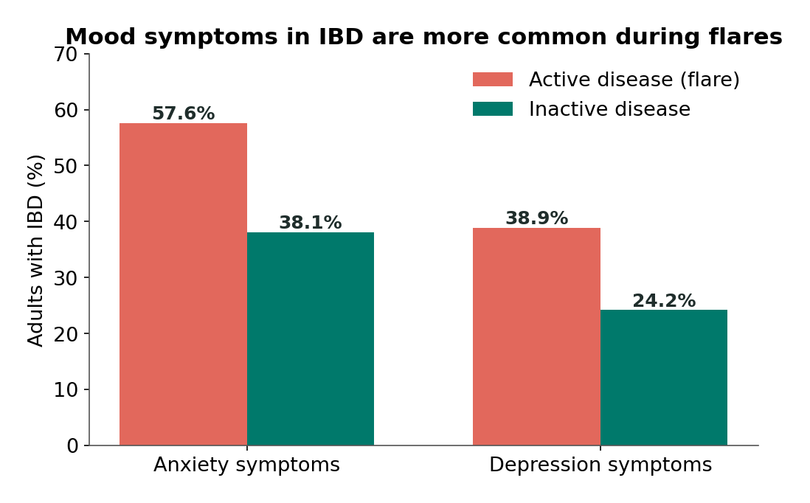

# Chapter 11: Anxiety, Depression, and the Gut

## Summary

People with gut conditions such as inflammatory bowel disease (IBD) and irritable bowel syndrome (IBS) report anxiety and depression symptoms much more often than other people. This chapter asks the obvious next question: which comes first? You will learn what anxiety disorders, depression, and gut-specific anxiety are, how researchers measure them, and why a link between two things can come from either direction or from a hidden third factor. You will see real evidence that the gut-brain street runs both ways, weigh the ideas that inflammation and gut microbes play a role, and learn why mental-health care belongs inside gut care, along with how and where to get help.

## Concepts Covered

1. Anxiety Disorder
2. Major Depressive Disorder
3. GI-Specific Anxiety
4. Psychiatric Comorbidity
5. Bidirectional Relationship
6. Meta-Analysis
7. Symptom Questionnaire
8. Cohort Study
9. Reverse Causation
10. Confounding Variable
11. Inflammatory Depression Theory
12. Illness Burden
13. Microbiota Transfer Study
14. Help-Seeking
15. Crisis Resources
16. Integrated Care

## Prerequisites

- [Chapter 3: Meet the Microbiome](../03-meet-the-microbiome/index.md) (correlation vs causation, germ-free mice)
- [Chapter 4: The Immune System as a Sense Organ](../04-immune-sense-organ/index.md) (cytokines and sickness behavior)
- [Chapter 7: Stress and the Gut](../07-stress-and-the-gut/index.md) (the HPA axis and stress)
- [Chapter 8: Pain, Sensitivity, and the Gut](../08-pain-and-sensitivity/index.md) (visceral hypersensitivity)
- [Chapter 9: Inflammatory Bowel Disease](../09-inflammatory-bowel-disease/index.md) (Crohn's disease, ulcerative colitis, flares, remission)
- [Chapter 10: IBS and Disorders of Gut-Brain Interaction](../10-ibs-and-dgbi/index.md) (irritable bowel syndrome)

!!! mascot-welcome "When the gut and mood travel together"
    { class="mascot-admonition-img" }
    If you live with a gut condition, you may have noticed that worry and low mood often show up alongside your symptoms. This chapter takes that experience seriously and asks a scientist's question about it: which way do the arrows point? Along the way, you'll pick up tools for reading health research that work far beyond the gut.

## 11.1 Which Came First?

Riya has noticed a pattern. In the days before a Crohn's flare, she often feels tense and on edge, the kind of anxious that makes it hard to focus on her violin part in orchestra. Then the belly pain and diarrhea arrive. Afterward she wonders: did the worry trigger the flare? Or was the flare already starting, quietly, and her body felt it before she did? (Riya is a fictional student who appears throughout this book.)

Her best friend Sam has his own version. His IBS gets worse before big tests, and he has test anxiety. On a bad morning, it's hard to tell whether his nervous stomach is making him anxious or his anxiety is making his stomach nervous.

They are not alone. A [2021 analysis of 77 studies](https://pubmed.ncbi.nlm.nih.gov/33721557/) found that about one in three adults with IBD screened positive for anxiety symptoms, and about one in four for depression symptoms. Numbers like that raise a question that sounds simple but isn't: **which came first, the gut or the worry?** By the end of this chapter you'll see that the honest answer is "often both," and you'll know how scientists figured that out.

## 11.2 A Two-Way Street

Before any technical terms, think about a friendship that's going badly. Jordan is rude to Casey, so Casey gets snappy, so Jordan gets ruder, so Casey gets snappier. If you only walk in at the end and see two people glaring at each other, you can't tell who started it. And maybe neither did: maybe they were both stressed from the same group project, and that hidden pressure made them both irritable.

That little scene holds the main ideas of this chapter. Effects can run one way, the other way, both ways at once, or come from a third thing pushing on both.

A **bidirectional relationship** is a connection between two things in which each one can influence the other, so that changes can flow in both directions. The gut-brain axis is the textbook example. In earlier chapters you saw the upward route (gut signals traveling through the vagus nerve, immune messengers, and microbial chemicals to the brain) and the downward route (stress hormones and nerve signals from the brain changing how the gut moves, senses, and defends itself). This chapter applies that two-way wiring to mood.

!!! mascot-thinking "I'm a two-lane road"
    { class="mascot-admonition-img" }
    As a vagus nerve fiber, I carry messages both up and down, and so do the other gut-brain routes. So when gut problems and mood problems show up together, my first question is never "which one is to blame?" but "which lanes are busy right now?"

## 11.3 What Anxiety and Depression Mean

Everyone feels anxious or sad sometimes. Before a big test, a nervous stomach is normal. After a loss, sadness is normal. These feelings become a health problem when they are strong, last a long time, and get in the way of everyday life. For a deeper look at emotion circuits and psychiatric conditions in the brain, see [From Neuron to Bedside, Chapter 11](https://aaryavvatts-lab.github.io/neuroscience-textbook/chapters/11-emotion-and-stress/) and [Chapter 15](https://aaryavvatts-lab.github.io/neuroscience-textbook/chapters/15-psychiatric-disorders-and-addiction/).

An **anxiety disorder** is a mental health condition in which worry, fear, or nervousness is more than occasional: it doesn't go away, shows up in many situations, and can get worse over time, interfering with daily life. That description follows the [National Institute of Mental Health (NIMH)](https://www.nimh.nih.gov/health/topics/anxiety-disorders), which lists several types, including generalized anxiety disorder, panic disorder, social anxiety disorder, and phobia-related disorders.

**Major depressive disorder** (often just called depression) is a mental health condition marked by a period of at least two weeks with a depressed mood or a loss of interest or pleasure in daily activities, along with other symptoms such as changes in sleep, appetite, energy, concentration, or feelings of self-worth.

[NIMH's guide to teen depression](https://www.nimh.nih.gov/health/publications/teen-depression) lists signs that include often feeling sad, anxious, worthless, or "empty"; losing interest in activities; being easily irritated or angry; pulling away from friends and family; falling grades; changes in eating or sleeping; tiredness; and thoughts of suicide or self-harm. Depression is a real medical condition, not a character flaw or a lack of effort, and NIMH notes that it can be treated with talk therapy, medication, or both.

There is a third kind of worry that matters a lot in gut conditions. **GI-specific anxiety** is worry and fear focused specifically on gut sensations, gut symptoms, or the situations where they might happen, such as fearing a cramp in class, constantly scanning the body for signs of trouble, or avoiding trips where a restroom might be hard to reach. Researchers measure it with tools such as the Visceral Sensitivity Index, a 15-question scale developed and tested in 2004 by [Labus and colleagues](https://pubmed.ncbi.nlm.nih.gov/15225175/) with 96 people with IBS.

GI-specific anxiety is different from general anxiety. Someone can be calm about school, friends, and the future, and still feel a spike of fear every time their stomach gurgles in a quiet classroom. It also connects to Chapter 8: worry focused on gut sensations is one way the brain may turn up the pain volume.

!!! mascot-warning "Symptoms are not a diagnosis"
    { class="mascot-admonition-img" }
    Most of the big numbers in this chapter come from questionnaires that flag symptoms, not from a professional's diagnosis. "Screened positive for anxiety symptoms" and "has an anxiety disorder" are different claims, so watch which one a headline is making.

## 11.4 How Common Is It? Reading the Numbers

When two health conditions show up in the same person more often than chance would predict, doctors use a special word. **Psychiatric comorbidity** is the presence of a mental health condition, such as anxiety or depression, in a person who also has another health condition, such as IBD or IBS. ("Co" means together, and "morbidity" means illness.)

How do we know how common psychiatric comorbidity is in gut conditions? Two research tools do most of the work.

A **symptom questionnaire** is a standard set of questions, scored with fixed rules, that measures how many symptoms of a condition a person reports and how strong they are. A score above a set cutoff "screens positive." Questionnaires are fast and useful for spotting people who may need help, but they can't diagnose; that takes a full evaluation by a trained professional.

A **meta-analysis** is a study that uses statistics to combine the results of many earlier studies on the same question, giving a single pooled estimate that is usually more reliable than any one study alone. It is only as good as the studies that go into it.

Here is the most important meta-analysis for this chapter. In 2021, [Barberio and colleagues](https://pubmed.ncbi.nlm.nih.gov/33721557/) pooled 77 studies that included 30,118 adults with IBD. Using screening questionnaires, they found:

- **Anxiety symptoms:** 32.1% (from 58 studies)
- **Depression symptoms:** 25.2% (from 75 studies)
- People with **active IBD** (a flare) had higher rates than people with inactive disease: anxiety symptoms 57.6% vs 38.1%, and depression symptoms 38.9% vs 24.2%. (These active-versus-inactive numbers come from a smaller subset of the studies.)
- People with Crohn's disease had slightly higher odds of both than people with ulcerative colitis, and women had higher rates of anxiety symptoms than men.

*Source: Barberio et al. 2021, Lancet Gastroenterology & Hepatology (meta-analysis of 77 studies). Symptom questionnaires, not diagnoses; the active-versus-inactive numbers come from a subset of the studies.*

These are symptom questionnaires, not diagnoses, and they come from adults. For IBS, a 2019 meta-analysis by [Zamani and colleagues](https://pubmed.ncbi.nlm.nih.gov/31157418/) found anxiety symptoms in 39.1% and depression symptoms in 28.8% of people with IBS, about three times the odds seen in healthy people.

What about teens? A 2018 meta-analysis by [Stapersma and colleagues](https://pubmed.ncbi.nlm.nih.gov/29984495/) pooled 28 studies of 8,107 children and teens with IBD (average age 14.3). It found anxiety symptoms in about 16.4% and depressive symptoms in about 15.0%, with lower rates of diagnosed anxiety disorders (4.2%) and depressive disorders (3.4%). These are lower than the adult numbers, but the authors warn that the studies used different questionnaires and cutoffs, so the figures should be read with caution. Studies with more active disease had higher rates of depressive symptoms, the same pattern seen in adults.

To put these numbers in context, mood struggles are common among all teens. In the [2025 Youth Risk Behavior Survey](https://www.cdc.gov/mmwr/volumes/75/su/su7501a4.htm) from the Centers for Disease Control and Prevention (CDC), published in October 2026, 33.3% of US high school students (about one in three, down from 39.7% in 2023) said that during the past year they had felt so sad or hopeless almost every day for two or more weeks in a row that they stopped doing some usual activities. That's not the same as having depression, but it shows that feeling this way is common and worth talking about, with or without a gut condition.

!!! claim-box "How to read a gut-brain claim: the 2021 IBD mood meta-analysis"
    | Question | This study |
    |---|---|
    | Mouse or human? | Human. Adults with IBD only (no children or teens). |
    | Correlation or cause? | Correlation. It pools observational studies that measured mood symptoms at one time, so it shows how common the symptoms are, not what causes them or which came first. |
    | How many? | Large: 77 studies with 30,118 adults. But the studies differed a lot from each other, and the active-versus-inactive comparison used fewer studies. |
    | How long? | Mostly snapshots. Each study measured symptoms once. |
    | Who paid for it? | The paper's funding statement says "None." |
    | Is something being sold? | No. The authors suggest that gastroenterologists screen for and treat anxiety and depression. |

The careful conclusion: anxiety and depression symptoms are clearly common in adults with IBD, especially during flares, and that is a strong reason to check on mental health in IBD care. But this study alone can't tell us whether IBD causes the symptoms, the symptoms worsen IBD, or both. For that we need studies that follow people over time, which is where we go next.

!!! hype-strong "Hype Meter: "People with IBD have higher rates of anxiety and depression symptoms""
    
StrongModeratePreliminaryHype

    **Verdict: Strong** (as an association). A 2021 meta-analysis of 77 studies and 30,118 adults found anxiety symptoms in about a third and depression symptoms in about a quarter of people with IBD, with higher rates during active disease, and IBS shows a similar pattern. That analysis measured how common the symptoms are rather than comparing people with IBD to people without it. Studies that did make the comparison point the same way: in a [2023 Danish registry study](https://pubmed.ncbi.nlm.nih.gov/37197708/) of 22,103 people with IBD and 110,515 matched people without it, those with IBD were more likely to have hospital-recorded anxiety and depression, both before and for at least ten years after diagnosis, and a [2024 UK study](https://pubmed.ncbi.nlm.nih.gov/37603846/) of 3,898 children and young adults (ages 5 to 25) with IBD found more new diagnoses of depression and anxiety than in matched peers. For IBS, the 2019 meta-analysis found about three times the odds of anxiety and depression symptoms compared with healthy people. These are questionnaire symptoms, not diagnoses, and they describe a link, not a cause.
    **What would change the grade:** Very little would weaken the association itself. Large studies in teens using the same questionnaires would sharpen the picture for younger readers. (See [the Hype Meter](../../hype-meter.md) for what each grade means.)

## 11.5 Why a Link Is Not an Arrow

You met correlation vs causation in [Chapter 3](../03-meet-the-microbiome/index.md). Here we sharpen it with two more precise ideas, because gut-mood headlines so often go wrong right here.

**Reverse causation** is when the cause-and-effect arrow points the opposite way from the one assumed. If a study finds that people with depression have different gut bacteria, a headline might say "gut bacteria cause depression." But depression changes appetite, food choices, sleep, activity, and sometimes medicine use, and all of those can change gut bacteria. The arrow might run from mood to microbes, not the other way around.

A **confounding variable** is a third factor that affects both things being studied, creating a link between them even if neither causes the other. In the Jordan and Casey story, the stressful group project was a confounder. In gut-mood research, possible confounders include poor sleep, chronic pain, stressful life events, money worries, side effects of some medicines, and social isolation. Each of these could push both gut symptoms and mood in the same direction.

So how do scientists untangle the arrows? One of the best tools short of an experiment is to follow people over time. A **cohort study** is a study that follows a group of people (a cohort) over time, measuring things at the start and again later, to see which earlier factors predict later outcomes. If anxiety measured at the start predicts new gut problems years later, among people who didn't have gut problems at the start, that is evidence for a brain-to-gut direction. If gut problems at the start predict new anxiety later, among people who weren't anxious at the start, that is evidence for a gut-to-brain direction.

Cohort studies are powerful, but they still can't fully rule out confounders. A hidden factor present at the start could cause both later outcomes. That's why the strongest evidence for cause usually comes from experiments, such as randomized trials, when those are possible and ethical.

The table below summarizes the three explanations for a gut-mood link we've just covered and what each would predict in a cohort study.

| Explanation | What it means | What a cohort study would show |
|---|---|---|
| Gut to brain | Gut problems lead to later mood problems | Earlier gut symptoms predict later mood symptoms |
| Brain to gut (reverse causation, if the gut was assumed to be the cause) | Mood problems lead to later gut problems | Earlier mood symptoms predict later gut symptoms |
| Confounding | A third factor causes both | Both may move together; the cohort study alone may not tell |

!!! mascot-encourage "This is the hard part, and it pays off"
    { class="mascot-admonition-img" }
    Reverse causation and confounding take a while to click, so don't worry if you have to reread this section. Once you can spot them, you'll start catching the mistake in health headlines.

## 11.6 Evidence That the Street Runs Both Ways

Now for the real studies that followed people over time.

**A 12-year study in Australia.** In 2012, [Koloski and colleagues](https://pubmed.ncbi.nlm.nih.gov/22234979/) reported on a random sample of 1,775 adults in Australia who answered a survey about gut symptoms, anxiety, and depression in 1997. Twelve years later, 1,002 of them answered again. Two findings stood out:

- Among people who had no functional gut disorder at the start, higher anxiety at the start predicted developing a new functional gut disorder (such as IBS or functional dyspepsia) 12 years later. That's the brain-to-gut direction.
- Among people who did not have high anxiety or depression at the start, those who had a functional gut disorder at the start had higher anxiety and depression 12 years later. That's the gut-to-brain direction.

The authors concluded that the brain and gut interact in both directions in these disorders. This is a human cohort study, so it shows prediction over time, not proof of cause, and 773 of the original 1,775 people (more than 4 in 10) didn't complete the follow-up survey.

**A 2-year study of IBD in England.** In 2018, [Gracie and colleagues](https://pubmed.ncbi.nlm.nih.gov/29366841/) followed 405 adults with Crohn's disease or ulcerative colitis for at least two years, measuring anxiety and depression with a questionnaire and tracking flares, steroid prescriptions, hospital stays, and changes in treatment.

- People whose IBD was **active** at the start were almost six times as likely to develop abnormal anxiety scores later (a hazard ratio of 5.77, meaning their risk was about 5.77 times higher over the follow-up). That estimate is rough, though: the range of likely values ran from about 2 to 18 times higher.
- Among people whose IBD was **quiet** at the start, those with abnormal anxiety scores were about twice as likely to later need steroids or have a flare (hazard ratio 2.08), and more likely to need their treatment stepped up.

These links held even when the researchers used a stool test of gut inflammation to confirm that the disease was truly quiet at the start. Again, it's a cohort study, so confounders can't be completely ruled out, but it's strong evidence that in IBD, gut activity and mood each predict changes in the other.

This brings us back to Riya. Her pre-flare anxiety might be partly an early signal of a flare already brewing (gut to brain), partly a stressor that nudges her immune system and gut toward a flare (brain to gut), or both. None of this means anxiety caused her Crohn's disease. These studies are about how symptoms and flares change over time in people who already have a condition, not about what causes IBD to start. (Chapter 9 covers what is known about IBD's causes.)

## 11.7 Try It: The Two-Way Street

The simulation below follows 500 fictional people. Each dot is one person, placed by their gut-symptom score (left to right) and mood-symptom score (bottom to top). You set the hidden rules: how strongly gut symptoms change later mood (gut to brain), how strongly mood changes later gut symptoms (brain to gut), and how strongly a shared third factor (a confounder) pushes on both. The top bar shows the correlation in one snapshot, like a survey. The other two bars show what you'd see in a cohort study: how well earlier gut symptoms predict later mood, and how well earlier mood predicts later gut symptoms. A correlation (r) of 0 means no link and 1 means a perfect link.

#### Diagram: The Two-Way Street
<iframe src="../../sims/ch11-two-way-street/main.html" height="622px" width="100%" scrolling="no"></iframe>

[Open The Two-Way Street fullscreen](../../sims/ch11-two-way-street/main.html){ .md-button .md-button--primary }

MicroSim specification: The Two-Way Street

Type: microsim
**sim-id:** ch11-two-way-street 
**Library:** p5.js 
**Status:** Implemented 
**Bloom Level:** Analyze 
**Bloom Verb:** analyze, distinguish 
**Learning Objective:** The learner will explain why gut-to-brain effects, brain-to-gut effects, and a shared confounder can each produce a similar correlation at one time point, and analyze how following people over time helps detect direction (reverse causation) but cannot by itself rule out confounding.

**Canvas:** 480 px drawing area plus 140 px controls (iframe 622 px); responsive to about 380 px wide, with the bars moving below the scatter plot on narrow screens.

**Controls:** Start/Pause, New cohort, Reset; Gut to brain effect slider (0 to 0.4, step 0.05, default 0.3); Brain to gut effect slider (0 to 0.4, default 0); Shared third factor slider (0 to 0.4, default 0).

**Rules:** 500 simulated people with gut score G, mood score M, and a fixed hidden trait Z. Each time step: G' = 0.5G + (brain to gut)M + (third factor)Z + noise; M' = 0.5M + (gut to brain)G + (third factor)Z + noise (noise SD 0.7). The cohort is run 40 steps to settle whenever a slider changes. Bars show the Pearson correlation of G and M now, of earlier G with later M, and of earlier M with later G.

**Feedback:** A readout names the pattern: gut first, mood first, linked with no clear order (both directions or a shared cause), or almost no link.

**Provenance:** Sections 11.5 and 11.6 (Koloski 2012; Gracie 2018). All numbers are simulated teaching values, not data from any study.

Start with the default settings: gut to brain at 0.30 and everything else at 0. The snapshot shows a modest link (around r = 0.2), and the "earlier gut, later mood" bar is clearly longer than "earlier mood, later gut." Now flip it: set gut to brain to 0 and brain to gut to 0.30. The snapshot bar looks about the same as before. A single survey can't tell these two worlds apart, which is exactly the reverse causation problem. But the time bars swap, so following people over time can.

Next, set both directions to 0.15. The snapshot still shows a link, and the two time bars come out about equal: a true two-way street. Finally, set both directions to 0 and the shared third factor to 0.30. The snapshot link gets even stronger, yet nothing in the model connects gut and mood directly. Both time bars are long and equal, so even a cohort study can't tell a two-way street from a hidden shared cause without measuring that cause. Press **New cohort** a few times to see how much the numbers wobble by chance, even with 500 people.

!!! model-limits "What this model leaves out"
    - Real people have many gut and mood symptoms, not one score each, and the strength of effects differs from person to person.
    - Real effects may be delayed, may build up over months, or may only appear during flares; the sim uses one simple step.
    - Real studies have dropouts, measurement error, and many confounders at once, not one hidden trait.
    - Treatment, which changes both gut and mood symptoms, is left out completely.
    - All numbers are made up. The sim shows how study designs behave, not what real effect sizes are.

## 11.8 Gut to Brain: How Gut Problems Can Affect Mood

If gut problems can lead to mood problems, how? There are several routes, and they likely work together.

### The weight of living with it

The first route is the most obvious and the easiest to overlook. **Illness burden** is the total load that a health condition places on a person's life, including symptoms such as pain, urgency, and fatigue, along with missed school or work, medical appointments, treatment side effects, money costs, worry about the future, and effects on friendships and self-image. A long-lasting gut condition carries a heavy illness burden. Imagine planning every outing around restrooms, missing a concert because of a flare, or being the only person at a sleepover who can't eat the pizza. Anyone carrying that load could become anxious or low.

Illness burden helps explain why mood symptoms are more common during active disease, when the burden is heaviest. It also explains why the answer is never "just think positive." The stress is real, and it deserves real support.

### Inflammation and the brain

The second route is biological. In [Chapter 4](../04-immune-sense-organ/index.md) you learned about sickness behavior, the tiredness, low mood, and withdrawal that come with infections, driven by immune messengers called cytokines reaching the brain. The **inflammatory depression theory** is the idea that ongoing inflammation in the body, signaled to the brain by cytokines and other immune messengers, can push brain circuits toward depression-like changes in mood, energy, and motivation, at least in some people.

What's the evidence? In 2020, [Osimo and colleagues](https://pubmed.ncbi.nlm.nih.gov/32113908/) combined 107 studies comparing 5,166 people with depression and 5,083 people without it. On average, people with depression had higher blood levels of several inflammation markers, including C-reactive protein (CRP), interleukin-6, and tumor necrosis factor. The authors called depression "a pro-inflammatory state." But this was an average shift across the group, not a feature of every depressed person, and no blood test can diagnose depression. It also measures blood markers at one time, so it can't show whether inflammation came first.

A 2016 review by [Miller and Raison](https://pubmed.ncbi.nlm.nih.gov/26711676/) lays out the theory's logic: immune signals that once helped early humans survive infections and threats (by making them withdraw, rest, and stay alert) may, in modern life, help drive depression in some people. They describe this as a promising treatment target still being tested. Since IBD is a disease of gut inflammation, this theory is one possible reason mood symptoms rise during flares. It's a hypothesis with good supporting evidence for the link, but cause in humans is not settled.

### Microbes and mood

The third route is the one that gets the most headlines. Could gut microbes themselves affect mood? Scientists test this with a **microbiota transfer study**, an experiment in which gut microbes (usually from stool) from one group of people or animals are transferred into animals whose own gut microbes have been removed or depleted, to see whether traits move along with the microbes.

Two well-known studies did this in 2016:

- [Kelly and colleagues](https://pubmed.ncbi.nlm.nih.gov/27491067/) in Ireland collected stool from people with major depression and from healthy people. Microbes from the depressed group, transferred into rats whose gut microbes had been depleted, led the rats to show behaviors that researchers read as depression-like and anxiety-like (such as anhedonia, a loss of interest in rewards), plus changes in how they processed tryptophan.
- [Zheng and colleagues](https://pubmed.ncbi.nlm.nih.gov/27067014/) in China moved gut microbes from people with major depression into germ-free mice (mice raised with no microbes, which you met in Chapter 3). These mice showed more depression-like behavior than mice that received microbes from healthy people.

These are real experiments that test cause, but in rodents. Rodent behavior tests can't capture human feelings, the transfers involve whole communities of microbes (so we don't know which ones matter), and rodents raised without microbes are very unusual animals. The studies suggest microbes *can* influence behavior. They don't show that microbes cause depression in people.

Human studies so far show links, not cause. In 2019, [Valles-Colomer and colleagues](https://pubmed.ncbi.nlm.nih.gov/30718848/) studied the gut microbes of 1,054 people in Belgium's Flemish Gut Flora Project and checked their results in a separate group. People with depression had lower levels of certain bacteria (Coprococcus and Dialister), even after accounting for antidepressant use. But this was a one-time snapshot. Depression changes diet, sleep, and activity, all of which change gut bacteria, so reverse causation is very possible.

!!! hype-preliminary "Hype Meter: "Gut bacteria from depressed people cause depression""
    
StrongModeratePreliminaryHype

    **Verdict: Preliminary.** In 2016, two animal studies found that moving gut microbes from people with major depression into rats or germ-free mice led to depression-like behavior. Human studies show that people with depression have somewhat different gut bacteria, but these are snapshots that can't show direction. That microbes can change rodent behavior is reasonably supported; that they cause depression in people is not shown.
    **What would change the grade:** Long-term human cohort studies showing microbe changes come before depression, plus well-controlled human trials in which changing the microbes changes mood, would move it up.

## 11.9 Brain to Gut: How Mood Can Affect the Gut

Now the downward lane. You already know most of these routes from earlier chapters.

- **Stress hormones and nerves.** In [Chapter 7](../07-stress-and-the-gut/index.md) you saw how the HPA axis and the stress response change gut movement, sensitivity, the gut barrier, and immune cells such as mast cells. Anxiety keeps these systems switched on more often.
- **Pain amplification.** In [Chapter 8](../08-pain-and-sensitivity/index.md) you saw how worry and attention can turn up pain through descending pathways. GI-specific anxiety is a direct route: the more a person fears gut sensations, the louder those sensations may become.
- **Daily life.** Depression can drain energy and motivation, making it harder to keep up with sleep, meals, activity, and appointments. These everyday changes can affect how a person feels physically, though researchers are still sorting out how much each one matters for gut conditions.

In IBD, the Gracie study suggests that anxiety in people whose disease is quiet predicts later flares and treatment changes. Scientists don't yet know exactly how. It could involve stress effects on the immune system, changes in behavior, or confounders the study didn't measure. That is why the careful phrase is "anxiety predicts later flares," not "anxiety causes flares." And once more: none of this says anxiety or stress causes IBD to begin.

In IBS, the brain-to-gut lane is especially busy, which is part of why brain-gut therapies such as CBT and gut-directed hypnotherapy help many people (see [Chapter 10](../10-ibs-and-dgbi/index.md)).

## 11.10 "Fix Your Gut, Fix Your Mood"? Grading the Big Claim

Put the evidence together and a popular claim falls apart. Wellness posts often say that healing your gut, with a supplement, a cleanse, a special diet, or a probiotic, will fix depression or anxiety. Some posts go further and tell people they don't need therapy or medicine.

Here's what this chapter shows. Yes, the gut-brain link is real and runs both ways. Yes, inflammation and microbes may play a role in some people's mood. But the microbe evidence is mostly from animals and snapshots, and depression and anxiety have many causes, including genes, life events, stress, and brain circuits that have nothing to do with the gut.

For people with IBD, treating inflammation is important for many reasons, but studies show mood symptoms remain common even in inactive disease (24.2% for depression symptoms in Barberio's analysis), so gut treatment alone isn't enough for everyone. Probiotics and depression are covered in [Chapter 16](../16-probiotics-psychobiotics/index.md), where you'll see that the trial evidence is small and mixed.

!!! hype-hype "Hype Meter: "Fixing your gut will fix your depression""
    
StrongModeratePreliminaryHype

    **Verdict: Hype.** The gut-mood link is real and two-way, but the evidence that gut changes cause human depression comes mostly from rodent transfer studies and one-time snapshots. Depression has many causes, mood symptoms stay common even when IBD is inactive, and proven treatments (talk therapy, medication, or both) work on the brain directly. Promising that gut fixes will cure depression can lead people to delay care that works.
    **What would change the grade:** Large, long, well-controlled human trials showing that a specific gut treatment reliably relieves depression, compared with placebo, could support a narrower claim for some groups of people.

!!! mascot-tip "Both lanes need care"
    { class="mascot-admonition-img" }
    If the street runs both ways, help can come from both ends too. Treating gut symptoms can ease mood, and treating anxiety or depression can ease gut symptoms, so the best plans usually work on both at once.

## 11.11 Getting Help

Knowing that gut conditions and mood are linked matters most if it helps people get care. The last three ideas of the chapter are about exactly that.

### Asking for help

**Help-seeking** is the process of recognizing that you're struggling and reaching out for support, whether to a friend, family member, school counselor, doctor, or mental health professional. It sounds simple, but it's often the hardest step. People with gut conditions may already feel worn out from explaining their bodies, and some worry that mentioning anxiety will make doctors take their gut symptoms less seriously. Others come from families or cultures where mental health is rarely discussed. (Chapter 19 looks at culture and stigma in more depth.)

NIMH's guide for teens suggests talking to a trusted adult, such as a parent, teacher, or school counselor, and asking a doctor about professional help. It also suggests staying connected with friends and family even when you don't feel like it, staying active, and keeping a regular sleep schedule. Telling your gastroenterologist about mood symptoms is not a distraction from your gut care. It's part of it, as the next ideas show.

### Help right now

**Crisis resources** are services that give immediate, free support to someone in emotional distress or danger, such as suicide and crisis hotlines, text lines, and emergency rooms. In the US, the [988 Suicide & Crisis Lifeline launched in July 2022](https://988lifeline.org/about/). You can call or text 988, or chat at 988lifeline.org. It is free, confidential, and available 24 hours a day, 7 days a week. If someone is in immediate danger, call 911.

!!! living-with "If you are struggling right now"
    If you are thinking about suicide or are in crisis, call or text **988** to reach the 988 Suicide & Crisis Lifeline (in the US), or go to the nearest emergency room. Outside the US, you can find a helpline at [findahelpline.com](https://findahelpline.com/). You can also talk to a parent, school counselor, or doctor.

### Care that treats the whole person

**Integrated care** is an approach in which physical and mental health care are delivered together by a coordinated team, for example a gastroenterologist, nurse, dietitian, and psychologist who share information and plan care as one team, often in the same clinic. Instead of sending someone with IBD and depression to two separate systems that never talk, integrated care treats both as parts of one problem.

What's the evidence? In 2023, [Riggott and colleagues](https://pubmed.ncbi.nlm.nih.gov/37543040/) (the same Leeds research group behind the Gracie studies) updated their [earlier 2017 analysis](https://pubmed.ncbi.nlm.nih.gov/28404134/) and pooled 25 randomized trials of psychological therapy in people with IBD aged 16 and up. In people whose disease was quiet, therapy lowered anxiety, depression, and stress scores and improved quality of life by small amounts at the end of treatment, and a small benefit for depression scores lasted to the end of follow-up. But therapy didn't change disease activity or prevent flares, and all 25 trials had a high risk of bias. Benefits were largest in trials that enrolled people who were already struggling with their mood, fatigue, or quality of life.

A [2025 Cochrane review](https://pubmed.ncbi.nlm.nih.gov/40243391/) of 48 trials reached a similar conclusion: in adults, psychological care probably improves mood and quality of life slightly, and it may have little to no effect on disease activity. In other words, therapy helps some people's mood and quality of life, but it isn't a treatment for the inflammation itself.

Barberio's 2021 meta-analysis and Gracie's 2018 cohort study both concluded that people with IBD should be checked for anxiety and depression as part of routine care.

!!! families "For families"
    If a teen with a gut condition seems more irritable, withdrawn, or tired than usual, it may be the illness, mood, or both, and it's worth asking gently. Try "You've seemed down lately. Do you want to talk, or should we bring it up with your doctor?" rather than "You just need to stay positive." Avoid suggesting that worrying caused their condition; that isn't what the science shows, and it adds guilt. You can help by mentioning mood at gut appointments and by learning the warning signs of depression and the 988 Lifeline yourself.

!!! living-with "If you're going through this"
    Feeling anxious or low when you have a gut condition is common, and it's not a sign of weakness or that you're "not handling it." It's also not your fault that your gut acts up when you're stressed. Try telling your GI doctor or nurse something like "My mood has been really low since my last flare." Saying it out loud to your care team is how integrated care starts, and many clinics can connect you with someone who understands both the gut and the mind.

## At the Bedside: A Flare That Took More Than the Gut

!!! note "Meet the patient (fictional)"
    Marcus is 16 and a sophomore who plays bass in a garage band and loves basketball. He was diagnosed with ulcerative colitis a year ago. Last winter he had a bad flare with bloody diarrhea, urgency, and exhaustion, and he missed three weeks of school. The flare is now under control, but his mom notices he still isn't himself. He's stopped going to band practice, sleeps most of the afternoon, snaps at his little sister, and says "What's the point?" when asked about the basketball tryouts he was once excited about.

**What the doctor checks:** At a follow-up visit, his gastroenterologist first makes sure the colitis is truly calm: she reviews his symptoms and checks blood and stool tests for inflammation, which are much better. She then talks with Marcus alone for a few minutes and asks him to fill out a short screening questionnaire for depression and anxiety. His depression score is high. She also asks directly, and kindly, whether he has had thoughts of hurting himself. He says no, and she makes sure he and his mom know about 988.

**Connecting the signals:** Marcus's mood dropped during his flare, when his illness burden was heaviest and his gut was inflamed. That fits the gut-to-brain lane: inflammation may have affected his brain, and weeks of pain, isolation, and missed school added stress. But his mood stayed low even after the inflammation calmed, which suggests the depression is no longer just a result of the flare. His team also knows the brain-to-gut lane: untreated depression could make it harder for him to keep up with daily routines and treatment, and in adults with IBD, anxiety has been linked to later flares.

**Diagnosis:** Ulcerative colitis in remission, with symptoms of depression. The team refers Marcus to a psychologist for a full evaluation, which confirms major depressive disorder.

**Why it happens:** Psychiatric comorbidity is common in IBD, especially during and after active disease. Likely contributors include the illness burden of a severe flare, inflammation signaling to the brain (the inflammatory depression theory), and the social losses of missing school and activities. Because the link is bidirectional, treating his depression matters for his colitis too.

**The mind-body side:** Marcus admits he felt embarrassed to bring up his mood at a "gut appointment." His doctor tells him this is one of the most common things she sees and that it's part of his IBD care. The team includes a psychologist who works with teens with chronic illness. Marcus and his parents meet with the school counselor to plan his catch-up work and a quiet return to band.

**Treatment today:** Marcus continues his colitis treatment as prescribed by his gastroenterologist. For depression, treatment options include talk therapy such as cognitive behavioral therapy, medication prescribed and monitored by a doctor, or both, as NIMH describes. His GI doctor and psychologist share notes so that his whole care team knows how both his gut and his mood are doing. Any decisions about medicines belong to Marcus, his family, and his doctors.

**What's new in research:** In 2021, [Lores and colleagues](https://pubmed.ncbi.nlm.nih.gov/32007538/) reported on a hospital IBD service in Australia that screened 335 adults for mental health risk and offered psychological care to those at risk. Among people who accepted the care, emergency department visits dropped in the following year, and the program saved money over two years. **Evidence grade: Preliminary.** It was a single-center study without a randomized comparison group, in adults, so other changes over time could explain part of the drop.

??? question "Your turn: reason through a variation"
    Riya has been in remission for a year, but she has started feeling intensely nervous before every orchestra concert. She worries that her stomach will act up on stage, and she has begun skipping meals on concert days and checking where the nearest restroom is. She isn't sad, and she enjoys school otherwise. What is going on, and what might help?

    **Answer:** This sounds most like GI-specific anxiety: fear focused on gut symptoms and the situations where they might happen, rather than general anxiety or depression. It's understandable after years of unpredictable symptoms, and it's worth taking seriously, because fear of gut sensations can turn up gut pain and symptoms through the brain-to-gut lane. Her care team would want to confirm her Crohn's is still quiet, and could then connect her with a psychologist who works with gut conditions. CBT-based approaches target exactly this kind of worry.

*This is a fictional teaching case. It is not medical advice. If you or someone you know has symptoms like these, talk to a doctor.*

## Common Misconceptions

**Myth:** Anxiety or stress causes IBD.  
**Reality:** Studies show that anxiety in people who already have IBD predicts later flares, and active IBD predicts later anxiety. These are about how symptoms change over time, not about what makes IBD start. No study in this chapter shows that anxiety causes IBD to begin.

**Myth:** Depression in people with IBD is just a normal reaction to being sick, so it doesn't need treatment.  
**Reality:** Feeling down about an illness is understandable, but major depressive disorder is a real condition that can be treated, and it may affect the gut through the brain-to-gut lane. Researchers recommend screening for and treating anxiety and depression as part of IBD care.

**Myth:** Since people with gut conditions have more depression, the gut must be causing it.  
**Reality:** A link can come from gut to brain, brain to gut, both, or a confounding variable such as poor sleep or pain. Cohort studies suggest the street runs both ways.

**Myth:** You should keep mental-health struggles to yourself at GI appointments, because your doctor will think your symptoms are "all in your head."  
**Reality:** Telling your gastroenterologist about mood symptoms helps them treat you as a whole person. Mood problems don't make gut symptoms less real, and many IBD clinics now include mental health care.

## Your Gut Check

Test yourself. Try each one before you open the answer.

??? question "1. Claim Check: "Depression starts in the gut! Studies prove that people with depression have bad gut bacteria, so our 30-day gut reset will fix your mood.""
    **Grade: Hype.** Human studies such as the 2019 Flemish Gut Flora Project found that people with depression had lower levels of some bacteria, but these were snapshots that can't show direction, and depression itself changes diet, sleep, and activity, which change gut bacteria (reverse causation). Animal transfer studies suggest microbes can influence behavior, but that's Preliminary for humans. No evidence in this chapter supports a 30-day product fixing depression. A careful version: "People with depression tend to have somewhat different gut bacteria, and scientists are studying whether microbes play a role. Talk therapy and medication are proven treatments."

??? question "2. Predict: In a new cohort study, 1,000 teens with IBD fill out mood questionnaires every 6 months for 3 years. Based on this chapter, what two patterns would you predict, and why?"
    Teens with active IBD at one visit should be more likely to report new anxiety or depression symptoms at later visits (gut to brain, through inflammation and illness burden), and teens with quiet IBD but high anxiety should be more likely to have flares later (brain to gut). This prediction comes from adult cohort studies (Gracie 2018) and the 12-year Koloski study, so a teen study would test whether the same two-way pattern holds at younger ages.

??? question "3. Explain: Why might mood symptoms be more common during an IBD flare than during remission?"
    During a flare, inflammation is high, and cytokines can signal the brain and push it toward sickness behavior and depression-like changes (the inflammatory depression theory). The illness burden is also heaviest: more pain, urgency, fatigue, missed school, and social isolation. Stress and worry about the flare can add to it too. Barberio's meta-analysis found anxiety symptoms in 57.6% of people with active IBD compared with 38.1% with inactive disease.

??? question "4. Apply: A study finds that teens who drink more energy drinks report more stomachaches and more anxiety. A classmate concludes, "Stomachaches make you anxious." Name a confounding variable and a reverse-causation explanation."
    A confounder could be poor sleep or school stress: teens who sleep badly or are under pressure may drink more energy drinks, and the same lack of sleep or stress could cause both stomachaches and anxiety. Reverse causation: anxiety could cause the stomachaches (brain to gut), rather than the other way around. The energy drinks themselves might also contribute to both. A cohort study or an experiment would be needed to sort these apart.

**5. Read the data.** In the 2021 Barberio meta-analysis of adults with IBD, researchers compared mood symptoms in people with active versus inactive disease (from a subset of the 77 studies):

| Group | Anxiety symptoms | Depression symptoms |
|---|---|---|
| Active IBD (flare) | 57.6% | 38.9% |
| Inactive IBD | 38.1% | 24.2% |

??? question "5. What does this data show, and what can't it show?"
    It shows that mood symptoms are more common during active disease: anxiety symptoms are about 20 percentage points higher, and depression symptoms about 15 points higher. It also shows that mood symptoms are common even when IBD is inactive. It can't show direction: active disease could worsen mood, or poor mood could come before flares, or both (and these are snapshots). It can't diagnose, because these are questionnaire symptoms, and it can't be applied directly to teens. A useful follow-up: a cohort study that measures inflammation and mood repeatedly in the same people, like Gracie 2018, ideally in teens.

## Exercises

### Remember

1. What is the difference between screening positive on a symptom questionnaire and being diagnosed with an anxiety disorder?

??? note "Answer"
    A symptom questionnaire counts reported symptoms and flags people whose scores are above a cutoff. A diagnosis of an anxiety disorder requires a full evaluation by a trained professional who checks how long the symptoms have lasted, how much they interfere with life, and whether something else explains them.

2. Name the 24/7 crisis line in the US and three ways to reach it.

??? note "Answer"
    The 988 Suicide & Crisis Lifeline. You can call 988, text 988, or chat at 988lifeline.org. It's free and confidential. If someone is in immediate danger, call 911.

### Understand

3. Explain the difference between reverse causation and a confounding variable, using gut symptoms and anxiety as your example.

??? note "Answer"
    Reverse causation means the arrow runs the opposite way from what was assumed: for example, a study assumes gut symptoms cause anxiety, but really anxiety causes gut symptoms. A confounding variable is a third factor, such as poor sleep or chronic stress, that causes both gut symptoms and anxiety, making them appear linked even if neither causes the other.

4. Explain why a cohort study gives better evidence about direction than a one-time survey.

??? note "Answer"
    A cohort study measures people at the start and again later, so it can test whether one thing measured earlier predicts the other thing appearing later. A one-time survey only shows that two things occur together, which can happen whichever direction the effect runs. Cohort studies still can't fully rule out confounders.

### Apply

5. Using The Two-Way Street MicroSim, find settings where the snapshot correlation is about 0.2 in two different ways. Record the three bar values for each, and explain which study design could tell your two settings apart.

6. A friend with IBS says, "My doctor sent me to a psychologist, so she must think my IBS is fake." Using the idea of a bidirectional relationship and integrated care, write three or four sentences you could say to reassure them.

### Analyze

7. Compare the Koloski 2012 study and the Gracie 2018 study. For each, identify the population, how long people were followed, and which directions of effect it supported. What can neither study fully rule out?

8. Analyze the two 2016 microbiota transfer studies using the six questions (mouse or human, correlation or cause, how many, how long, who paid, is something being sold). Which questions can you answer from the chapter, and which would you need the full papers for? Why do they earn only a Preliminary grade for human depression?

### Evaluate

9. A school is deciding whether to add a mental health screening question to the forms that students with chronic illnesses fill out for the nurse. Evaluate the benefits and risks of this plan, using at least two pieces of evidence from this chapter.

10. Evaluate the inflammatory depression theory. Using the Osimo 2020 meta-analysis and the Miller and Raison 2016 review, decide what grade the claim "inflammation causes depression" deserves, and what grade "people with depression have higher inflammation markers on average" deserves. Explain why they differ.

### Create

11. Design a cohort study to test whether GI-specific anxiety in teens with IBS predicts worse pain a year later. Describe who you would recruit, what you would measure and when, one confounding variable you would measure, and the result that would support your hypothesis.

12. Create a short, friendly card (under 150 words) that a pediatric IBD clinic could hand to teens, explaining why the clinic asks about mood, what the two-way street means, and where to get help right away (including 988).

## Key Takeaways

- Anxiety and depression symptoms are common in gut conditions. In adults with IBD, about a third screen positive for anxiety symptoms and a quarter for depression symptoms, with higher rates during flares. These are questionnaire symptoms, not diagnoses.
- Anxiety disorders, major depressive disorder, and GI-specific anxiety are different things. GI-specific anxiety focuses on gut sensations and the situations where they might happen.
- A link between gut and mood problems is not an arrow. It can reflect gut-to-brain effects, brain-to-gut effects (reverse causation, if you assumed the other direction), both, or a confounding variable.
- Cohort studies that follow people over time, such as a 12-year Australian study and a 2-year IBD study, show that the gut-brain street runs both ways. They still can't fully rule out confounders.
- Possible gut-to-brain routes include illness burden, inflammation (the inflammatory depression theory), and microbes, though microbiota transfer studies are in animals and grade Preliminary for humans. "Fixing your gut will fix your depression" is Hype.
- Help-seeking is part of good gut care. Integrated care treats gut and mental health together, and crisis resources such as the 988 Lifeline (call, text, or chat) are free, confidential, and available 24/7.

!!! mascot-celebration "You learned to read the arrows!"
    { class="mascot-admonition-img" }
    You can now look at a gut-mood headline and ask the right questions: which way does the arrow point, what else could explain it, and was anyone followed over time? Next, in Chapter 12, we'll explore celiac disease and food reactions, where one specific food protein sets off an immune attack on the gut.
