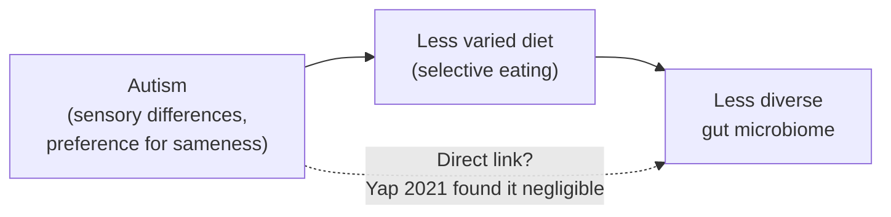

# Chapter 13: Autism, ADHD, and the Gut

## Summary

Autism and ADHD are neurodevelopmental differences: ways a brain develops and works, not diseases to fix. This chapter looks at what the gut-brain research actually shows. Autistic children have gut symptoms such as constipation and belly pain more often than other children, and those symptoms are real health problems worth treating. But headlines claiming that gut bacteria *cause* autism have not held up: a [large 2021 study](https://pubmed.ncbi.nlm.nih.gov/34767757/) found that differences in diet, often linked to selective eating, explained most of the microbiome differences. You'll learn how confounders, open-label trials, placebo controls, and sample size shape what a study can prove, and why "cure" claims about autism and ADHD are both unsupported and harmful.

## Concepts Covered

1. Autism
2. ADHD
3. Neurodiversity
4. Identity-First Language
5. GI Symptoms in Autism
6. Selective Eating
7. Interoceptive Differences
8. Diet as Confounder
9. Maternal Immune Activation
10. Open-Label Trial
11. Placebo-Controlled Trial
12. Sample Size
13. Microbiota Transfer Therapy
14. Harmful Cure Claims

## Prerequisites

- [Chapter 3: Meet the Microbiome](../03-meet-the-microbiome/index.md) (microbial diversity, correlation vs causation)
- [Chapter 10: IBS and Disorders of Gut-Brain Interaction](../10-ibs-and-dgbi/index.md) (the placebo response)
- [Chapter 11: Anxiety, Depression, and the Gut](../11-anxiety-depression-gut/index.md) (confounding variables)

!!! mascot-welcome "A chapter about real people, so let's be careful"
    { class="mascot-admonition-img" }
    Some of you reading this are autistic or have ADHD, and some of you love someone who is. This chapter is about a real health issue (gut problems are common and treatable) and about a lot of overblown headlines. My goal is to help you sort the two, with respect for the people the research is about.

## 13.1 A Headline, and a Boy Named Leo

A few years ago, you could find headlines suggesting that gut bacteria might "cause" autism, and posts promising that changing the microbiome could "reverse" it. Then, in 2021, a team in Australia published a large, careful study in the journal *Cell* with a much less dramatic conclusion: the microbiome differences they found seemed to be explained mostly by differences in what children ate, not by autism itself.

Meet Leo. Leo is 12, autistic, and the kind of person who can tell you every stop on three different subway lines. (Leo is a fictional character, like everyone in this book's cases.) For months, Leo has been having a hard time: he wakes up at night, he's more irritable after school, and he has started pressing his stomach against the edge of the kitchen table. Leo talks, but describing what's going on inside his body is hard for him. His parents eventually figure out, with his doctor's help, that Leo has been badly constipated. Treating it doesn't change who Leo is. It just means his stomach stops hurting.

Sam has a connection to this topic too. His younger cousin Nico, who is 10, has ADHD. Sam's older cousin, the one who posts about supplements, recently shared a video claiming that ADHD is "caused by sugar and a toxic gut." Sam isn't buying it, but he wants to know what the evidence actually says. So do we.

## 13.2 Autism, ADHD, and Neurodiversity

Before we can talk about the gut, we need to be clear about what autism and ADHD are, and what they aren't.

**Autism** is a lifelong neurodevelopmental difference that affects how a person communicates and interacts with others, processes sensory information, and experiences the world, often including focused interests and repetitive behaviors. [The National Institute of Mental Health (NIMH)](https://www.nimh.nih.gov/health/topics/autism-spectrum-disorders-asd) describes autism as affecting how people interact, communicate, learn, and behave, with signs that generally appear in the first two years of life. It's called a "spectrum" because autistic people have a wide range of characteristics, needs, strengths, and challenges. NIMH lists strengths that many autistic people have, such as learning things in detail, remembering information for long periods, and excelling in areas like math, science, music, or art. Some autistic people need a lot of daily support; others need little.

How many people are autistic? According to the Centers for Disease Control and Prevention (CDC) Autism and Developmental Disabilities Monitoring Network, about 1 in 31 eight-year-olds (32.2 per 1,000) had been identified as autistic in 2022, across 16 US sites, in a [report published in 2025](https://pubmed.ncbi.nlm.nih.gov/40232988/). Autism was identified about 3.4 times as often in boys as in girls. The estimate was higher than in earlier years, and the report points to increased identification, especially among very young children and groups that were previously under-identified.

**ADHD** (attention-deficit/hyperactivity disorder) is a neurodevelopmental condition involving ongoing patterns of inattention, hyperactivity, and/or impulsivity that show up in more than one setting and affect daily life. [NIMH describes the three patterns](https://www.nimh.nih.gov/health/topics/attention-deficit-hyperactivity-disorder-adhd): trouble staying focused and organized; moving, fidgeting, or talking a lot; and acting quickly without pausing. Everyone does these things sometimes. For a person with ADHD, they're frequent, start in childhood, and happen across settings like school and home. According to the CDC, [about 7 million US children aged 3 to 17 (11.7%) had a current ADHD diagnosis in 2024](https://www.cdc.gov/adhd/data/index.html), based on a national parent survey. NIMH says researchers aren't sure what causes ADHD, but many studies suggest genes play a large role.

What causes autism? NIMH says researchers don't know the primary causes, but studies suggest that genes and aspects of the environment before birth may affect development. Factors linked to a higher likelihood include having an autistic sibling, older parents, certain genetic conditions, and very low birth weight. None of these is a "cause" by itself, and gut bacteria are not on the list.

| | Autism | ADHD |
|---|---|---|
| What it is | Neurodevelopmental difference in communication, social interaction, sensory processing, and patterns of interest and behavior | Neurodevelopmental condition involving inattention, hyperactivity, and/or impulsivity |
| When it starts | Signs usually appear in early childhood | Symptoms begin in childhood |
| How common (US) | About 1 in 31 eight-year-olds identified (2022) | About 11.7% of children aged 3 to 17 with a current diagnosis (2024) |
| Main known influences | Genes and early development (NIMH) | Genes play a large role (NIMH) |
| Caused by gut bacteria? | No evidence that it is | No evidence that it is |

### A different way to think about brains

**Neurodiversity** is the idea that natural variation in how human brains develop and work, including autism and ADHD, is part of normal human diversity, so the goal is understanding, support, and accommodation rather than cure. Think of it like handedness. Left-handed people were once forced to write with their right hands, as if left-handedness were a defect. Today we see it as a difference that needs the right tools (left-handed scissors, a different desk), not a problem to fix.

The neurodiversity view doesn't mean autistic people or people with ADHD never struggle or never need help. Many face real challenges, and many have co-occurring health conditions, including gut problems, sleep problems, anxiety, and depression, that deserve good care. The key is to separate the *person and their way of thinking* from the *health problems* that can make their life harder. That separation is the whole spirit of this chapter.

### Words matter: identity-first language

**Identity-first language** is a way of talking about a group that puts the identity first, such as "autistic person" instead of "person with autism," often preferred because many autistic people see autism as a core part of who they are rather than something they carry. This book uses identity-first language for autism by default.

Why? A 2021 commentary by [Bottema-Beutel and colleagues](https://pubmed.ncbi.nlm.nih.gov/36601265/) in the journal *Autism in Adulthood*, drawing largely on writing by autistic scholars, describes how language can treat autism as something bad that should be fixed. They suggest neutral alternatives, such as "focused interests" instead of "special interests," and "increased likelihood of autism" instead of "at risk for autism," and they recommend avoiding talk of autism as a "burden."

People don't all agree, though. A 2016 UK survey of 3,470 people by [Kenny and colleagues](https://pubmed.ncbi.nlm.nih.gov/26134030/) found that "autistic" was endorsed by many autistic adults and parents but by fewer professionals, and that no single term was preferred by everyone. The best rule: when talking about a specific person, use the words they prefer. You'll also notice this chapter avoids phrases like "suffers from autism" or "recovered from autism."

!!! mascot-thinking "Two separate questions"
    { class="mascot-admonition-img" }
    Whenever you read about autism and the gut, I want you to split it into two questions. Question one: "Does this person have a gut problem that's hurting them?" Question two: "Does the gut cause autism?" The first is a health question with good answers. The second has a lot of hype attached.

## 13.3 Real Gut Problems, Worth Treating

Here's a finding that has held up well. **GI symptoms in autism** refers to the higher rate of digestive problems, such as constipation, diarrhea, and belly pain, reported in autistic children compared with non-autistic children; these are real health issues that deserve diagnosis and treatment, separate from autism itself.

The best summary comes from a 2014 meta-analysis (a study that pools results from many studies) by [McElhanon and colleagues](https://pubmed.ncbi.nlm.nih.gov/24777214/) in the journal *Pediatrics*. They combined 15 studies that compared autistic children with other children. Here's what they found, as odds ratios. (An odds ratio compares the odds of something in one group with the odds in another; 1.0 means no difference.)

| Symptom | Odds ratio (autistic vs comparison children) |
|---|---|
| General GI symptoms | 4.42 |
| Constipation | 3.86 |
| Diarrhea | 3.63 |
| Abdominal pain | 2.45 |

So autistic children had roughly four times the odds of general GI symptoms. That's a big difference. But notice what the authors were careful to say: the studies varied a lot in how they measured symptoms, and the analysis could not tell *why* the symptoms were more common. They named diet restrictions as one possible factor that future research should explore.

!!! hype-strong "Hype Meter: \"Autistic children have more gut symptoms on average\""
    
StrongModeratePreliminaryHype

    **Verdict: Strong (as an association).** A 2014 meta-analysis of 15 comparison studies found that autistic children had higher odds of general GI symptoms (about 4.4 times), constipation, diarrhea, and belly pain. The link is consistent across studies, though the size varies and the causes are not known. This grade is about the *association*; it does not mean the gut causes autism.
    **What would change the grade:** Very little would undo the association. Large studies with standard symptom measures would pin down how big it is and why it happens.

Why does this matter? Because gut pain is painful. Constipation can cause belly pain, poor sleep, and a bad mood in anyone. When doctors and families recognize gut problems in autistic children, they can treat them with the same tools they use for other children. A 2010 set of expert recommendations in *Pediatrics*, led by Buie, concluded that autistic children with GI problems can benefit from [adapting the standard pediatric guidelines for evaluating](https://pubmed.ncbi.nlm.nih.gov/20048084/) belly pain, chronic constipation, and reflux.

## 13.4 Why Gut Pain Can Be Hard to See

If autistic children have more gut problems, why do they sometimes go unnoticed for months, like Leo's? Two big reasons: how people sense their own bodies, and how they communicate about it.

### Sensing the inside of the body

You have senses for the outside world (sight, hearing, touch) and also senses for the inside. That inner sense, called interoception, is how you notice hunger, fullness, a full bladder, a racing heart, or a stomachache. You learned in [Chapter 2](../02-vagus-highway/index.md) that most vagus nerve fibers carry signals from the body up to the brain; interoception is what the brain makes of signals like those.

**Interoceptive differences** are differences in how a person notices, interprets, or reports signals from inside the body, such as hunger, pain, or the need to use the bathroom. A 2016 review by [DuBois and colleagues](https://pubmed.ncbi.nlm.nih.gov/27269967/) found that interoception is atypical in autism on average, with a slight tendency toward *less* awareness of internal signals, but the direction and size of the difference vary a lot from person to person. Some autistic people may notice internal signals less; others may find them overwhelming.

Picture two smoke alarms. One is set to go off at the faintest wisp of smoke, and one only sounds when the kitchen is already full of it. Neither is "broken," but if you live with the second one, you need other ways to catch a small fire early.

### Communicating about pain

Even when someone feels pain, putting it into words can be hard. Some autistic people speak fluently but find it hard to describe inner sensations on the spot. Some communicate using typing, picture boards, or speech-generating devices. Some show discomfort through behavior: sleep changes, irritability, pressing on the belly, or new repetitive movements. The 2010 Buie recommendations noted that autistic children with gut disorders may show their discomfort through changes in behavior.

That's why caregivers and doctors are encouraged to ask, when behavior changes suddenly, "Could something be hurting?" A change in behavior is information, not just a "behavior problem."

### Selective eating

Many autistic people have strong food preferences. **Selective eating** is eating a limited range of foods, often because of sensitivity to taste, texture, smell, or appearance, or a strong need for sameness; it is more common in autistic children. A 2013 meta-analysis of 17 studies by [Sharp and colleagues](https://pubmed.ncbi.nlm.nih.gov/23371510/) found that autistic children had about five times the odds of feeding problems compared with other children (odds ratio 5.11), and lower average intake of calcium and protein.

Selective eating isn't stubbornness. For someone with strong sensory responses, a new texture can feel truly unbearable, the way a fork scraping a plate feels to some people. But a narrow diet can sometimes mean less fiber, which can contribute to constipation, and it changes what gut bacteria get to eat. Hold on to that idea. It turns out to be the key to the next section.

## 13.5 The Microbiome Question: Diet as Confounder

Over the past two decades, many small studies reported that the gut microbiomes of autistic children looked different from those of non-autistic children. It was tempting to read an arrow from microbes to autism. But remember the rule from [Chapter 3](../03-meet-the-microbiome/index.md): correlation is not causation. And remember from [Chapter 11](../11-anxiety-depression-gut/index.md) that a confounding variable is a third factor that affects both things you're measuring.

Here's an everyday example. Ice cream sales and sunburns rise together. Ice cream doesn't cause sunburns; summer weather drives both. Now apply that to the microbiome.

**Diet as confounder** is the idea that differences in what people eat can create an apparent link between a condition and the gut microbiome, because diet shapes the microbiome and may also differ between groups for reasons related to the condition. In autism research, if autistic children on average eat a narrower range of foods (selective eating), and diet shapes gut bacteria, then autistic children will have different gut bacteria on average, even if autism itself has no direct effect on the microbiome.

### The 2021 study that changed the conversation

In 2021, [Yap and colleagues](https://pubmed.ncbi.nlm.nih.gov/34767757/) published the study mentioned in this chapter's opening. They analyzed stool samples from 247 children and teens, from the Australian Autism Biobank and the Queensland Twin Adolescent Brain project, using metagenomics (reading all the microbial DNA in a sample). Crucially, they also collected detailed information on diet, age, stool consistency, and other factors.

Their main findings:

- They found **negligible direct associations** between an autism diagnosis and the gut microbiome.
- Instead, the data fit a chain: autism-related restricted interests were linked to a **less diverse diet**, which was linked to **less diverse gut bacteria** and looser stools.
- Their study had enough data to detect microbiome links with things like age, diet, and stool consistency, so the missing autism link was not just because the study was too small.

The authors concluded that microbiome differences in autism may reflect dietary preferences, and they explicitly cautioned against claims that the microbiome drives autism.

### A second look from another angle

Science moves forward by checking results in different ways. In 2023, [Morton and colleagues](https://pubmed.ncbi.nlm.nih.gov/37365313/) pooled 10 microbiome data sets plus 15 other data sets (diet, metabolism, immune markers, brain gene activity) in *Nature Neuroscience*. They did find autism-linked microbial and chemical patterns, and those patterns were associated with restrictive diets and inflammation markers. But here's the telling detail: the pattern showed up when autistic children were compared with unrelated children matched by age and sex, and **did not** show up when autistic children were compared with their own siblings, who share their home, family meals, and much of their environment.

That's what you'd expect if shared environment and diet, not autism itself, explained much of the difference. Neither study shows that microbes cause autism. Together, they make diet a leading suspect for why the microbiomes differ.

The debate isn't over, though. In 2024, Su and colleagues in Hong Kong [sequenced stool samples from 1,627 children aged 1 to 13](https://pubmed.ncbi.nlm.nih.gov/38977906/) in *Nature Microbiology* and reported many microbial differences between autistic and non-autistic children, including in bacteria, fungi, and viruses. That study was larger than Yap's. But it was also observational: it took one snapshot of stool, so it can't show which came first or rule out every difference in diet and daily life. Bigger studies make a difference easier to detect. They don't, by themselves, show what caused it.

In the simulation below, you'll be the detective. Two groups of simulated children have different average microbiome diversity scores. Your job is to find out why.

#### Diagram: Confounder Detective
<iframe src="../../sims/ch13-confounder-detective/main.html" height="582px" width="100%" scrolling="no"></iframe>

[Open the Confounder Detective fullscreen](../../sims/ch13-confounder-detective/main.html){ .md-button .md-button--primary }

MicroSim specification: Confounder Detective

Type: microsim
**sim-id:** ch13-confounder-detective 
**Library:** p5.js 
**Status:** Implemented 
**Bloom Level:** Analyze 
**Bloom Verb:** differentiate 
**Learning Objective:** The learner will identify how a confounding variable (diet variety) can create an apparent difference in microbiome diversity between an autistic group and a comparison group, and distinguish a confounder from variables that are balanced between groups.

**Canvas:** 460 px drawing area plus 120 px controls (iframe 582 px); responsive to about 380 px wide.

**Controls:** New sample button; Color dots by select (None; Diet variety; Age; Recent antibiotics); Account for checkboxes (Diet variety; Age; Antibiotics).

**Rules:** 40 simulated children per group. Microbiome diversity depends on diet variety, age, and recent antibiotics, plus random noise. Group membership has no direct effect. The autistic group has lower average diet variety; age and antibiotic use are balanced between groups. Accounting for variables uses a linear regression and shows adjusted scores and the adjusted group difference.

**Feedback:** Group means, the raw and adjusted differences in points, and a status message explaining which variables changed the difference.

**Provenance:** Section 13.5 (Yap et al. 2021; Morton et al. 2023). All data are simulated; the model builds in "no direct effect" to teach confounding, not to report real effect sizes.

Start with **Color dots by: None** and look at the gap between the two groups' average lines. Now color the dots by **Age**, then by **Recent antibiotics**. Do the colors line up with the gap? Then color by **Diet variety**: you'll see that the low-diversity dots are mostly the children who eat fewer kinds of food, and there are more of those in the autistic group.

Next, check the **Account for** boxes one at a time. Accounting for age or antibiotics barely changes the gap, because those are spread evenly across both groups. Accounting for **Diet variety** shrinks the gap to nearly zero. Press **New sample** a few times: the leftover difference bounces around zero just from chance, which is a good reminder of why sample size matters.

!!! model-limits "What this model leaves out"
    - The data are simulated, and the model was built so autism has no direct effect. Real studies have to *discover* whether there's a direct effect, and they measure diet imperfectly.
    - Real microbiomes have hundreds of species; a single "diversity score" hides most of that complexity.
    - Real diets differ in many ways (fiber, variety, specific foods, food textures), not one number.
    - The sim shows only three hidden variables. Real studies must consider many more, such as medications, sleep, stool consistency, and family environment.
    - "Accounting for" a variable with a statistical model is useful but not perfect; it can't fix variables nobody measured.

## 13.6 What Mice Can and Can't Tell Us

Some of the strongest-sounding evidence for a gut-autism link comes from mice. Here's what it is, and why we keep it in its lane.

**Maternal immune activation** (MIA) is a strong immune response in a pregnant animal or person, such as from an infection; in research, it's usually triggered on purpose in pregnant mice to study how it affects the offspring's development. In mice, offspring of mothers given MIA show behaviors that researchers label "autism-like," such as differences in communication-related, repetitive, anxiety-like, and sensorimotor behaviors.

In a well-known 2013 study in *Cell*, [Hsiao and colleagues](https://pubmed.ncbi.nlm.nih.gov/24315484/) found that MIA mouse offspring had leaky gut barriers and altered gut microbes. When the researchers gave these mice a human gut bacterium, *Bacteroides fragilis*, the gut barrier improved and some of the behaviors changed. They also found a microbe-linked chemical in the blood that, when given to normal mice, caused some behavior changes.

This is clever science, and it shows that in mice, gut microbes can affect behavior-related traits. But it is not evidence about autistic people, for several reasons:

- **A mouse "autism-like behavior" is not autism.** Autism is defined by human communication, social experience, sensory processing, and patterns of interest. Mice can model small pieces of biology, not a human identity.
- **The trigger was artificial.** The immune activation was caused on purpose in the lab, so it doesn't tell us whether anything similar happens in people.
- **Mouse results often don't carry over.** As Chapter 1 noted, many findings in mice are never confirmed in people.

Whether maternal immune activation plays any role in human autism is still an open research question. For this chapter, the takeaway is simple: mouse results are a reason to ask questions, not a reason to change how anyone treats an autistic child.

## 13.7 Reading Treatment Studies: Open Labels, Placebos, and Sample Size

Suppose someone claims a treatment helps. How do you judge it? Three features of a study design matter enormously.

An **open-label trial** is a study in which participants, families, and researchers all know who is getting the treatment; there's usually no placebo group, so improvements may come from expectations, extra attention, or time passing rather than the treatment. Think of tasting two sodas when you can see the labels. Your opinion is shaped by what you expect.

A **placebo-controlled trial** is a study that compares the real treatment with a look-alike dummy treatment (a placebo), ideally with assignment by chance and with neither participants nor researchers knowing who got which (double-blind), so that expectation effects are the same in both groups. You learned about the placebo response in [Chapter 10](../10-ibs-and-dgbi/index.md). It's powerful, especially for outcomes rated by people who know what was given.

**Sample size** is the number of participants in a study; small samples give results that swing more by chance and can't detect uncommon side effects, so a finding in 18 people is a hint, while a finding in hundreds or thousands is much more reliable. Flip a coin 10 times and getting 7 heads isn't surprising. Flip it 1,000 times and getting 700 heads would be shocking. Bigger samples let chance even out.

### The microbiota transfer therapy studies

**Microbiota transfer therapy** (MTT) is an experimental treatment protocol in which a person receives antibiotics, a bowel cleanse, and stomach-acid medicine, followed by repeated doses of processed stool from healthy donors (a fecal microbiota transplant) to try to replace their gut microbes. Fecal microbiota transplants are covered in more detail in [Chapter 17](../17-medicine-gut-brain-axis/index.md).

In 2017, [Kang and colleagues](https://pubmed.ncbi.nlm.nih.gov/28122648/) reported a small open-label trial of MTT in 18 autistic children aged 7 to 16 who all had moderate to severe GI problems. The protocol was long: 2 weeks of an antibiotic, a bowel-cleansing drink, a stomach-acid reducer, and then 7 to 8 weeks of daily donor-microbe doses. At the end of treatment, scores on a GI symptom scale were about 80% lower, with improvements in constipation, diarrhea, indigestion, and belly pain, and the improvement lasted at least 8 weeks. The researchers also reported changes on autism rating scales.

A 2019 follow-up of the same 18 children found that, two years later, GI symptom scores were still about 58% lower than at the start.

Those GI results are encouraging for the children's comfort and health. But look at what the design can and can't tell us.

!!! claim-box "How to read a gut-brain claim: the 2017 microbiota transfer therapy trial"
    | Question | This study |
    |---|---|
    | Mouse or human? | Human: 18 autistic children aged 7 to 16, all with moderate to severe GI problems. |
    | Correlation or cause? | It tested a treatment, but with no placebo group, so it can't separate the treatment's effect from expectations, attention, or time. Families and researchers knew everyone was treated, and the protocol bundled four parts (antibiotic, cleanse, acid reducer, donor microbes), so even if it helped, we can't tell which part did. |
    | How many? | Very small: 18 treated children. Twenty non-autistic children were measured only for comparison of their microbes, not as a treatment control. |
    | How long? | 10 weeks of treatment plus 8 weeks of follow-up, with a later 2-year follow-up of the same children. |
    | Who paid for it? | Mainly the Arizona Board of Regents, with extra funding from the Autism Research Institute and a Gordon and Betty Moore Foundation grant. |
    | Is something being sold? | Not to the public, but several authors had pending or approved patents on using fecal transplants or probiotics for conditions including autism, and some received research funding from or consulted for a company working on fecal microbiota treatments (Crestovo), as the paper discloses. |

The authors themselves called their study exploratory and said a double-blind, placebo-controlled trial was needed. What happened when one was done?

In 2024, [Wan and colleagues](https://pmc.ncbi.nlm.nih.gov/articles/PMC11347384/) reported a randomized, double-blind, placebo-controlled trial of oral fecal microbiota transplants in 103 autistic children in China (52 got the transplant, 51 got a placebo). Their main measure was a social-behavior rating scale. Both groups improved, and the difference between the transplant and placebo groups on that main measure was **not** statistically significant. The authors noted a substantial placebo effect.

(One secondary measure of social skills did favor the transplant group, but the authors described such secondary results as preliminary, and the trial was reported only as a short research letter.) That's exactly the kind of result an open-label study can't reveal: when everyone knows they're being treated, part of the improvement can come from expectations.

It's also worth asking what the goal of a treatment should be. Many autistic people and their allies question whether lowering scores on autism rating scales should be a treatment goal at all, since autism is a part of who someone is. Relieving constipation, belly pain, and diarrhea, on the other hand, is a goal everyone can agree on. That's why some newer trials measure gut symptoms as their main outcome (see the At the Bedside section).

!!! hype-hype "Hype Meter: \"Fecal transplants cure autism\""
    
StrongModeratePreliminaryHype

    **Verdict: Hype.** The best-known study treated just 18 autistic children with GI problems in an open-label trial with no placebo group; GI symptoms improved, but the design can't show cause. A 2024 placebo-controlled trial of 103 autistic children found no significant difference from placebo on its main behavior measure. And autism is a lifelong neurodevelopmental difference, not a disease to cure.
    **What would change the grade:** Nothing would make "cure" the right word. For the separate question of whether microbiome treatments can ease *GI symptoms* in autistic people, large placebo-controlled trials with gut symptoms as the main outcome would give a real answer; right now that question is Preliminary.

!!! mascot-encourage "This part takes practice"
    { class="mascot-admonition-img" }
    Open-label, placebo-controlled, sample size, bundled treatments: that's a lot of design vocabulary at once. If you remember just one question, make it this: "Compared with what?" An improvement only means something if a similar group that didn't get the treatment improved less.

## 13.8 When "Cure" Claims Cause Harm

Autism and ADHD attract a lot of products and programs that promise a cure. **Harmful cure claims** are promises that a product, diet, supplement, or procedure can cure or reverse autism or ADHD; they're unsupported by evidence and can cause harm through risky treatments, wasted money and time, missed care for real health problems, and the message that neurodivergent people need to be fixed.

Here's how harm can happen:

- **Physical risk.** Some "gut-healing" protocols involve antibiotics, bowel cleanses, or homemade fecal transplants. These are real medical interventions with real risks. The Kang trial was run under FDA oversight as an investigational treatment. Outside such oversight, things can go badly wrong: in 2019, [the FDA reported](https://www.fda.gov/safety/medical-product-safety-information/fecal-microbiota-transplantation-safety-communication-risk-serious-adverse-reactions-due) that two adults with weakened immune systems developed serious infections from drug-resistant *E. coli* after receiving investigational fecal transplants from the same donor, and one of them died.
- **Restrictive diets.** Cutting out food groups can be especially risky for children who already eat a limited range of foods. Remember that autistic children on average already have lower calcium and protein intake.
- **Missed care.** Money and hope spent on an unproven "cure" can delay treatment for problems that do have good treatments, like constipation, sleep problems, or anxiety.
- **The message.** Constant talk of "curing" or "recovering from" autism tells autistic people that who they are is a disease. That message can hurt self-esteem and mental health.

!!! hype-hype "Hype Meter: \"Gut bacteria cause autism\""
    
StrongModeratePreliminaryHype

    **Verdict: Hype.** One of the most carefully controlled human studies (247 children, 2021) found negligible direct links between autism and the microbiome once diet was considered, and a pooled analysis found autism-linked microbial patterns disappeared in sibling comparisons. The strongest causal evidence comes from mouse models, which can't capture what autism is. NIMH points to genes and early development, not gut bacteria.
    **What would change the grade:** Large studies that follow babies from birth, measure diet carefully, and show microbiome differences appearing *before* any signs of autism, replicated in several countries, would be needed to even reach Preliminary.

!!! mascot-warning "Watch for the slide from 'gut' to 'cure'"
    { class="mascot-admonition-img" }
    A common trick is to start with a true fact ("autistic kids have more constipation") and slide to a false one ("so fixing the gut fixes autism"). The first is a reason to treat constipation. It isn't a reason to believe the second.

## 13.9 ADHD and the Gut

Compared with autism, research on ADHD and the gut is younger and thinner.

A 2025 systematic review by [Dias and colleagues](https://pubmed.ncbi.nlm.nih.gov/41075498/) found 14 studies on the gut microbiome in ADHD, with 1,319 participants, mostly children and teens aged 4 to 18, from Europe and East Asia. Some studies reported differences in particular bacteria (for example, less of one group called *Faecalibacterium* in some studies), but results on overall microbial diversity were inconclusive. As with autism, these are correlations, and diet, medications, sleep, and other factors could explain differences. Nobody has shown that gut bacteria cause ADHD.

What about sugar? The idea that sugar causes hyperactivity is one of the most widely believed food myths. In a 1995 meta-analysis in *JAMA*, [Wolraich and colleagues](https://pubmed.ncbi.nlm.nih.gov/7474248/) pooled 23 studies in which children were given either sugar or an artificial sweetener, with neither the children, their parents, nor the researchers knowing which. They found that sugar did not affect children's behavior or thinking. The authors suggested that parents' strong belief might come from expectation and from the settings where kids eat sugar (birthday parties are exciting with or without cake), while noting that a small effect, or effects in some individual children, could not be completely ruled out.

That's a good example of why blinding matters. If parents know their child just had sugar, their expectations can color what they see. Only a test where nobody knows who got sugar can separate expectation from a real effect.

So when Sam's older cousin posts that ADHD is "caused by sugar and a toxic gut," Sam can now answer: NIMH says genes play a large role in ADHD, blinded studies don't support the sugar idea, and gut microbiome studies in ADHD are small and inconsistent. Nico deserves good food, good sleep, and a comfortable gut like any kid. That's about health, not about "fixing" ADHD.

## 13.10 Care That Respects the Person

So what *does* the evidence support? It supports treating gut problems in autistic people and people with ADHD the same careful way we'd treat them in anyone, with extra attention to communication and sensory needs.

That might include:

- **Taking behavior changes seriously** as possible signs of pain, as the Buie recommendations suggest.
- **Using standard, proven approaches** for constipation, reflux, and belly pain, chosen by the care team.
- **Working with feeding specialists or dietitians** who respect sensory needs, rather than forcing foods.
- **Adjusting the doctor visit** with clear explanations, visual schedules, or extra time.
- **Watching mental health.** Anxiety and depression often co-occur with ADHD, according to NIMH, and NIMH is investing in research for autistic people with co-occurring mental health conditions. Chronic gut pain can add stress on top of that.

!!! living-with "If you are struggling right now"
    If you are thinking about suicide or are in crisis, call or text **988** to reach the 988 Suicide & Crisis Lifeline (in the US), or go to the nearest emergency room. Outside the US, you can find a helpline at [findahelpline.com](https://findahelpline.com/). You can also talk to a parent, school counselor, or doctor.

!!! families "For families"
    If your child is autistic or has ADHD and has gut symptoms, it's okay to push for those symptoms to be checked; they're a health issue, not "just part of autism." A sudden change in sleep, mood, or behavior can be a clue that something hurts, so it's worth writing down when changes happen and bringing notes to the doctor. Be cautious about programs that promise to "heal the gut" and "recover" your child, especially if they sell supplements, tests, or restrictive diets, and talk with your child's doctor before trying anything. Treating constipation or reflux can make your child more comfortable without changing who they are.

!!! living-with "If you're going through this"
    If you're autistic or have ADHD and your stomach often hurts, you deserve care for that, just like anyone else. It's okay if it's hard to describe; you can point, type, rate pain with numbers or pictures, or bring notes to an appointment. You don't need to change who you are to feel better physically. If someone tells you a product will "fix" your autism or ADHD, you can say no and ask your care team what the evidence shows instead.

## At the Bedside: When a Stomachache Looks Like Something Else

!!! note "Meet the patient (fictional)"
    Leo is 12 and autistic. He loves maps and transit systems and uses speech for most things, though describing body sensations is hard for him. Over three months, his parents notice that he wakes up at night, melts down more often after school, eats even fewer foods than usual, and presses his belly against the table. His school reports he seems distracted and upset.

**What the doctor checks:** Leo's pediatrician asks about bowel habits, using a picture chart of stool types that Leo can point to, and asks his parents about diet, sleep, and when the changes started. She examines his belly gently, explaining each step first, and finds signs of a lot of stool in his colon. She looks for warning signs that would need more testing (such as blood in the stool, weight loss, or vomiting) and finds none.

**Connecting the signals:** The night waking, irritability, and belly pressing started around the same time as harder, less frequent stools. Leo's selective eating has narrowed further, which may mean less fiber and fluid. His interoceptive and communication differences make it harder for him to say "my stomach hurts," so the pain showed up as changes in sleep and behavior instead.

**Diagnosis:** Functional constipation (constipation without an underlying disease).

**Why it happens:** Constipation is common in autistic children, as the 2014 meta-analysis showed, and a narrow diet may contribute. When stool builds up, stretch signals from the colon travel to the brain and can cause pain and discomfort. For Leo, those signals were real but hard to name.

**The mind-body side:** Leo's parents were worried his "behavior was getting worse." The care team helped them reframe it: Leo was communicating pain. The doctor tells the family clearly that treating constipation is about Leo's comfort and health, not about changing who he is. An occupational therapist suggests sensory-friendly ways to try new foods slowly, at Leo's pace. His parents work with him on a simple visual chart for rating stomach pain, so he has a tool to use next time.

**Treatment today:** The pediatrician recommends standard treatment for childhood constipation, which may include a medicine to soften stool, regular toilet routines, and gradual changes to fluids and fiber that work with Leo's food preferences. The family is told to follow the doctor's specific instructions rather than trying supplements or restrictive diets on their own. Within weeks, Leo is sleeping better and seems more like himself.

**What's new in research:** The Gut Bugs in Autism Trial in New Zealand, whose protocol was published in 2024 by [Tweedie-Cullen and colleagues](https://pubmed.ncbi.nlm.nih.gov/38320845/), plans to randomly assign 100 autistic teens and adults aged 16 to 45 with GI symptoms to receive either donor-microbe capsules or a placebo, with neither participants nor researchers knowing who gets which. Its main outcome is a GI symptom score at 6 weeks, a design focused on gut comfort and well-being. As of October 2026, its results had not been published, and the trial's University of Auckland study page still had no link to findings. **Evidence grade: Preliminary** for microbiome treatments as a way to ease GI symptoms in autistic people; this is an experimental approach, not standard care.

??? question "Your turn: reason through a variation"
    Nico, Sam's 10-year-old cousin with ADHD, starts complaining of stomachaches most mornings before school, but never on weekends. His older cousin says it's "leaky gut" and recommends a supplement. How would you reason about this?

    **Answer:** The weekday-only pattern suggests something linked to school, such as worry, rushing breakfast, or skipping the bathroom in the morning. Stress can change gut sensations, as you learned in Chapter 7. ADHD often co-occurs with anxiety, so a doctor might ask about school stress as well as bowel habits. "Leaky gut" is not a diagnosis that explains this pattern, and a supplement isn't a substitute for a checkup. The right step is for Nico's parents to talk to his doctor, who can check for constipation or other causes and help with any school-related stress.

*This is a fictional teaching case. It is not medical advice. If you or someone you know has symptoms like these, talk to a doctor.*

## Common Misconceptions

**Myth:** Autism is a disease that needs to be cured.  
**Reality:** Autism is a lifelong neurodevelopmental difference. Autistic people may need support and may have health conditions worth treating, but autism itself is part of who they are, not an illness to remove.

**Myth:** Gut problems are just part of autism, so there's nothing to do about them.  
**Reality:** GI symptoms are more common in autistic children, but they're separate health problems. Constipation, belly pain, and reflux can be treated with the same standard approaches used for other children.

**Myth:** The 2017 microbiota transfer study proved fecal transplants are a treatment for autism.  
**Reality:** It was a small open-label study of 18 children with no placebo group. GI symptoms improved, but the design can't show cause, and a 2024 placebo-controlled trial of 103 children found no significant difference from placebo on its main behavior measure.

**Myth:** ADHD is caused by sugar or a bad diet.  
**Reality:** NIMH says genes play a large role in ADHD. A 1995 meta-analysis of 23 blinded studies found that sugar did not affect children's behavior or thinking.

**Myth:** Different gut bacteria in autistic kids prove that bacteria cause autism.  
**Reality:** A 2021 study of 247 children found that diet differences, linked to selective eating, explained most of the microbiome differences. Diet is a confounder.

## Your Gut Check

Test yourself. Try each one before you open the answer.

??? question "1. Claim Check: \"New research shows autism starts in the gut! Our probiotic blend helps kids recover. Thousands of happy parents!\""
    **Grade: Hype.** No human research shows that autism starts in the gut. One of the most carefully controlled studies (247 children) found that diet, not autism itself, explained most microbiome differences, and the strongest gut-behavior evidence comes from mouse models. "Recover" treats autism as a disease, and testimonials from parents are not controlled evidence, especially when a product is being sold. A careful version: "Autistic children have gut symptoms more often than other children, and those symptoms deserve standard medical care. There's no evidence that probiotics change autism."

??? question "2. Predict: A new study finds that autistic teens have lower microbial diversity than their non-autistic classmates. The researchers then compare autistic teens with their own non-autistic siblings who eat the same family meals. Predict what will happen to the difference, and explain why."
    The difference will probably shrink or disappear. Siblings share family meals, home environment, and many other exposures, so comparing with siblings removes much of the confounding from diet and environment. That's what Morton and colleagues found in 2023: autism-linked microbial patterns showed up in age- and sex-matched comparisons but not in sibling-matched ones. If a difference remained even among siblings with similar diets, that would be more interesting.

??? question "3. Explain: Why might an autistic child with constipation show it through sleep problems or irritability instead of saying \"my stomach hurts\"?"
    Many autistic people have interoceptive differences, meaning they may notice or interpret internal signals like pain differently, and some find it hard to describe body sensations in words, especially in the moment. The pain signals from a stretched colon are still real, so discomfort may come out as night waking, irritability, or pressing on the belly. Expert recommendations note that GI problems in autistic children may show up as behavior changes, so caregivers should ask whether something hurts.

??? question "4. Apply: A parent group shares a study where 12 children took a supplement for 8 weeks, and parents reported that 9 of them \"seemed calmer.\" Use the ideas of open-label trials, placebo control, and sample size to evaluate it."
    It's very small (12 children), so the result could easily be chance. Parents knew their children were taking the supplement, so their ratings could be shaped by expectation, the same effect the sugar researchers suspected behind parents' beliefs about sugar. There's no placebo group, so we can't tell whether children would have "seemed calmer" anyway over 8 weeks. A better study would randomly assign many more children to the supplement or a look-alike placebo, with neither parents nor researchers knowing which.

**5. Read the data.** In a 2014 meta-analysis of 15 studies (McElhanon et al., *Pediatrics*), researchers compared GI symptoms in autistic children and comparison children. Here are the pooled odds ratios:

| Symptom | Odds ratio |
|---|---|
| General GI symptoms | 4.42 |
| Constipation | 3.86 |
| Diarrhea | 3.63 |
| Abdominal pain | 2.45 |

??? question "5. What does this data show, and what can't it show?"
    It shows that autistic children had higher odds of every GI symptom measured, from about 2.5 times for belly pain to about 4.4 times for general GI symptoms. It can't show why: the studies were observational, varied a lot in methods, and couldn't separate causes such as diet, sensory differences, medications, or how symptoms were reported. It also can't tell you about any individual child, since many autistic children have no GI problems. A useful follow-up would follow autistic and non-autistic children over time with the same symptom checklist and detailed diet records, to see whether diet explains part of the difference.

## Exercises

### Remember

1. What does "identity-first language" mean? Give one example.

??? note "Answer"
    Identity-first language puts the identity first, such as "autistic person" instead of "person with autism." Many autistic people prefer it because they see autism as a core part of who they are, though preferences vary, so it's best to use the words a specific person prefers.

2. According to the 2014 meta-analysis, roughly how much higher were the odds of general GI symptoms in autistic children than in comparison children?

??? note "Answer"
    About 4.4 times higher (odds ratio 4.42), based on 15 studies.

### Understand

3. Explain what a confounding variable is, using diet and the microbiome in autism as your example.

??? note "Answer"
    A confounding variable is a third factor that affects both things being compared, creating a link that isn't direct. On average, autistic children eat a narrower range of foods (selective eating), and diet shapes gut bacteria. So autistic children have different microbiomes on average, even if autism itself doesn't directly affect the microbiome, as the 2021 Yap study suggested.

4. Explain why an open-label trial can't show that a treatment caused an improvement.

??? note "Answer"
    In an open-label trial, everyone knows who's being treated, and usually there's no placebo group for comparison. Improvements could come from expectations, extra attention, natural changes over time, or biased ratings by people who know about the treatment. Without a comparison group treated identically except for the real treatment, you can't separate those effects from the treatment's effect.

### Apply

5. Use the Confounder Detective. Record the group difference with nothing accounted for, then with only Age, only Antibiotics, and only Diet variety accounted for. Which variable is the confounder, and how can you tell? Press New sample three times and describe how the leftover difference changes.

6. A news headline says: "Scientists find gut bacteria differences in kids with ADHD." Write three questions you would ask about the study before believing that bacteria cause ADHD, using ideas from this chapter.

### Analyze

7. Compare the 2017 Kang open-label study (18 children) with the 2024 Wan placebo-controlled trial (103 children). For each, answer at least four of the six claim questions. Why might the open-label study have found improvements that the placebo-controlled trial didn't find relative to placebo?

8. The Hsiao 2013 mouse study and the Yap 2021 human study seem to point in different directions. Analyze what kind of question each can answer, and explain why a mouse result about "autism-like behaviors" can't settle whether gut bacteria cause autism in people.

### Evaluate

9. A clinic advertises a "gut restoration program" that "helps children recover from autism," using antibiotics, a restrictive diet, and supplements. Evaluate this program using evidence from this chapter, considering safety, evidence quality, and the message it sends to autistic people.

10. Some researchers measure autism rating scales as the main outcome of microbiome treatment trials; others measure GI symptoms. Evaluate the two choices. Which outcome better fits a neurodiversity-affirming approach, and why?

### Create

11. Design a study to test whether a microbiome treatment eases constipation in autistic teens. Describe your sample size, control group, blinding, main outcome, and how you would make participation comfortable for autistic participants (for example, communication and sensory needs).

12. Create a short, respectful guide (one page or a set of slides) for a pediatric clinic on "Recognizing gut pain in patients who communicate differently." Include at least three possible signs, two communication tools, and one sentence that explains why GI care is about comfort, not changing who someone is.

## Key Takeaways

- Autism and ADHD are neurodevelopmental differences, not diseases to fix. NIMH points to genes and early development, not gut bacteria, as the main known influences. Identity-first language ("autistic person") is this book's default, but individual preferences come first.
- GI symptoms such as constipation, diarrhea, and belly pain are more common in autistic children (about 4.4 times the odds of general GI symptoms in a 2014 meta-analysis). They're real health problems that deserve standard, respectful care.
- Interoceptive and communication differences can make gut pain harder to recognize, so behavior changes may be a sign that something hurts. Selective eating is common and can narrow the diet.
- Diet is a confounder: a 2021 study of 247 children found negligible direct links between autism and the microbiome once diet was considered, and patterns found in another analysis disappeared in sibling comparisons.
- Mouse studies of maternal immune activation show that microbes can affect behavior-related traits in mice, but mouse "autism-like behaviors" are not autism.
- Open-label trials, small sample sizes, and bundled treatments can't prove cause. The 2017 microbiota transfer study (18 children, no placebo) is not proof of a treatment, and a 2024 placebo-controlled trial found no significant difference from placebo on its main measure.
- Claims that the gut causes or cures autism or ADHD, or that sugar causes ADHD, are Hype, and harmful cure claims can lead to risky treatments and hurtful messages.

!!! mascot-celebration "You can separate a health problem from a headline!"
    { class="mascot-admonition-img" }
    You now know how to keep two questions apart: "Is this person's gut hurting?" and "Does the gut cause autism?" Next, in Chapter 14, we'll follow a different gut-brain mystery: the idea that Parkinson's disease might start in the gut for some people.

!!! note "Help us get this chapter right"
    This chapter was written with care, but it was not written by autistic people or people with ADHD, and you are the experts on your own lives. If you're autistic or have ADHD (or both) and something here feels off, from a word choice to a missing perspective, please tell us through the [Contact page](../../contact.md). We'll read every message and list confirmed changes on the Accuracy page.
