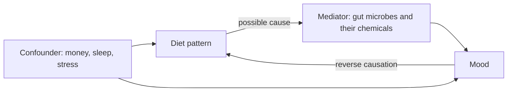
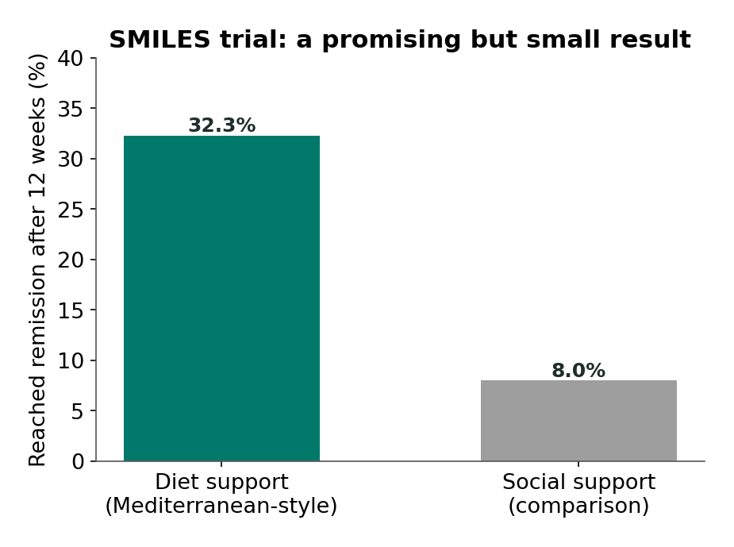

# Chapter 15: Food and Mood

## Summary

Headlines link food to mood almost every week, but most of those headlines come from studies that can only show that two things travel together, not that one causes the other. This chapter explains how researchers study whole dietary patterns, such as the Mediterranean diet and diets high in ultra-processed food, and what gut-brain pathways (fiber, fermented foods, and plant compounds called polyphenols) might connect food to the brain. You'll learn the difference between observational studies and randomized controlled trials, and how hidden factors like money, sleep, and existing low mood can create misleading links. Then you'll examine the real trials, including the SMILES trial, and see why diet may be a helpful add-on to depression care but never a replacement for it. Throughout, food is treated as nourishment, culture, and comfort, not as a moral test.

## Concepts Covered

1. Dietary Pattern
2. Mediterranean Diet
3. Ultra-Processed Food
4. Dietary Fiber Gap
5. Fermented Food
6. Polyphenol
7. Nutritional Psychiatry
8. Observational Study
9. Randomized Controlled Trial
10. SMILES Trial
11. Dose-Response Relationship
12. Healthy User Bias
13. Mediator Variable
14. Food Insecurity
15. Eating Disorder Risk

## Prerequisites

- [Chapter 3: Meet the Microbiome](../03-meet-the-microbiome/index.md) for gut microbes, diversity, and correlation versus cause
- [Chapter 6: Fiber, Fatty Acids, and the Blood-Brain Barrier](../06-fiber-fatty-acids-bbb/index.md) for how microbes turn fiber into short-chain fatty acids
- [Chapter 11: Anxiety, Depression, and the Gut](../11-anxiety-depression-gut/index.md) for depression and two-way gut-brain links
- [Chapter 13: Autism, ADHD, and the Gut](../13-autism-adhd-gut/index.md) for confounding variables

!!! mascot-welcome "What's on your plate, and what's in the study?"
    { class="mascot-admonition-img" }
    You eat several times a day, so food-and-mood headlines feel personal. This chapter won't hand you a menu. Instead, it gives you the tools to read a nutrition study like a scientist, so you can tell a real finding from a link that hidden factors created. Let's check the evidence.

## 15.1 Chips and Sadness: Which Came First?

Sam was scrolling on the bus after cross-country practice when a headline stopped him: "Ultra-processed food linked to depression." He looked down at the bag of chips in his hand. He thought about the week before his last big test, when he felt low, slept badly, and lived on vending machine snacks because cooking felt like too much. So which came first? Did the snacks make him feel low, or did feeling low make him reach for the snacks? (Sam is a fictional student who appears throughout this book.)

He texted Riya, who was in her grandmother's kitchen, learning to make her family's dal and rotis. "Does that mean your grandma's cooking makes you happy?" he wrote. Riya laughed. "It definitely makes me happy. But I don't think that's what the study means."

Both of them are asking a sharp scientific question. A link between food and mood could mean food affects mood, or mood affects food, or something else, like money, time, or sleep, affects both. This chapter is about telling those apart. By the end, you'll be able to read Sam's headline and know exactly what it can and can't tell him.

## 15.2 Thinking in Patterns, Not Single Foods

Start with an everyday comparison. If you wanted to know whether a soccer team is good, you wouldn't judge it by one player or one game. You'd look at how the whole team plays over a season. Nutrition researchers have learned to think the same way about food.

People don't eat single nutrients in isolation. They eat meals, made of many foods, in combinations that repeat over weeks and years. A **dietary pattern** is the overall combination of foods and drinks a person usually eats over time, studied as a whole instead of one food or nutrient at a time. Studying patterns helps because foods come in bundles. Someone who eats a lot of beans probably also eats differently in other ways, so looking at beans alone could be misleading.

The field that studies these links has a name. **Nutritional psychiatry** is the area of research that studies how diet and nutrition relate to mental health, including whether changing diet can help prevent or treat conditions like depression and anxiety. It's a young field. A 2020 analysis in the *BMJ* by [Firth and colleagues](https://pubmed.ncbi.nlm.nih.gov/32601102/) concluded that poor nutrition may contribute to low mood, but that the evidence is still developing and many questions remain open.

Before we go further, one important note about how this book talks about food. Every food can be part of a person's life, and food is also family, culture, celebration, and comfort. When researchers compare "diet quality," they are measuring patterns across large groups, not judging anyone's plate. This chapter never sorts foods into "good" and "bad," and it never talks about body size. Mood is the topic, and the question is always "what does the evidence show?"

!!! mascot-tip "Patterns beat single foods"
    { class="mascot-admonition-img" }
    When a post claims one food or one supplement will change your mood, remember that the research mostly studies whole patterns over weeks or years. A single food is one player, not the whole team.

## 15.3 Four Ingredients Researchers Watch

Researchers often describe dietary patterns using a few big features. Here are the ones that connect most directly to the gut-brain axis.

### The Mediterranean diet

The **Mediterranean diet** is a dietary pattern based on the traditional eating habits of countries around the Mediterranean Sea, rich in vegetables, fruits, whole grains, legumes (beans and lentils), nuts, olive oil, and fish, with fewer highly processed foods. There isn't one official version. In the SMILES trial (Section 15.6), for example, dietitians encouraged foods from 12 groups, including whole grains, vegetables, fruit, legumes, nuts, fish, and olive oil, with fewer refined cereals, fried and fast foods, processed meats, and sugary drinks.

The word "Mediterranean" can sound like it's about one culture's cuisine. It isn't really. Many food traditions, including Indian, Mexican, Ethiopian, and East Asian home cooking, are built on legumes, vegetables, whole grains, and spices. Riya's grandmother's dal, made from lentils, is packed with the same kinds of ingredients researchers count in Mediterranean-style scores.

### Ultra-processed food

The **ultra-processed food** label comes from the NOVA classification system, developed in 2009, which groups foods by how much industrial processing they go through. Ultra-processed foods are industrial formulations made mostly from substances extracted or derived from foods, often with additives such as flavors, colors, or emulsifiers that you wouldn't use in a home kitchen. Examples include many packaged snacks, sweetened drinks, and ready-to-eat products. The category is about processing, not about any single nutrient, and many people rely on these foods because they're affordable, quick, and shelf-stable.

### The fiber gap

You met fiber in [Chapter 6](../06-fiber-fatty-acids-bbb/index.md): the parts of plant foods that your own enzymes can't digest, which your gut microbes ferment into short-chain fatty acids. The **dietary fiber gap** is the difference between how much fiber people actually eat and how much dietary guidelines suggest.

| Measure | Amount | Source |
|---|---|---|
| Average US intake | About 16 grams a day (16.2 g, 2009 to 2010 national survey) | [Quagliani and Felt-Gunderson 2017](https://pubmed.ncbi.nlm.nih.gov/30202317/) |
| Suggested for girls 14 to 18 | About 25 grams a day | [Dietary Guidelines for Americans, 2020 to 2025](https://www.dietaryguidelines.gov/sites/default/files/2020-12/Dietary_Guidelines_for_Americans_2020-2025.pdf) |
| Suggested for boys 14 to 18 | About 31 grams a day | Dietary Guidelines for Americans, 2020 to 2025 |
| Share not meeting the goal | More than 90% of women and 97% of men | Dietary Guidelines for Americans, 2020 to 2025 |

The newest federal guidelines, the *[Dietary Guidelines for Americans, 2025 to 2030](https://cdn.realfood.gov/DGA.pdf)*, don't give a gram target. Instead, a "Gut Health" box says highly processed foods can disrupt the balance of the microbiome, while vegetables, fruits, fermented foods, and high-fiber foods support a diverse microbiome, "which may be beneficial for health." These numbers describe the whole population. They aren't a personal target, and people with some gut conditions, including some people with Crohn's disease like Riya, get different fiber advice from their care team.

### Fermented foods and polyphenols

**Fermented food** is food made by letting microbes such as bacteria or yeasts transform it, as in yogurt, kefir, kimchi, sauerkraut, miso, and many traditional foods like idli and dosa batter. In a 2021 Stanford study, [Wastyk and colleagues](https://pubmed.ncbi.nlm.nih.gov/34256014/) randomly assigned 36 healthy adults (18 per group) to eat more fermented foods or more fiber for 17 weeks. The fermented-food group had steadily rising gut microbe diversity and lower levels of several inflammation markers in the blood. That's a randomized experiment, which is a strength, but it was small, short, done in healthy adults, and it measured microbes and immune markers, **not mood**.

A **polyphenol** is one of a large family of natural chemical compounds made by plants, found in foods such as berries, grapes, onions, tea, and spices like turmeric, that may affect the body partly through the gut microbes that break them down. According to a 2021 review by [Chiu and colleagues](https://pmc.ncbi.nlm.nih.gov/articles/PMC8038706/), only about 5 to 10% of the polyphenols people eat are absorbed in the small intestine; roughly 90% reach the large intestine, where gut microbes break them into smaller compounds. That's why scientists think polyphenols and microbes may work as a team. Most of the brain-related evidence for polyphenols, though, comes from lab and animal studies.

The table below summarizes the four features and how they might connect to the gut-brain axis.

| Pattern feature | Possible gut-brain connection | Strength of evidence for mood |
|---|---|---|
| Mediterranean-style eating | More fiber, polyphenols, and olive oil, nuts, and fish; less inflammation | A few small trials (Section 15.6) |
| Ultra-processed food | Less fiber; additives might affect microbes | Associations only (Section 15.5) |
| Fiber | Microbes make short-chain fatty acids | Mostly animal and indirect human evidence |
| Fermented foods and polyphenols | Change microbe diversity and inflammation markers | Microbe and immune changes in people; mood not tested |

## 15.4 Two Ways to Study Food and Mood

Now for the most important tool in the chapter. Suppose you want to know whether eating more vegetables improves mood. There are two basic ways to find out.

**Way 1: Watch.** Ask thousands of people what they eat and how they feel, then see whether the two go together. An **observational study** is a study in which researchers measure what people already do (such as what they eat) and their health, without assigning anyone to change anything, and then look for links. Observational studies can be huge, cheap, and long, so they're great for spotting patterns.

**Way 2: Change one thing on purpose.** Take a group of people and use chance, like a coin flip, to decide who gets diet coaching and who doesn't. A **randomized controlled trial** (RCT) is an experiment in which participants are randomly assigned to receive a treatment or a comparison condition, so the groups start out alike on average, and any difference at the end can be credited to the treatment. Randomization is powerful because, on average, it balances everything, including things researchers didn't think to measure. In a small trial, chance can still leave the groups somewhat different.

This matters a lot in nutrition, because in an observational study, people who eat differently also tend to live differently. Three traps show up again and again.

**Trap 1: Confounding.** A confounding variable is a hidden third factor that affects both the thing you think is the cause and the outcome. Money is a classic example: families with more money can usually afford more fresh food **and** have less financial stress, which affects mood. Diet and mood would be linked even if food itself did nothing.

**Trap 2: Reverse causation.** Depression often changes appetite, energy, and motivation to cook. If low mood makes people eat more convenience foods, diet and mood are linked, but the arrow points from mood to food. The 2022 review of ultra-processed food by [Lane and colleagues](https://pubmed.ncbi.nlm.nih.gov/35807749/) noted that the link appeared to run in both directions, though most of its studies were snapshots that can't settle which way.

**Trap 3: Healthy user bias.** **Healthy user bias** is a distortion in observational studies that happens because people who choose one health-related behavior, such as following dietary advice, often also have many other health-related habits and advantages (more sleep, more exercise, regular checkups, less smoking), which make that behavior look more beneficial than it really is.

!!! mascot-thinking "Who chose the food?"
    { class="mascot-admonition-img" }
    My favorite question for any food study: who decided what people ate? If people chose for themselves, hidden factors can sneak in. If a coin flip decided, those hidden factors get spread evenly between the groups.

### Two more tools for reading diet studies

Observational researchers aren't helpless. They use clues that make a cause more or less believable.

A **dose-response relationship** is a pattern in which more of an exposure goes with a steadily larger effect, for example, a little more of a food linked with a little more of an outcome, and a lot more linked with a lot more. A dose-response pattern makes a causal story more believable, because it's what you'd expect if the exposure really mattered. But it isn't proof. A confounder that also comes in "doses," like income, can create the same smooth pattern.

A **mediator variable** is a factor that lies on the causal path between a cause and an outcome and helps explain **how** the cause produces its effect. For example, if fiber improved mood, gut microbes and the short-chain fatty acids they make could be mediators: fiber changes microbes, microbes make short-chain fatty acids, and those chemicals affect the brain. Notice the difference from a confounder. A confounder sits **outside** the path and affects both ends; a mediator sits **inside** the path, carrying the effect along. Mixing them up leads to wrong conclusions: if you "adjust away" a mediator, you can accidentally hide a real effect.

Here's a simple flowchart of the three ways a diet-mood link can arise. Each arrow means "affects."

## 15.5 Ultra-Processed Food and Mood: What the Studies Show

Let's return to Sam's headline. What do the studies actually show?

In 2022, Lane and colleagues combined 17 observational studies with 385,541 people. Most (15) were cross-sectional, meaning they measured diet and mood at one moment, and 2 were prospective, meaning they measured diet first and followed people forward. People who ate more ultra-processed food had higher odds of depression symptoms (an odds ratio of 1.44) and anxiety symptoms (1.48). In the two prospective studies, higher intake was linked to a 22% higher risk of later depression (a hazard ratio of 1.22).

In 2024, a [larger "umbrella review"](https://pubmed.ncbi.nlm.nih.gov/38418082/) in the *BMJ* by the same research group pulled together 45 pooled analyses covering nearly 10 million people. Ultra-processed food was linked to 32 of 45 health outcomes. Under their rules, the links with anxiety and common mental disorders counted as "convincing" evidence of an **association**. But when the team graded the **quality** of the evidence with a standard system called GRADE, those same mental health links were rated "low" quality. Across all 45 analyses, only 4 were rated moderate quality; 22 were low and 19 were very low.

How can evidence be "convincing" and "low quality" at once? "Convincing" is a statistical label: the link is backed by large numbers of people, is consistent across studies, and is very unlikely to be a statistical fluke. It doesn't mean the effect is big. "Low quality" means the studies' designs (mostly observational, often snapshots) can't rule out confounding or reverse causation. A link can be very real and still not tell you what causes what.

!!! hype-moderate "Hype Meter: "Eating lots of ultra-processed food is linked to depression""
    
StrongModeratePreliminaryHype

    **Verdict: Moderate.** (The stronger claim that ultra-processed food *causes* depression is not shown.) Large pooled analyses of observational studies (17 studies and 385,541 people in 2022; nearly 10 million people across a 2024 umbrella review) consistently link more ultra-processed food with more depression and anxiety symptoms. But most studies are snapshots, the evidence quality was rated low, money and stress can affect both diet and mood, and low mood can change what people eat. "Linked to" is accurate; "causes" is not shown.
    **What would change the grade:** Randomized trials that change ultra-processed food intake while keeping other things equal, and that measure mood over months, could upgrade the causal claim. Long prospective studies that carefully account for income, sleep, and earlier mood would also help.

## 15.6 Testing Diet in Trials: SMILES and Beyond

To get closer to cause, researchers need randomized trials. There aren't many, and they're hard to run, because you can't hide from people what they're eating.

### The SMILES trial

The **SMILES trial** (Supporting the Modification of lifestyle In Lowered Emotional States) was a 12-week randomized controlled trial, published in 2017 by [Felice Jacka and colleagues](https://pubmed.ncbi.nlm.nih.gov/28137247/) in Australia, that tested whether dietitian support toward a Mediterranean-style diet improved symptoms in adults with moderate to severe depression.

The researchers enrolled 67 adults with moderate to severe depression and randomly assigned them to one of two groups. One group (33 people) had seven sessions with a clinical dietitian, who helped them shift toward the 12 food groups described in Section 15.3. The comparison group (34 people) got "social support": friendly sessions with a trained person, on the same schedule and for the same length of time, but with no diet advice. Most participants (55 of 67) were already getting therapy, medication, or both, so diet support was an **add-on**, not a replacement for treatment.

The results: among people who had complete data at 12 weeks (31 in the diet group and 25 in the social support group), depression scores improved more in the diet group. Remission, meaning symptoms low enough to count as no longer depressed on the rating scale, happened in **32.3%** of the diet group (10 of 31) versus **8.0%** of the social support group (2 of 25).

*Source: Jacka et al. 2017, BMC Medicine. 67 adults were randomized; percentages are among the 56 who finished (31 and 25), and participants knew which group they were in.*

!!! claim-box "How to read a gut-brain claim: the SMILES trial"
    | Question | This study |
    |---|---|
    | Mouse or human? | Human: 67 adults with moderate to severe depression. |
    | Correlation or cause? | Cause, in principle: people were randomly assigned. But participants knew which group they were in (only the people rating their depression were blinded), which can affect results. |
    | How many? | Small: 67 enrolled, and only 56 had complete 12-week data (31 vs 25). |
    | How long? | 12 weeks. It can't show whether benefits last. |
    | Who paid for it? | Mainly the National Health and Medical Research Council of Australia. Woolworths (a supermarket chain) provided food vouchers, other companies donated small items, and Meat and Livestock Australia funded some blood tests; the paper says sponsors had no role in the design or analysis. Several authors reported other industry and foundation funding. |
    | Is something being sold? | No specific product. In a later paper (2022), the lead author disclosed that she has written two books for commercial publication and personally believes diet quality matters for mental health. |

The conclusion: SMILES is a promising, carefully designed early trial, and its result is striking. But it's small, short, not fully blinded, and limited to adults who mostly had other treatment too. One trial, no matter how exciting, needs to be repeated before anyone should rely on it.

### Other trials

Three other studies help put SMILES in context.

- **HELFIMED (2019).** [Parletta and colleagues](https://pubmed.ncbi.nlm.nih.gov/29215971/) recruited 152 adults with self-reported depression. One group got food hampers and Mediterranean-style cooking workshops for 3 months, plus fish oil supplements for 6 months; the other attended social groups. The diet group had a greater drop in depression at 3 months. But only 95 people completed the 3-month check, and because the diet came with fish oil, you can't credit the result to food alone.
- **Firth and colleagues' meta-analysis (2019).** This combined [16 randomized trials](https://pubmed.ncbi.nlm.nih.gov/30720698/) with 45,826 participants, mostly people without diagnosed depression. Diet-improvement programs reduced depressive symptoms by a small amount (an effect size of about 0.16, where 0.2 is usually called "small") but did not significantly reduce anxiety.
- **PREDIMED (2013).** In a [large Spanish heart-health trial](https://pubmed.ncbi.nlm.nih.gov/24229349/) of 3,923 older adults (ages 55 to 80) at high risk of heart disease, a Mediterranean diet with extra nuts did **not** significantly lower the overall risk of new depression compared with a low-fat diet. A benefit showed up only in the subgroup with type 2 diabetes, an exploratory finding in older adults, not teens. (PREDIMED's main 2013 heart-disease paper was [retracted and republished in 2018](https://pubmed.ncbi.nlm.nih.gov/29897866/) after problems were found with how some participants were randomized. This depression analysis comes from the same trial, so treat its subgroup result with extra caution.)

!!! hype-preliminary "Hype Meter: "Eating a Mediterranean diet treats depression""
    
StrongModeratePreliminaryHype

    **Verdict: Preliminary.** A few small randomized trials, including SMILES (67 adults, 12 weeks, remission 32.3% vs 8.0%) and HELFIMED (152 adults, diet plus fish oil), found improvements when diet support was added to usual care. A meta-analysis of 16 trials found a small effect on depressive symptoms, and the large PREDIMED trial found no significant overall effect on new depression. The trials were small or short, participants knew their group, and diet was an add-on, not a replacement for therapy or medicine.
    **What would change the grade:** Several larger, longer trials, in different countries and age groups including teens, with careful comparison groups and consistent results, could move it to Moderate. A careful version of the claim: "Adding dietitian support may help some adults with depression, alongside usual treatment."

See [the Hype Meter page](../../hype-meter.md) for how the four grades are defined.

## 15.7 The Diet Pattern Explorer

The best way to understand confounding is to watch it fool you. In the MicroSim below, you'll study a population of simulated people. You get to decide two things that real scientists never know for sure: how much diet **truly** affects mood in this made-up world, and which hidden factors are present. "Food access" stands for money and nearby stores, "sleep" for how well people sleep, and "low mood changes eating" switches on reverse causation. The scores are made-up numbers from 0 to 100.

#### Diagram: Diet Pattern Explorer
<iframe src="../../sims/ch15-diet-pattern-explorer/main.html" height="632px" width="100%" scrolling="no"></iframe>

[Open the Diet Pattern Explorer fullscreen](../../sims/ch15-diet-pattern-explorer/main.html){ .md-button .md-button--primary }

MicroSim specification: Diet Pattern Explorer

Type: microsim
**sim-id:** ch15-diet-pattern-explorer 
**Library:** p5.js 
**Status:** Implemented 
**Bloom Level:** Analyze 
**Bloom Verb:** distinguish 
**Learning Objective:** The learner will distinguish association from causation in nutrition research by showing that hidden factors can create a diet-mood correlation even when diet has no true effect, and that random assignment removes that confounding.

**Canvas:** 480 px drawing area plus 150 px controls (iframe 632 px); responsive to about 380 px wide.

**Controls:** Study design select (Observational study; Randomized trial); New sample button; checkboxes for Food access (money), Sleep, Low mood changes eating; True effect of diet slider (none to strong, 0 to 0.5 in steps of 0.1).

**Rules:** 200 simulated people. Hidden factors are standard normal values (zero when switched off). Diet = 0.6 x food access + 0.4 x sleep - 0.6 x earlier low mood + noise. In a trial, a coin flip adds 1.5 to diet for the coaching group regardless of hidden factors. Low-mood score = -(true effect) x diet - 0.5 x food access - 0.6 x sleep + 0.8 x earlier low mood + noise. Scores are shown on a 0 to 100 scale.

**Feedback:** Observational mode shows a scatter plot, best-fit line, and correlation r; trial mode shows the two randomized groups with means and the difference. A message compares the result with the true effect the learner set.

**Provenance:** Concepts from Section 15.4 (confounding, reverse causation, healthy user bias) and Section 15.6 (randomized trials such as SMILES). All people and numbers are simulated.

Start in **Observational study** mode with the true effect set to **none** and all three hidden factors switched on. Look at the scatter plot: people with higher diet scores have lower low-mood scores, and the correlation is clearly negative. But you set the true effect to zero! Every bit of that link comes from hidden factors. Now switch the hidden factors off one at a time and watch the correlation shrink. Which one creates the most fake link?

Next, switch to **Randomized trial** mode without changing anything else. A coin flip now decides who gets diet coaching. With the true effect at none, the two groups end up with nearly the same average low-mood score, even with all the hidden factors still on. Raise the true effect and watch a real difference appear. Press **New sample** a few times: the trial's answer wobbles by chance from sample to sample, which is why one small trial isn't enough.

!!! model-limits "What this model leaves out"
    - The people, scores, and effect sizes are made up. Real diets and moods can't be summed up in one number each.
    - Real confounders are far more numerous and tangled (culture, family, school stress, medicines, illness, physical activity), and many can't be measured.
    - The model's "trial" is perfect: everyone follows the diet coaching and nobody drops out. Real trials like SMILES lose participants, and people know their group.
    - It shows only a direct diet-to-mood effect; it leaves out mediators like gut microbes and the possibility that diet affects different people differently.
    - The model can't show harms. In real life, restrictive diets can cause problems, which a mood score alone wouldn't capture.

## 15.8 Healthy Eating Isn't Equally Easy for Everyone

Now go back to the "food access" switch in the sim. It stands for something real.

**Food insecurity** is the condition of not having reliable access to enough food for an active, healthy life, because of limited money or other resources; households that are food insecure are uncertain of having, or unable to get, enough food for all their members. According to the US Department of Agriculture, in 2024, 13.7% of US households (about 18.3 million households, including 47.9 million people) were food insecure at some time during the year. Among households with children, the rate was 18.4%.

Food insecurity matters for food-and-mood research in two ways. First, it's a powerful confounder. Worrying about money and food is stressful, and stress affects mood, so studies that don't account for it can blame (or credit) the food instead of the circumstances. Second, it reminds us that "just eat better" isn't fair advice. Fresh produce, time to cook, a kitchen, and nearby grocery stores aren't available to everyone. Shelf-stable, quick foods are often the most practical option for busy families, and there's nothing shameful about that.

!!! families "For families"
    If someone in your family is struggling with low mood, meals can be a gentle way to support them without pressure: cooking together, eating together, or simply making sure food is available when energy is low. Avoid commenting on what or how much they eat, and never frame food as a test of willpower. If money for food is tight, school meal programs, food banks, and federal programs such as SNAP exist for exactly this purpose, and a school counselor or social worker can help you find them. Diet is never a substitute for mental health care; if someone seems depressed, help them talk to a doctor.

## 15.9 When Food Changes Become Risky: Eating Disorder Risk

There's one more reason this book is careful about food advice. Diet messages, even well-meaning ones, can push some people toward restrictive eating.

**Eating disorder risk** refers to the chance of developing an eating disorder, a serious illness marked by severe disturbances in eating behaviors, thoughts, and feelings about food; strict food rules, cutting out whole food groups, or intense focus on eating "perfectly" can be warning signs. [The National Institute of Mental Health (NIMH)](https://www.nimh.nih.gov/health/topics/eating-disorders) describes eating disorders as serious and sometimes life-threatening illnesses, and it stresses that they can be treated successfully and that early detection and treatment are important for recovery.

This connects directly to the chapter. A headline that says "this food causes depression" can sound like a rule: never eat it. A teen who is already anxious might start cutting out more and more foods, hoping to feel better. That's the opposite of what the evidence supports. The trials in this chapter **added** variety and support; none of them tested cutting out food groups to improve mood. People with gut conditions face extra risk here, because they sometimes need medically supervised diets (like celiac disease's gluten-free diet), and the line between "medically needed" and "self-imposed" restriction can blur.

!!! mascot-warning "Don't turn a headline into a food rule"
    { class="mascot-admonition-img" }
    A study that links a food pattern with mood across thousands of people is not a rule for your plate. If you notice yourself making stricter and stricter food rules, or feeling guilty after eating, that's worth talking about with a doctor or counselor.

!!! living-with "If you're going through this"
    If you're dealing with low mood, a gut condition, or both, you might feel pressure to "eat perfectly" to fix how you feel. You don't have to. Food can be one gentle part of feeling better, but it works best alongside the care that helps most, like therapy, medicine when needed, sleep, and people you trust. If you have a gut condition, ask your care team before changing your diet, and ask for a referral to a registered dietitian if food feels confusing or stressful. If you are ever in crisis, you can call or text **988** to reach the 988 Suicide & Crisis Lifeline in the US.

## At the Bedside: Food as One Part of a Plan

!!! note "Meet the patient (fictional)"
    Jordan is 17 and a senior. For the past two months Jordan has felt flat and tired, has stopped enjoying soccer, and has trouble sleeping. Meals have become irregular, mostly snacks grabbed between classes, because cooking or even deciding what to eat feels exhausting. Jordan's parent saw a video saying "fix your gut, fix your depression" and asks the family doctor whether Jordan should start a strict "gut-healing" diet.

**What the doctor checks:** The doctor asks about mood, sleep, appetite, energy, school, friends, and any thoughts of self-harm, and uses a standard depression questionnaire. A physical exam and, if needed, blood tests look for medical causes of tiredness, such as thyroid problems or anemia. The doctor also asks gently about eating: skipped meals, food rules, worry about food, and whether there's always enough food at home.

**Connecting the signals:** Jordan's low mood, poor sleep, and loss of interest came first; the change in eating looks like part of the depression, not its cause. This is the reverse causation arrow from Section 15.4. At the same time, irregular eating and poor sleep may make Jordan feel worse, so the two can feed each other in a loop.

**Diagnosis:** Depression (major depressive episode).

**Why it happens:** Depression has many causes, including genes, stress, sleep, and life events. Diet may be one small piece in some people, possibly through pathways involving gut microbes and inflammation, but the evidence for that in teens is limited. What's clear is that depression itself often changes appetite and eating.

**The mind-body side:** The doctor explains that food is nourishment and comfort, not a test Jordan is failing. A strict elimination diet isn't recommended; there's no solid evidence it treats depression, and restrictive eating can raise the risk of an eating disorder in a teen who is already struggling. The family also learns that blaming Jordan's snacks for the depression would add guilt to an illness Jordan didn't choose.

**Treatment today:** Depression in teens is usually treated with talk therapy, and sometimes with medicine prescribed and monitored by a doctor. The doctor refers Jordan to a therapist and also to a registered dietitian, whose job is to help Jordan eat regularly and enough, adding easy, enjoyable foods (including foods from the family's own traditions) rather than cutting things out. Sleep and gentle activity are part of the plan too. Every change is made with the care team.

**What's new in research:** In 2022, the AMMEND trial by [Bayes and colleagues](https://pubmed.ncbi.nlm.nih.gov/35441666/) in Australia randomly assigned young men aged 18 to 25 with moderate to severe depression to 12 weeks of Mediterranean diet support or to "befriending" sessions; 72 completed the study. On a depression questionnaire the men filled out themselves (the BDI-II), the diet group's scores dropped about 14 points more than the befriending group's, a very large difference. **Evidence grade: Preliminary.** Treat that size with caution. The trial was small and short, it was open-label (participants knew their group) while the main outcome was the men's own rating of their mood, and it included only young men. Larger trials, ideally with depression rated by people who don't know each participant's group, are needed to see whether an effect this big holds up, and it doesn't yet tell us what would happen in teens or other groups.

??? question "Your turn: reason through a variation"
    Six months later, Jordan's mood has improved a lot with therapy, and Jordan is eating more regular meals. Jordan's parent says, "See, it was the food all along." How would you reason about this?

    **Answer:** Several things changed at once: therapy, regular meals, better sleep, and time. Depression can also improve on its own over months. With everything changing together, there's no way to tell which part helped most, which is exactly why researchers use randomized trials. It's fine to keep the routines that help, but this one story can't show that food caused the improvement.

*This is a fictional teaching case. It is not medical advice. If you or someone you know has symptoms like these, talk to a doctor.*

## Common Misconceptions

**Myth:** One superfood can fix your mood.  
**Reality:** Research studies whole dietary patterns over weeks or years, and even for patterns, the trials are few and small, and pooled effects are small. No single food has been shown to treat depression.

**Myth:** A big observational study proves that a food causes depression.  
**Reality:** Observational studies show links, which can come from confounders like money and sleep, from healthy user bias, or from low mood changing what people eat. Only randomized trials can test cause directly, and those are still few and small.

**Myth:** Cutting out food groups is a good way to improve mood.  
**Reality:** The diet trials in this chapter added variety and support; none tested cutting out food groups for mood. Unneeded restriction can lead to missing nutrients and can raise eating disorder risk. Medically needed diets should be guided by a care team.

**Myth:** Healthy eating is equally easy for everyone.  
**Reality:** In 2024, 13.7% of US households were food insecure at some point. Money, time, cooking space, and nearby stores shape what people can eat, which is also why these factors confound diet studies.

**Myth:** Diet can replace therapy or medicine for depression.  
**Reality:** In SMILES, most participants were already in therapy or on medication, and diet support was an add-on. Depression should be treated with a care team.

## Your Gut Check

Test yourself. Try each one before you open the answer.

??? question "1. Claim Check: "Depression is caused by processed food. Cut it out completely and you won't need antidepressants!""
    **Grade: Hype.** Large observational studies link ultra-processed food with more depression symptoms (a Moderate association), but they can't show cause, and the link may run in both directions. No trial has shown that cutting out processed food treats depression, and the trials that helped added diet support **on top of** usual treatment. Telling someone to stop medicine on the basis of a diet claim could cause real harm. A careful version: "Diets high in ultra-processed food are linked to depression symptoms, but we don't yet know if changing them helps."

??? question "2. Predict: Sam notices that on test weeks he eats more vending machine snacks and feels more anxious. Predict what a researcher would see if they surveyed thousands of students like Sam once, and explain why that wouldn't show the snacks caused the anxiety."
    The survey would probably find that students who eat more packaged snacks report more anxiety. But test stress could cause both: stressed students sleep less, have less time to eat regular meals, and feel more anxious. Anxiety could also change eating (reverse causation). A one-time survey can't tell which came first or rule out the shared cause, so it shows a link, not a cause.

??? question "3. Explain: In the Diet Pattern Explorer, why does a strong correlation appear in observational mode even when the true effect of diet is set to none?"
    The hidden factors affect both diet and mood. In the sim, more food access and better sleep raise diet scores **and** lower low-mood scores, and earlier low mood lowers diet scores while raising low-mood scores. So people line up along a diagonal even though diet itself does nothing. That's confounding (food access, sleep) plus reverse causation (low mood changes eating).

??? question "4. Apply: A study finds that teens who eat the most fermented foods have the best mood scores, and the link gets stronger the more fermented food they eat. A classmate says the dose-response pattern proves fermented foods improve mood. How do you respond?"
    A dose-response pattern makes a causal story more believable, but it isn't proof. A confounder that also comes in degrees, such as family income or cultural food traditions that come with strong family support, could produce the same smooth pattern. Healthy user bias could also play a role. A randomized trial that assigns fermented foods and measures mood would be needed; the 2021 Stanford fermented-food trial measured microbes and inflammation, not mood.

**5. Read the data.** In the SMILES trial (Jacka et al. 2017), adults with moderate to severe depression were randomly assigned to dietitian support or social support for 12 weeks. Here are the remission results among people with complete 12-week data:

| Group | People with 12-week data | Reached remission | Percentage |
|---|---|---|---|
| Diet support | 31 | 10 | 32.3% |
| Social support | 25 | 2 | 8.0% |

??? question "5. What does this data show, and what can't it show?"
    It shows that, in this trial, remission was about four times as common with diet support as with social support (32.3% vs 8.0%), and because people were randomized, the groups started out alike on average. But the numbers are tiny: a difference of a few people would change the percentages a lot, and 11 of the 67 enrolled people are missing from this table. Participants knew their group, the trial lasted only 12 weeks, and most people were also in therapy or on medication, so it can't show that diet alone treats depression or that the benefit lasts. A larger, longer trial in several places, including teens, would help.

## Exercises

### Remember

1. What is the difference between an observational study and a randomized controlled trial?

??? note "Answer"
    In an observational study, researchers measure what people already do and look for links, without assigning anything. In a randomized controlled trial, chance decides who gets the treatment or comparison, so the groups start out alike on average.

2. In the SMILES trial, what were the remission rates in the diet support and social support groups?

??? note "Answer"
    32.3% (10 of 31) in the diet support group and 8.0% (2 of 25) in the social support group, among people with complete 12-week data.

### Understand

3. Explain the difference between a confounder and a mediator, using fiber, gut microbes, mood, and family income as examples.

??? note "Answer"
    A mediator lies on the path from cause to outcome: fiber could change gut microbes, which could make chemicals that affect mood, so microbes would be a mediator. A confounder sits outside the path and affects both ends: family income can affect how much fiber people eat and also their stress and mood, creating a link even if fiber did nothing.

4. Explain how evidence for a link between ultra-processed food and anxiety could be rated "convincing" in class but "low" in quality.

??? note "Answer"
    "Convincing" means the association comes from large numbers of people, is consistent across studies, and is very unlikely to be a statistical fluke (it doesn't mean the effect is big). "Low quality" means the studies are mostly observational snapshots, so they can't rule out confounding or reverse causation. The link is solid; what causes it isn't.

### Apply

5. Using the Diet Pattern Explorer, set the true effect to none and record the correlation with each hidden factor switched on by itself. Which factor creates the strongest fake link, and why might that be?

6. A news story says, "People who take daily vitamins have better mood, study finds." Identify how healthy user bias could explain this finding, and name two other habits that might differ between vitamin users and non-users.

### Analyze

7. Compare SMILES, HELFIMED, and PREDIMED using four of the six claim questions. Why do you think PREDIMED, the largest, found no significant overall effect on new depression?

8. Food insecurity affected 13.7% of US households in 2024. Analyze two separate ways food insecurity could distort an observational study of diet and mood.

### Evaluate

9. A school wellness newsletter wants to print: "Science shows the Mediterranean diet cures depression." Evaluate this sentence and rewrite it so it earns an accurate Hype Meter grade.

10. Some people argue that because diet trials can't be blinded, they should never be trusted. Evaluate this argument. What design features could make a diet trial more trustworthy even without blinding?

### Create

11. Design a randomized trial to test whether adding fermented foods improves mood in high school students. Describe your groups, how you'd randomize, what you'd measure and when, how you'd protect students with eating disorder risk or gut conditions, and what result would support your hypothesis.

12. Create a short, food-positive message (under 100 words) for a school cafeteria poster about food and mood that is accurate, avoids good/bad food language, doesn't mention body size, and would earn a fair Hype Meter grade.

## Key Takeaways

- Nutrition researchers study whole dietary patterns, such as Mediterranean-style eating or diets high in ultra-processed food, rather than single foods.
- Possible gut-brain links include fiber feeding microbes, fermented foods raising microbe diversity, and polyphenols being processed by microbes, but most mood evidence for these is indirect or from animals.
- Observational studies link ultra-processed food with depression and anxiety symptoms (a Moderate association), but confounding, healthy user bias, and reverse causation mean cause is not proven.
- Randomized controlled trials balance hidden factors by chance. A few small trials, including SMILES (remission 32.3% vs 8.0%), suggest diet support may help adults with depression as an add-on to care (Preliminary).
- Dose-response patterns make cause more believable but aren't proof; mediators explain how an effect happens, while confounders create fake links.
- Healthy eating isn't equally easy for everyone: in 2024, 13.7% of US households were food insecure.
- Food is nourishment, culture, and comfort, not a moral test. Restrictive diets aimed at mood can raise eating disorder risk, and diet never replaces treatment for depression.

!!! mascot-celebration "You can read a food study like a scientist!"
    { class="mascot-admonition-img" }
    You can now spot confounders, reverse causation, and healthy user bias, and you know why a coin flip is so powerful. Next, in Chapter 16, we'll use those same tools on one of the biggest gut-health markets of all: probiotics, prebiotics, and so-called "psychobiotics."
