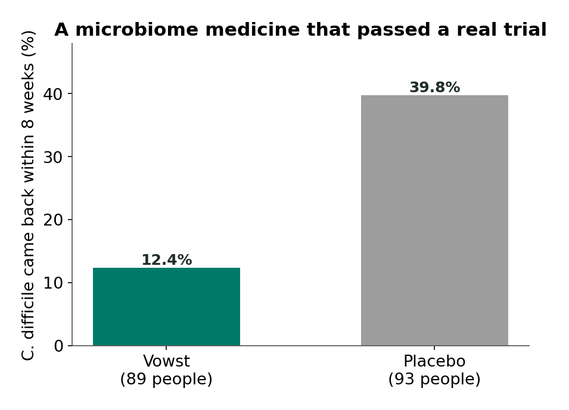

# Chapter 17: Medicine for the Gut-Brain Axis

## Summary

Some gut-brain treatments have moved from the lab into real medicine. This chapter explains how fecal microbiota transplant became a lifesaving treatment for repeat *C. difficile* infections, and how two microbiome medicines made from donated stool earned FDA approval in 2022 and 2023. It follows vagus nerve stimulation from its approval for epilepsy in 1997 to depression in 2005, stroke rehabilitation in 2021, and rheumatoid arthritis in 2025, and contrasts those devices with consumer "vagus" gadgets. It explains why doctors prescribe low doses of old antidepressants for IBS pain. Along the way, you'll learn how treatments get approved (and how "approved," "cleared," and "off-label" differ), how doctors weigh benefits against risks, and how patients and doctors make these choices together.

## Concepts Covered

1. C. difficile Infection
2. Fecal Microbiota Transplant
3. Live Biotherapeutic Product
4. FDA Approval
5. Clinical Trial Phases
6. Off-Label Use
7. Benefit-Risk Balance
8. Vagus Nerve Stimulation
9. Implanted VNS Device
10. Noninvasive VNS
11. Inflammatory Reflex
12. Bioelectronic Medicine
13. Consumer Wellness Device
14. Tricyclic Antidepressant
15. Shared Decision-Making
16. Precision Medicine

## Prerequisites

- [Chapter 2: The Vagus Highway](../02-vagus-highway/index.md) (afferent and efferent vagus fibers)
- [Chapter 3: Meet the Microbiome](../03-meet-the-microbiome/index.md) (dysbiosis, antibiotic disruption)
- [Chapter 4: The Immune System as a Sense Organ](../04-immune-sense-organ/index.md) (cytokines and inflammation)
- [Chapter 9: Inflammatory Bowel Disease](../09-inflammatory-bowel-disease/index.md) (biologic therapy, remission)
- [Chapter 10: IBS and Disorders of Gut-Brain Interaction](../10-ibs-and-dgbi/index.md) (gut-brain neuromodulators, placebo response)
- [Chapter 16: Probiotics, Prebiotics, and "Psychobiotics"](../16-probiotics-psychobiotics/index.md) (supplement regulation, trial reading)

!!! mascot-welcome "From the lab to the pharmacy"
    { class="mascot-admonition-img" }
    In the last chapter, most products had never been checked by anyone before they were sold. This chapter is about treatments that went through the full gauntlet of trials and FDA review, including one that stimulates my home nerve with electricity. Knowing exactly what each one is approved for, and what it isn't, will protect you from a lot of confusing headlines.

## 17.1 "Wait, They Transplant *What*?"

Riya is in Dr. Alvarez's office for her regular checkup. Her Crohn's disease has been quiet for months, and her biologic injections are working. But she has two questions saved on her phone. The first came from a video her cousin sent: a woman described how a bacterial infection called *C. difficile* kept coming back after every round of antibiotics, three times in one year, until doctors treated her with a "fecal transplant." She said it gave her life back. "Is that real?" Riya asks. "And could a fecal transplant fix my Crohn's?"

Her second question came from Sam, who had seen an ad for a $300 ear clip that "activates your vagus nerve" to melt away anxiety. Riya had also read that doctors implant vagus nerve stimulators in some patients. "Are those the same thing?" (Riya, Sam, and Dr. Alvarez are fictional.)

Dr. Alvarez smiles. "Great questions. One of those has FDA-approved versions and works remarkably well, but only for one specific infection. One is still being tested. And one is a gadget that hasn't been shown to do what it claims." By the end of this chapter, you'll be able to sort them yourself.

## 17.2 When Antibiotics Clear the Garden: C. difficile Infection

Imagine a lawn so thick with healthy grass that weeds can't find a spot to grow. Now spray it with weed killer that also kills most of the grass. In the bare patches, the toughest weed on the block moves in and takes over. Even if you spray again, the weed often comes back, because the grass that used to crowd it out is still missing.

That's roughly what happens in one of the most common hospital infections in the United States. **C. difficile infection** (CDI) is an infection of the colon by the bacterium *Clostridioides difficile* (often shortened to *C. diff*), which causes diarrhea and inflammation of the colon and can be life-threatening. It most often happens during or soon after a course of antibiotics, which can wipe out many of the normal gut bacteria that usually keep *C. diff* in check (the "antibiotic disruption" from [Chapter 3](../03-meet-the-microbiome/index.md)).

According to the [Centers for Disease Control and Prevention](https://www.cdc.gov/c-diff/about/index.html) (CDC):

- *C. diff* causes almost **half a million infections** in the United States each year.
- People are up to **10 times more likely** to get it while taking an antibiotic, and the risk stays higher for about a month after.
- Symptoms include diarrhea, fever, stomach pain or tenderness, loss of appetite, and nausea.
- Risk is higher for adults 65 and older, people in hospitals and nursing homes, people with weakened immune systems, and people who have had *C. diff* before.

The FDA, in its 2023 announcement of a new treatment, said *C. diff* is associated with **15,000 to 30,000 deaths** in the United States each year.

The hardest part is that it keeps coming back. A [2023 Cochrane review](https://pubmed.ncbi.nlm.nih.gov/37096495/) notes that *C. diff* can cause recurrent infections in nearly a third of people who get it. The FDA explains that the risk of another recurrence rises with each infection, while treatment options shrink. Doctors needed a way to replant the lawn.

## 17.3 Replanting the Garden: Fecal Microbiota Transplant

The idea sounds strange at first: if the problem is missing healthy gut bacteria, give the patient healthy gut bacteria from someone else. And the richest source of a healthy person's gut bacteria is their stool.

A **fecal microbiota transplant** (FMT) is a procedure in which stool from a carefully screened healthy donor, containing that person's gut microbes, is delivered into a patient's digestive tract to restore a healthier microbial community. It can be given through a colonoscope (a flexible tube with a camera, passed into the colon), an enema, a tube through the nose into the small intestine, or capsules.

### The trial that changed medicine

Doctors had tried FMT before, but they wanted proof from a randomized trial. In 2013, a team in Amsterdam led by van Nood published the [first randomized controlled trial](https://pubmed.ncbi.nlm.nih.gov/23323867/) of FMT for recurrent *C. diff* in the *New England Journal of Medicine*. Adults with recurrent infection were randomly assigned to one of three groups:

| Group | Resolution of C. diff without relapse (10 weeks) |
|---|---|
| Short antibiotic course, bowel cleanse, then donor-stool infusion | 13 of 16 (81%) after the first infusion |
| Standard antibiotic (vancomycin) alone | 4 of 13 (31%) |
| Vancomycin plus bowel cleanse | 3 of 13 (23%) |

The difference was so large that the study was stopped early, after an interim check showed the donor-stool group was doing far better. Of the 3 people whose infection wasn't cleared by the first infusion, 2 were cured after a second infusion from a different donor.

This was a small trial (42 people in total), but the effect was huge, and later trials agreed. A 2023 Cochrane systematic review pooled 6 randomized trials with 320 adults whose immune systems were working normally. FMT roughly doubled the chance that recurrent *C. diff* cleared up compared with control treatments (risk ratio 1.92), and the reviewers rated this moderate-certainty evidence. They calculated that about **3 people** need to be treated with FMT for one additional person to be cured (a "number needed to treat" of 3, which is very good). The review couldn't reach firm conclusions on safety, because serious harmful events were rare in these small trials, and it couldn't say much about people with weakened immune systems, who were mostly excluded.

### Why screening matters, and why DIY FMT is dangerous

Stool can also carry viruses, parasites, and antibiotic-resistant germs, so medical FMT uses screened donors and tested stool.

Even screening can miss something. In 2019, doctors at Massachusetts General Hospital [reported](https://pubmed.ncbi.nlm.nih.gov/31665575/) in the *New England Journal of Medicine* that two patients in two different FMT clinical trials developed bloodstream infections with a drug-resistant strain of *E. coli*. Genetic testing traced both infections to the same stool donor, and one of the patients died. The doctors who reported the cases called for enhanced donor screening. A homemade "FMT" with untested stool from a friend or relative is far riskier. Do-it-yourself FMT is unsafe.

!!! mascot-warning ""It's just bacteria" is not a safety plan"
    { class="mascot-admonition-img" }
    The same thing that makes FMT powerful, transferring a whole living community, is what makes it risky. Medical FMT works because of donor screening, stool testing, and follow-up; a homemade version skips every one of those safeguards.

## 17.4 From Stool to Medicine: Live Biotherapeutic Products

FMT from a hospital stool bank works, but every batch comes from a different person. Medicines are supposed to be consistent, so companies set out to turn FMT into a standardized product that could earn FDA approval.

A **live biotherapeutic product** (LBP) is a medicine that contains live microorganisms, such as bacteria, and is meant to prevent, treat, or cure a disease. According to a [2020 review](https://pmc.ncbi.nlm.nih.gov/articles/PMC8080583/) by Cordaillat-Simmons and colleagues, the FDA first proposed this category in a 2010 draft guidance. The key difference from the probiotics in [Chapter 16](../16-probiotics-psychobiotics/index.md) is regulation: an LBP is reviewed like a drug or biologic. Its maker must prove in clinical trials that it is safe and effective for a specific disease and must meet strict manufacturing and testing standards before it can be sold.

As of October 2026, two products made from donated human stool have been FDA approved, both for the same narrow purpose:

| Product | FDA approval date | How it's given | Approved use |
|---|---|---|---|
| [Rebyota](https://www.fda.gov/vaccines-blood-biologics/vaccines/rebyota) (fecal microbiota, live-jslm) | November 30, 2022 | Single rectal dose | Prevent *C. diff* infection from coming back in adults 18 and older, after antibiotic treatment for recurrent infection |
| [Vowst](https://www.fda.gov/news-events/press-announcements/fda-approves-first-orally-administered-fecal-microbiota-product-prevention-recurrence-clostridioides) (fecal microbiota spores, live-brpk) | April 26, 2023 | Oral capsules, taken over 3 days | Same: prevent recurrence in adults 18 and older after antibiotic treatment for recurrent infection |

Rebyota, made by Ferring Pharmaceuticals, was the first FDA-approved fecal microbiota product. Vowst, developed by Seres Therapeutics and sold to Nestlé Health Science in 2024, was the first one taken by mouth. In the trial the FDA described when it approved Vowst, 89 people received Vowst and 93 received a placebo after finishing antibiotics. Over the next 8 weeks, *C. diff* came back in **12.4%** of the Vowst group compared with **39.8%** of the placebo group.

*Source: US FDA, April 26, 2023 approval announcement (ECOSPOR III trial). Adults with recurrent C. difficile infection, after antibiotic treatment.*

Read the "approved use" column carefully, because the limits matter:

- **Prevention of recurrence, not treatment.** Both are given *after* antibiotics have treated a recurrent infection, to stop it from returning. Neither is approved to treat an active infection or a first episode.
- **Adults only.** Both are approved for people 18 and older.
- **Only *C. diff*.** Neither is approved for IBD, IBS, autism, depression, or any other condition.

The FDA also notes that because Vowst is made from human stool, it may carry a risk of transmitting infectious agents even though donors and stool are tested.

!!! mascot-thinking "Same idea, different rules"
    { class="mascot-admonition-img" }
    A probiotic supplement and an approved live biotherapeutic product both contain live microbes, but only one had to prove in trials that it works for a disease before it reached patients. When I want to know how much to trust a microbe product, I ask which set of rules it followed.

## 17.5 How a Treatment Earns Approval

### Approval for drugs and biologics

**FDA approval** is the US Food and Drug Administration's decision, based on evidence the company submits, that a drug, biologic, or high-risk device is safe and effective for a specific intended use. The FDA explains that "safe" doesn't mean a treatment has no side effects. It means the FDA has decided that, for that particular use, the benefits outweigh the possible risks. Approval comes with official labeling that lists the exact conditions the treatment is approved for.

That last part is the key to reading headlines. **Approval is always for a specific use.** A drug approved for one type of cancer is not approved for another type, and a device approved for epilepsy is not approved for anxiety.

### The phases of clinical trials

Before approval, a new drug usually goes through **clinical trial phases**, a series of increasingly large studies in people that test first safety, then whether the treatment works, then how it compares at a large scale, with monitoring continuing after approval. The FDA describes them like this:

| Phase | Who takes part | Typical length | Main purpose | Share of drugs that move on |
|---|---|---|---|---|
| Phase 1 | About 20 to 100 healthy volunteers or people with the condition | Several months | Safety and dosage | About 70% |
| Phase 2 | Up to several hundred people with the condition | Several months to 2 years | Whether it works, and side effects | About 33% |
| Phase 3 | About 300 to 3,000 people with the condition | 1 to 4 years | Confirm it works, watch for side effects | About 25 to 30% |
| Phase 4 | Several thousand people | After approval | Ongoing safety monitoring | (already approved) |

Most treatments drop out along the way, which is why "a new study shows promise" is very different from "approved."

### Devices: approval, clearance, and authorization

Medical devices follow different paths depending on their risk, and the words matter:

| Pathway | What the FDA decides | Word to use | Example in this chapter |
|---|---|---|---|
| Premarket approval (PMA) | The device has enough scientific evidence of safety and effectiveness; FDA calls this its most stringent device review, used for the highest-risk (Class III) devices | **Approved** | Implanted vagus nerve stimulators |
| De Novo | A new type of device with no existing equivalent, for which general or special controls can reasonably assure safety and effectiveness | **Authorized** (granted) | gammaCore for cluster headache (2017) |
| 510(k) | The device is "substantially equivalent" to a device already legally on the market | **Cleared** | gammaCore expansion to migraine (2018) |

"Cleared" and "authorized" are real FDA decisions, but they are not the same as "approved."

### Off-label use

Once a drug is approved, doctors may sometimes prescribe it for a different condition. **Off-label use** is the use of an FDA-approved drug for a condition, dose, or form that is not listed in its official labeling. The FDA explains that, once a drug is approved, health care providers generally may prescribe it for an unapproved use when they judge that it's medically appropriate for their patient, for example when no approved drug exists for a condition, or approved treatments haven't worked. The FDA is also clear about the trade-off: for the off-label use, it has not determined that the drug is safe and effective. Off-label use can be backed by good research (see Section 17.9), but it should be a thoughtful choice made with a doctor.

### Benefit-risk balance

Every treatment decision, by the FDA or by a patient and doctor, comes down to a **benefit-risk balance**: weighing how much a treatment is likely to help against how likely and how serious its harms are, for a particular person and a particular condition. The same treatment can have a great balance for one person and a poor one for another.

FMT shows how this works. For an adult whose *C. diff* keeps coming back despite antibiotics, the benefit is large (roughly 3 people treated for one extra cure), so a small risk of infection is worth taking. For a healthy person who wants to "optimize" their gut, there's no proven benefit, so any risk tips the balance the wrong way.

## 17.6 FMT Beyond C. diff: Hope, Hype, and Ongoing Trials

If FMT works so well for *C. diff*, why not for other conditions linked to the microbiome? Here's where the research stood as of 2026.

**Ulcerative colitis.** A [2023 Cochrane review](https://pubmed.ncbi.nlm.nih.gov/37094824/) of 12 randomized trials with 550 participants found that FMT *may* help some people with active ulcerative colitis reach clinical remission, but rated the evidence low certainty. Results for endoscopic remission (healing seen through a scope) were uncertain, and the evidence for keeping people in remission was very uncertain. FMT for ulcerative colitis is **experimental**, not approved.

**Crohn's disease.** The same review found the evidence for Crohn's disease very uncertain, with few studies. That's the answer to Riya's question: FMT for Crohn's is a research question, not a treatment her doctor can prescribe.

**Autism.** A [2017 study](https://pubmed.ncbi.nlm.nih.gov/28122648/) by Kang and colleagues gave 18 autistic children, aged 7 to 16, an intensive microbiota transfer protocol (antibiotics, a bowel cleanse, then many weeks of donor microbes). Their gastrointestinal symptoms, such as constipation, diarrhea, and stomach pain, improved by about 80% on a symptom scale, and the researchers also reported changes on behavior measures. But the study was **open-label**, meaning everyone knew they were getting the treatment, and it had **no placebo group**, so it can't show the treatment caused the changes. Gut problems in autistic children are real health problems worth treating on their own terms, and this study is a reason for further research on them. It is not proof of a treatment, and autism itself is a neurodevelopmental difference, not a disease to be cured by changing the microbiome (see [Chapter 13](../13-autism-adhd-gut/index.md)).

**Parkinson's disease.** Here the placebo-controlled trials disagree. A [2024 Belgian trial](https://pubmed.ncbi.nlm.nih.gov/38686220/) (GUT-PARFECT) of 46 people with early Parkinson's found a mild improvement in movement scores after 12 months with donor stool compared with the patients' own stool. But a [2024 Finnish trial](https://pubmed.ncbi.nlm.nih.gov/39073834/) of 48 people found FMT was safe and did not offer clinically meaningful improvements, and a [2026 Polish trial](https://pubmed.ncbi.nlm.nih.gov/41674471/) of 59 people found that a single FMT did not change movement symptoms, though some non-movement symptoms improved at certain time points. Mixed results from small trials mean FMT for Parkinson's remains **experimental**.

| Condition | Best evidence so far (as of 2026) | Status |
|---|---|---|
| Recurrent *C. diff* | Several randomized trials and a Cochrane review; two approved products | Approved products and standard care |
| Ulcerative colitis | Cochrane review, low-certainty benefit | Experimental |
| Crohn's disease | Very uncertain | Experimental |
| Autism | Small open-label studies, no placebo group | Experimental (not a cure) |
| Parkinson's disease | Small placebo-controlled trials with mixed results | Experimental |

!!! hype-hype "Hype Meter: "Poop transplants cure autism and Parkinson's""
    
StrongModeratePreliminaryHype

    **Verdict: Hype.** For autism, the best-known study had 18 children, no placebo group, and participants who knew they were treated, so it can't show cause. For Parkinson's, three small placebo-controlled trials found a mild benefit in one and no meaningful motor benefit in two. No FMT product is approved for either condition, and "cure" isn't supported by any study.
    **What would change the grade:** Large, placebo-controlled, repeated trials showing clear, lasting benefits would move specific, carefully worded claims (such as "improves GI symptoms in some autistic children") toward Preliminary or Moderate. "Cure" would still not fit.

## 17.7 Treating the Body Through Its Wiring: Vagus Nerve Stimulation

Now to Riya's second question. Remember from [Chapter 2](../02-vagus-highway/index.md) that the vagus nerve is a two-way highway between the brainstem and the organs of the chest and abdomen, and that most of its fibers carry signals up to the brain. If you could send small electrical pulses along that highway, could you change what the brain or body does?

**Vagus nerve stimulation** (VNS) is a treatment that delivers mild electrical pulses to the vagus nerve, either through a device implanted under the skin or through a handheld device placed on the skin, to change nerve signaling to the brain or the body. Think of it like tapping out a signal on a telegraph line that already runs between two cities. You aren't building new wiring; you're sending a message along wiring that's already there.

### Implanted devices: four different approvals

An **implanted VNS device** is a small pulse generator placed under the skin by a surgeon and connected to the vagus nerve in the neck, which delivers programmed electrical pulses on a schedule. Different implanted devices have been approved for four very different conditions:

| Year approved | Device | Approved for | Notes |
|---|---|---|---|
| 1997 (July 16) | [VNS Therapy System](https://www.accessdata.fda.gov/scripts/cdrh/cfdocs/cfPMA/pma.cfm?id=P970003) (originally the NeuroCybernetic Prosthesis, now made by LivaNova) | Add-on treatment for drug-resistant partial-onset epilepsy | The first FDA-approved VNS device |
| 2005 (July 15) | [VNS Therapy System](https://www.accessdata.fda.gov/scripts/cdrh/cfdocs/cfPMA/pma.cfm?id=P970003S050) (new approved use) | Add-on, long-term treatment of chronic or recurrent depression in adults 18 and older in a major depressive episode who have not responded well to 4 or more adequate antidepressant treatments | For treatment-resistant depression only |
| 2021 (August 27) | [Vivistim System](https://www.accessdata.fda.gov/scripts/cdrh/cfdocs/cfpma/pma.cfm?id=P210007) | Use during rehabilitation therapy to reduce arm movement problems in people with chronic ischemic stroke and moderate to severe arm weakness | Stimulates the vagus nerve during rehabilitation exercises, not on a daily schedule |
| 2025 (July 30) | [SetPoint System](https://www.accessdata.fda.gov/cdrh_docs/pdf24/P240039B.pdf) | Adults with moderately to severely active rheumatoid arthritis who did not respond well to, lost response to, or could not tolerate one or more biologic or targeted synthetic drugs | Stimulates the left vagus nerve for 1 minute once a day |

Notice how specific each approval is. The depression approval is not for anyone with depression; it's an add-on for adults whose depression has resisted at least four other treatments. And as of October 2026, **no VNS device is approved for Crohn's disease, IBS, or anxiety.** (One prescription ear stimulator has a narrower FDA authorization for IBS pain in 11- to 18-year-olds; Section 17.8 explains it.)

!!! hype-strong "Hype Meter: "Vagus nerve stimulation is FDA approved for depression""
    
StrongModeratePreliminaryHype

    **Verdict: Strong, with fine print.** FDA records show that in July 2005 the implanted VNS Therapy System was approved as an add-on, long-term treatment for adults with chronic or recurrent depression who haven't responded to 4 or more adequate antidepressant treatments. The approval fact is solid. How well VNS works for depression is less clear-cut than the approval itself, so the evidence for its benefit is better described as Moderate, and it is not a first-choice treatment.
    **What would change the grade:** The approval fact won't change unless the FDA changes the label. A version of the claim that drops the fine print ("VNS treats depression," implying anyone, any device) would earn a lower grade.

### The inflammatory reflex

Why would a nerve stimulator help arthritis, a disease of the immune system? The answer comes from a discovery about how nerves and immune cells talk to each other.

Your body has reflexes for many things: pull your hand from a hot stove, and your spinal cord acts before you think. In 2002, Kevin Tracey, a scientist in New York, [described a reflex for inflammation](https://pubmed.ncbi.nlm.nih.gov/12490958/). The **inflammatory reflex** is a nerve circuit in which the brain senses inflammation (partly through incoming vagus signals) and responds by sending signals back out, largely through the vagus nerve, that calm the immune system's release of inflammatory chemicals such as cytokines (from [Chapter 4](../04-immune-sense-organ/index.md)). Tracey's key point was that the nervous system regulates inflammation in real time, the way it controls heart rate, and that neurons using the chemical messenger acetylcholine can shut down acute inflammation. Much of the detailed evidence for this circuit comes from animal studies.

That idea led to a new field. **Bioelectronic medicine** is an approach to treatment that uses electrical stimulation of nerves, instead of or alongside drugs, to change how organs or the immune system work. The SetPoint System is the first device the FDA has approved to treat rheumatoid arthritis, an autoimmune disease, by stimulating the vagus nerve.

How strong is the evidence? SetPoint's first human pilot study, published in 2020 by [Genovese and colleagues](https://pubmed.ncbi.nlm.nih.gov/38273617/), enrolled just 14 patients and was funded by the company. The larger RESET-RA trial, [summarized by the FDA](https://www.accessdata.fda.gov/cdrh_docs/pdf24/P240039B.pdf), randomly assigned 242 adults to active stimulation or sham stimulation (an implanted device that wasn't turned on). After 12 weeks, 35.2% of the active group versus 24.2% of the sham group had at least a 20% improvement on a standard arthritis scale (ACR20). That's a real but modest difference from one sham-controlled trial. The full peer-reviewed results appeared in [*Nature Medicine* in December 2025](https://pubmed.ncbi.nlm.nih.gov/41429981/) (Tesser and colleagues) and reported the same 12-week numbers. After 12 weeks, everyone's device was switched on, and by 12 months 52.8% of the people who completed the study met the ACR20 mark. That later number is harder to interpret, because there was no longer a sham group to compare against, so some of the improvement could come from expectations or from the disease changing on its own. The trial was sponsored by SetPoint Medical, and several authors work for the company. Serious problems related to the device or surgery occurred in 1.6% of patients, all around the time of surgery, and all resolved.

### What about Crohn's disease?

The same idea makes researchers wonder about Crohn's, another inflammatory disease. In a [2016 pilot study](https://pubmed.ncbi.nlm.nih.gov/26920654/), Bonaz and colleagues in France implanted vagus nerve stimulators in 7 patients with active Crohn's disease and followed them for 6 months. Two were taken out of the study at 3 months because their disease got worse; the other 5 moved toward remission. A second small study, [published in 2023](https://pubmed.ncbi.nlm.nih.gov/37738465/), treated 16 patients with drug-resistant Crohn's disease; D'Haens and colleagues reported lower disease activity and inflammation markers, but it was also open-label, with no comparison group. Two small studies without control groups are a starting point, not proof. VNS for Crohn's is **experimental**. Dr. Alvarez tells Riya it's an interesting area to watch, and that her biologic, which has strong evidence behind it, is doing its job.

## 17.8 Handheld Stimulators and Wellness Gadgets

Implanted devices require surgery. Could you stimulate the vagus nerve from outside the body?

**Noninvasive VNS** is vagus nerve stimulation delivered through the skin, without surgery, using a handheld or wearable device placed on the neck or the ear. The best-known medical example is gammaCore, a handheld device held against the side of the neck. The [FDA's records](https://www.accessdata.fda.gov/scripts/cdrh/cfdocs/cfpmn/denovo.cfm?id=DEN150048) show:

- **April 14, 2017:** The FDA granted a De Novo authorization for gammaCore for the acute treatment of pain from episodic cluster headache in adults.
- **January 23, 2018:** A 510(k) clearance added the acute treatment of pain from migraine headache in adults.
- **February 12, 2021:** A later 510(k) clearance extended migraine treatment to teens 12 to 17. (Other clearances added more headache uses.)

These are FDA **authorization** and **clearance**, not "approval," as Section 17.5 explained. And they are for headaches, not for anxiety, IBS, or Crohn's disease.

One ear device does have an FDA decision for a gut condition, and it was made for teens. On June 7, 2019, the FDA granted a [De Novo authorization to IB-Stim](https://www.accessdata.fda.gov/scripts/cdrh/cfdocs/cfpmn/denovo.cfm?id=DEN180057), a prescription-only stimulator worn behind the ear. Tiny needle electrodes deliver mild pulses to branches of several nerves around the ear, including a branch of the vagus nerve. It is authorized for patients 11 to 18 years old with abdominal pain from IBS, worn for up to 3 weeks, as an aid to reduce pain alongside other IBS treatments. The FDA based its decision mainly on about 50 teens with IBS inside one sham-controlled trial of 115 adolescents. The 2025 pediatric guideline from ESPGHAN and NASPGHAN suggests this kind of ear stimulation as a treatment option (a conditional recommendation, moderate-certainty evidence). So it is authorized, not approved; it is for IBS pain in teens, not for anxiety or Crohn's disease; and it is a prescription medical device, not a consumer gadget.

### Consumer gadgets are a different category

Now Sam's ad. A **consumer wellness device** is a product sold directly to the public that claims to support general health or well-being, such as relaxation or stress relief, and is marketed without having to show the FDA that it treats any disease. The FDA has a ["general wellness" policy](https://www.fda.gov/regulatory-information/search-fda-guidance-documents/general-wellness-policy-low-risk-devices) for low-risk products that promote a healthy lifestyle; the latest version of the guidance page was updated in January 2026. These products aren't reviewed like medical devices, which is exactly why they shouldn't claim to treat a disease like an anxiety disorder.

Do these gadgets even affect the vagus nerve? Scientists often use heart rate variability (small beat-to-beat changes in heart rate, partly controlled by the vagus nerve) as a possible sign of vagus activity. A [2021 "living" meta-analysis](https://pubmed.ncbi.nlm.nih.gov/34473846/) by Wolf and colleagues pooled 16 studies in healthy people that compared ear-based stimulation with sham (fake) stimulation. It found strong evidence for **no effect** on this heart rate measure during stimulation. That doesn't rule out other effects, but this common heart-rate measure gave no sign that ear stimulation changes vagus activity, let alone that it cures anxiety.

!!! hype-hype "Hype Meter: "This $300 vagus nerve gadget fixes anxiety""
    
StrongModeratePreliminaryHype

    **Verdict: Hype.** Consumer wellness gadgets are not the medical devices tested in clinical trials, and no vagus stimulator is FDA approved to treat anxiety. A 2021 meta-analysis of 16 sham-controlled studies in healthy people found ear stimulation did not change a common heart-rate sign of vagus activity. The approved, authorized, and cleared vagus-related devices are for epilepsy, treatment-resistant depression, rheumatoid arthritis, headaches, and (for one prescription ear stimulator) IBS pain in teens.
    **What would change the grade:** Large, sham-controlled trials of that specific device in people with diagnosed anxiety disorders, showing clear benefit, followed by an FDA decision for that use.

!!! mascot-tip "Ask "approved for what?""
    { class="mascot-admonition-img" }
    Whenever someone says a vagus device is "FDA approved," ask two follow-up questions: approved, cleared, or authorized, and for which condition? The honest answer will usually be epilepsy, treatment-resistant depression, arm rehabilitation after stroke, rheumatoid arthritis, headache, or prescription-only teen IBS pain, not whatever the ad is selling.

## 17.9 Turning Down the Volume on Gut Pain: Tricyclic Antidepressants

Sam's IBS doesn't involve inflammation or tissue damage. As [Chapter 10](../10-ibs-and-dgbi/index.md) explained, it's a disorder of gut-brain interaction: the gut and brain process signals in a way that turns ordinary sensations into pain and changes bowel habits. One treatment for this surprises many families.

A **tricyclic antidepressant** (TCA) is one of an older class of medicines, named for their three-ring chemical structure, that were first used for depression and are now also prescribed, usually in much lower doses, to reduce chronic pain, including gut pain in disorders of gut-brain interaction. When doctors use them this way, they act as gut-brain neuromodulators: medicines that change how pain signals are processed along the gut-brain axis.

Think of a stereo turned up so high that a quiet song blasts. A low-dose TCA is more like turning down the volume knob on pain signaling than changing the song.

### What the evidence shows

- **Rome Foundation report (2018).** [A team led by Drossman](https://pubmed.ncbi.nlm.nih.gov/29274869/) reviewed medicines for disorders of gut-brain interaction and concluded that low to modest doses of TCAs give the most convincing evidence of benefit for chronic gut pain. A related class, SNRIs, can also be recommended.
- **Network meta-analysis (2020).** [Black and colleagues](https://pubmed.ncbi.nlm.nih.gov/31859183/) combined 51 randomized trials with 4,644 people with IBS. TCAs ranked second for overall IBS symptoms and first for abdominal pain. But the pain result came from only 4 trials and 92 patients, only 13 of the 51 trials had a low risk of bias, and TCAs caused more side effects than placebo.
- **Guidelines.** The two main US guidelines agree that TCAs can help, but they rate the recommendation differently. The [American College of Gastroenterology's 2021 IBS guideline](https://pubmed.ncbi.nlm.nih.gov/33315591/) makes a strong recommendation, based on moderate-quality evidence, that TCAs be used to treat overall IBS symptoms. The [American Gastroenterological Association's 2022 guideline for IBS with diarrhea](https://pubmed.ncbi.nlm.nih.gov/35738725/) makes a conditional recommendation for TCAs, based on low-certainty evidence. "Conditional" means the experts think the benefits probably outweigh the risks for many patients, but the right choice depends more on the person.
- **The biggest trial (2023).** The [ATLANTIS trial](https://pubmed.ncbi.nlm.nih.gov/37858323/), described in the box below, tested low-dose amitriptyline in 463 people with IBS.
- **Children and teens (2025).** Almost all of this evidence comes from adults. The [2025 ESPGHAN/NASPGHAN pediatric guideline](https://pmc.ncbi.nlm.nih.gov/articles/PMC12314588/), for ages 4 to 18, says amitriptyline "may be suggested" for IBS and related belly pain, a conditional recommendation based on low-certainty evidence, and adds that it should only be prescribed by caregivers experienced in this area. Antidepressants, including amitriptyline, also carry an FDA warning: in studies, a small number of children, teens, and young adults up to age 24 had new suicidal thoughts or behavior while taking them. [MedlinePlus](https://medlineplus.gov/druginfo/meds/a682388.html) notes that people under 18 normally should not take amitriptyline, though a doctor may decide it is the best choice for a particular young person. That is why, for teens, doctors weigh this option especially carefully and check in on mood.

Because amitriptyline's labeled use in the US is for depression (according to MedlinePlus, which lists other uses such as nerve pain and migraine prevention), prescribing a low dose for IBS is an example of **off-label use** backed by trials and guidelines.

### "Does my doctor think it's all in my head?"

This is the question families ask most, and the answer is no. The doses used for gut pain are generally lower than those used for depression, and the goal is to calm pain signaling along the gut-brain axis. In the ATLANTIS trial, amitriptyline improved IBS symptoms, but an [ACG summary](https://gi.org/journals-publications/ebgi/schoenfeld_dec2023/) of the trial reported no evidence that it changed depression scores. Most people in the trial weren't depressed to begin with, so the result fits the idea that the medicine works on gut symptoms rather than by treating depression, though the trial wasn't built to prove exactly how it works. Being offered a TCA for IBS means your doctor is treating a real problem in how your gut and brain communicate.

## 17.10 How to Read a Gut-Brain Claim: The ATLANTIS Trial

In 2023, Ford and colleagues in England published the ATLANTIS trial in *The Lancet*. They recruited adults with IBS (by Rome IV criteria) from 55 general medical practices whose symptoms continued despite first-line treatments such as diet changes. Participants were randomly assigned to a low dose of amitriptyline or a placebo for 6 months, and they could slowly adjust the dose within a set range based on symptoms and side effects. Nobody (participants, their doctors, or the researchers) knew who got which. The primary outcome was a standard IBS symptom severity score at 6 months.

At 6 months, the amitriptyline group's symptom scores were about 27 points better than the placebo group's, a statistically significant difference. The authors concluded that low-dose amitriptyline was superior to placebo and safe. An ACG evidence summary, written by an outside expert, called the trial "a major achievement" but noted that the average benefit was modest and did not reach the 35-point difference often considered meaningful to patients; more people in the amitriptyline group did report relief of their overall symptoms. About 13% stopped amitriptyline because of side effects, compared with 9% on placebo.

!!! claim-box "How to read a gut-brain claim: the 2023 ATLANTIS trial"
    | Question | This study |
    |---|---|
    | Mouse or human? | Human: 463 adults with IBS in primary care in England. |
    | Correlation or cause? | Tests cause: randomized, double-blind, placebo-controlled, with a primary outcome set in advance. |
    | How many? | 463 people (232 amitriptyline, 231 placebo), the largest trial of a TCA in IBS so far, according to its authors. |
    | How long? | 6 months of treatment, longer than most earlier IBS drug trials (often 4 to 12 weeks). |
    | Who paid for it? | The UK National Institute for Health and Care Research, a government research funder. |
    | Is something being sold? | No company product is being promoted. Amitriptyline is an old, inexpensive generic medicine. |

The conclusion: this is strong evidence that low-dose amitriptyline helps IBS symptoms more than placebo, in adults, over 6 months. The average size of the benefit was modest, it caused side effects for some people, and the trial didn't include teens. It does not mean every person with IBS should take a TCA. That's a benefit-risk decision for each patient and doctor.

!!! living-with "If you're going through this"
    If your doctor suggests a medicine called an "antidepressant" for gut pain, it's okay to feel surprised, or even a little insulted. Ask what dose they mean, how it's supposed to help your gut, what side effects to watch for (including changes in mood, which matter for anyone under 25), and how long before you'd know if it's working. You can also ask about other options, like gut-directed therapy, which [Chapter 18](../18-sleep-exercise-therapy/index.md) covers. Your symptoms are real, and choosing a treatment is a decision you get to make together with your care team.

## 17.11 Try It Yourself: The Treatment Evidence Map

Time to sort what you've learned. In the simulation below, treatment cards appear one at a time. Drag each card (or tap a bin) to sort it into **Approved, cleared, or standard care**; **Experimental (still being tested)**; or **Unproven or unsafe**. After each choice, a panel explains the right answer with the evidence from this chapter.

#### Diagram: Treatment Evidence Map
<iframe src="../../sims/ch17-treatment-evidence-map/main.html" height="562px" width="100%" scrolling="no"></iframe>

[Open the Treatment Evidence Map fullscreen](../../sims/ch17-treatment-evidence-map/main.html){ .md-button .md-button--primary }

MicroSim specification: Treatment Evidence Map

Type: microsim
**sim-id:** ch17-treatment-evidence-map 
**Library:** p5.js 
**Status:** Implemented 
**Bloom Level:** Evaluate 
**Bloom Verb:** classify, judge 
**Learning Objective:** The learner will classify gut-brain treatments by FDA status and strength of evidence (approved, cleared, or standard care; experimental; unproven or unsafe) and justify each choice with evidence.

**Canvas:** 500 px drawing area plus 60 px controls (iframe 562 px); responsive to about 380 px wide.

**Controls:** Drag the card, or tap a bin, to sort it; Next card button; Start over button (reshuffles).

**Cards (13):** microbiome product for recurrent C. diff; FMT for ulcerative colitis; FMT for autism; DIY FMT; implanted VNS for epilepsy; implanted VNS for treatment-resistant depression; implanted VNS for rheumatoid arthritis; VNS for Crohn's disease; gammaCore for cluster headache; consumer ear-clip gadget for anxiety; low-dose TCA for IBS; biologic for Crohn's disease; FMT for Parkinson's disease.

**Feedback:** Immediate correct or not-quite message with a one-sentence evidence reason; sorted cards appear in each bin with check or cross marks; running score.

**Provenance:** Sections 17.3 to 17.9; statuses as of October 2026.

Try to sort all 13 cards before looking back at the chapter. Pay special attention to the vagus nerve cards: the same basic technology lands in different bins depending on the condition, because approval is always for a specific use. When you get one wrong, ask which word on the card you missed: the condition, the type of device, or the kind of evidence.

!!! model-limits "What this model leaves out"
    - Real evidence comes in shades, not three bins. "Experimental" covers everything from a 7-person pilot study to large trials that are almost finished.
    - Approval status changes over time, and statuses differ between countries. The sim reflects the US as of October 2026.
    - "Approved" or "standard care" doesn't mean right for every person; the benefit-risk balance depends on the individual.
    - The sim doesn't show cost, insurance, access, or side effects, all of which matter in real decisions.
    - Card reasons are one-sentence summaries; the chapter and its sources have the full details.

## 17.12 Making the Choice Together

Knowing what's approved is only the start. Most treatment decisions have more than one reasonable option, and the right one depends on things only the patient can judge, like how much a side effect would bother them or how they feel about surgery.

**Shared decision-making** is a process in which a patient (and, for a teen, often their family) and their clinician decide on a treatment together, combining the clinician's knowledge of the evidence with the patient's own values, goals, and preferences. The doctor explains the options, including waiting, with their likely benefits and risks, and the patient explains what matters to them.

Good questions to bring to these conversations include:

1. What are my options, including not treating it right now?
2. What are the likely benefits and the possible harms of each?
3. How strong is the evidence, and was it tested in people like me (my age, my condition)?
4. Is this use approved, off-label, or experimental?
5. What happens next if it doesn't work?

Medicine is also trying to get better at matching treatments to individuals from the start. **Precision medicine**, as defined by the US Precision Medicine Initiative and explained by MedlinePlus, is "an emerging approach for disease treatment and prevention that takes into account individual variability in genes, environment, and lifestyle for each person." It contrasts with a one-size-fits-all approach. In gut-brain medicine, researchers hope a person's microbiome, genes, or nerve signals could someday predict who will respond to FMT, a probiotic strain, or a stimulator. That's research, not routine care today, but the mixed results in this chapter are part of why scientists want it.

!!! families "For families"
    When your teen faces a treatment decision, the most helpful thing you can do is help them ask questions, not answer for them. Bring the list of five questions above to appointments, and let your teen speak first. If a relative pushes a treatment they saw online, like a home "fecal transplant" or a vagus gadget, you can say, "We're going to check that with the care team," which respects the relative and protects your child. And if your teen is offered a low-dose antidepressant for gut pain, avoid saying "So it's all in your head?" The medicine is treating real pain signaling.

## At the Bedside: When the Infection Keeps Coming Back

!!! note "Meet the patient (fictional)"
    Helen is 71 and lives on her own. After a course of antibiotics for pneumonia last winter, she developed severe watery diarrhea and was diagnosed with *C. difficile* infection. Antibiotics cleared it, but it came back two months later, and then again. She has now had three episodes. She's lost weight, is afraid to leave the house in case she can't reach a bathroom, and has stopped going to her book club. Her daughter, who lives an hour away, has started calling every day.

**What the doctor checks:** Her gastroenterologist reviews the timeline of her infections and treatments, checks for dehydration and kidney function, confirms the current episode with stool testing for *C. difficile*, and reviews her other medicines and her immune status. The doctor also asks how the infections are affecting her daily life and mood.

**Connecting the signals:** Each round of antibiotics kills *C. diff* but also keeps her normal gut bacteria from recovering, so the "bare lawn" invites the infection back. Her age raises her risk too. Her doctor explains that what she needs isn't just another antibiotic, but a way to restore the microbial community that normally keeps *C. diff* in check.

**Diagnosis:** Recurrent *C. difficile* infection (second recurrence, her third episode).

**Why it happens:** As Section 17.2 explained, antibiotics disrupt the gut microbiome and give *C. diff* room to grow, and the risk of another recurrence rises with each episode. Microbiome-based treatments work by replanting the missing community.

**The mind-body side:** Months of unpredictable diarrhea have left Helen anxious, isolated, and embarrassed. Her care team takes that seriously. They talk with her about what to expect, connect her with a social worker, and encourage her daughter to help with practical support rather than worried daily calls. Her doctor is careful with expectations: the treatment has a very good track record, but it is not a guarantee, and a small number of people still have another recurrence.

**Treatment today:** After antibiotic treatment for the current episode, her doctor discusses her options using shared decision-making: one of the two FDA-approved microbiome products (Rebyota, given once rectally, or Vowst, capsules taken over three days), both approved to prevent recurrence in adults after antibiotic treatment for recurrent infection, or FMT from a screened donor through her hospital's program. They go through the benefits, the small risk of transmitting infections from donor material, and what she'd prefer. Helen chooses the capsules because she'd rather avoid another procedure.

**What's new in research:** The 2023 Cochrane review concluded that, in adults with healthy immune systems, FMT likely leads to a large increase in resolution of recurrent *C. diff*, with about 3 people treated for one additional cure. It also said more data, such as from large national registries, are needed to understand longer-term risks, and that too few people with weakened immune systems have been studied to draw conclusions for them. **Evidence grade: Strong** for preventing recurrent *C. diff* in adults with healthy immune systems; long-term safety is still being studied.

??? question "Your turn: reason through a variation"
    Helen's friend Rosa, who is 68, has ulcerative colitis. She hears about Helen's recovery and asks her own doctor whether she can take the same capsules for her colitis. What should her doctor explain?

    **Answer:** Vowst and Rebyota are FDA approved only to prevent recurrent *C. diff* infection in adults after antibiotics, not for ulcerative colitis. A 2023 Cochrane review found that FMT may help some people with active ulcerative colitis reach remission, but the evidence is low certainty, so it remains experimental. Using an approved product for a different disease would be off-label without good evidence, and the benefit-risk balance is unknown. Her doctor might mention clinical trials she could ask about, alongside her proven colitis treatments.

*This is a fictional teaching case. It is not medical advice. If you or someone you know has symptoms like these, talk to a doctor.*

## Common Misconceptions

**Myth:** If a treatment is "natural," like a stool transplant, it must be safe.  
**Reality:** Stool can carry dangerous germs. In 2019, a drug-resistant *E. coli* infection traced to one FMT donor killed a patient, even with screening. FMT is powerful medicine with real risks, which is why it's done with screened donors and tested stool.

**Myth:** Doing your own fecal transplant at home is basically the same as getting one at a hospital.  
**Reality:** Medical FMT depends on donor screening, stool testing, and follow-up. Homemade versions skip all of them, so the risk of passing on an infection is much higher, and they're done for conditions where FMT hasn't been proven to help.

**Myth:** If a treatment is FDA approved for one condition, it's approved for related conditions too.  
**Reality:** FDA approval is always for a specific use. Vagus nerve stimulators are approved for epilepsy, treatment-resistant depression, arm-movement rehabilitation after stroke (the Vivistim System), and rheumatoid arthritis, but not for Crohn's disease, IBS, or anxiety (a separate ear device, IB-Stim, is authorized only for IBS belly pain in patients 11 to 18), and Vowst and Rebyota are approved only to prevent recurrent *C. diff*.

**Myth:** If your doctor prescribes an antidepressant for IBS, they think your symptoms are all in your head.  
**Reality:** Low-dose tricyclic antidepressants are used to calm pain signaling along the gut-brain axis. In the 2023 ATLANTIS trial, amitriptyline improved IBS symptoms without evidence of changing depression scores. It treats a real problem in gut-brain communication.

## Your Gut Check

Test yourself. Try each one before you open the answer.

??? question "1. Claim Check: "FDA-approved vagus nerve stimulation is now available to heal your gut and calm your anxiety. Order our clinic-grade ear device today!""
    **Grade: Hype.** The FDA-approved implanted VNS devices are for drug-resistant epilepsy, treatment-resistant depression in adults, arm-movement rehabilitation after stroke, and rheumatoid arthritis, and the handheld gammaCore is authorized and cleared for cluster headache and migraine. None is approved for gut disorders or anxiety; the closest is a prescription ear stimulator (IB-Stim) that is authorized only as an add-on for IBS pain in 11- to 18-year-olds, which is not what this ad is selling. A consumer ear gadget is a different product from the devices tested in trials, and a 2021 meta-analysis found ear stimulation didn't change a common heart-rate sign of vagus activity in healthy people. A careful version would say: "Vagus nerve stimulation is FDA approved for a few specific conditions; its use for gut disorders and anxiety is still being researched."

??? question "2. Predict: Riya reads that her friend's grandfather had FMT and his recurrent C. diff never came back. She wonders whether FMT would work as well for her Crohn's disease. What would you predict, based on the evidence?"
    FMT probably would not work as reliably for Crohn's as it does for recurrent *C. diff*, and nobody knows for sure. *C. diff* is a single germ taking over a disrupted microbiome, so replanting the community directly fixes the problem. Crohn's disease involves the immune system, genes, and the environment, and a 2023 Cochrane review found the evidence for FMT in Crohn's very uncertain. Riya's biologic has much stronger evidence, so this is a question for Dr. Alvarez and possibly a future clinical trial.

??? question "3. Explain: Why is the SetPoint System approved for rheumatoid arthritis, a disease of the immune system, even though it stimulates a nerve?"
    It's based on the inflammatory reflex: the brain senses inflammation and sends signals back through the vagus nerve that calm the release of inflammatory chemicals like cytokines. Stimulating the left vagus nerve is meant to switch on that calming signal. In the RESET-RA trial summarized by the FDA, 35.2% of people with active stimulation versus 24.2% with sham stimulation improved by at least 20% on an arthritis scale after 12 weeks. The approval is only for adults with moderate to severe rheumatoid arthritis whose biologic or targeted drugs didn't work well.

??? question "4. Apply: Sam's doctor suggests a low-dose tricyclic antidepressant for his IBS pain, and Sam's cousin Dev says, "See? They think you're crazy." How could Sam respond using this chapter?"
    Sam could explain that low doses of TCAs are used as gut-brain neuromodulators to turn down pain signaling, and that US guidelines support them for IBS (a strong recommendation from the ACG and a conditional one from the AGA). In the large ATLANTIS trial, amitriptyline improved IBS symptoms without evidence of changing depression scores. Using it for IBS is off-label but backed by trials. Sam can also tell Dev that whether to try it is a decision he'll make with his doctor, weighing the possible side effects. Because Sam is 16, his doctor will be extra careful: the 2025 pediatric guideline gives amitriptyline only a conditional recommendation, and antidepressants carry a warning about mood changes in young people.

**5. Read the data.** In the 2013 van Nood trial, adults with recurrent *C. diff* were randomly assigned to three treatments. Here's the share whose infection resolved without relapse at 10 weeks:

| Treatment group | Cured | Total | Percent |
|---|---|---|---|
| Donor stool infusion (first infusion) | 13 | 16 | 81% |
| Vancomycin alone | 4 | 13 | 31% |
| Vancomycin plus bowel cleanse | 3 | 13 | 23% |

??? question "5. What does this data show, and what can't it show?"
    It shows a large difference: about 81% cured with donor stool versus about 23 to 31% with antibiotics alone, in a randomized trial, so the difference is likely caused by the treatment. Including a bowel-cleanse group shows the cleanse alone wasn't responsible. But the trial was small (42 people), was stopped early, and included only adults with recurrent infection, so it can't tell us about first infections, children, people with weak immune systems, or long-term safety. The 2023 Cochrane review, pooling 6 trials with 320 people, helps by confirming the benefit across more studies.

## Exercises

### Remember

1. What two FDA-approved products are made from donated human stool, when was each approved, and what are they approved for?

??? note "Answer"
    Rebyota (approved November 30, 2022, given rectally) and Vowst (approved April 26, 2023, oral capsules). Both are approved to prevent *C. diff* infection from coming back in adults 18 and older after antibiotic treatment for recurrent infection.

2. List the four conditions for which implanted vagus nerve stimulators are FDA approved, with the year of each approval.

??? note "Answer"
    Drug-resistant partial-onset epilepsy as an add-on (1997); chronic or recurrent treatment-resistant depression in adults as an add-on after 4 or more failed treatments (2005); arm-movement rehabilitation after a chronic ischemic stroke (Vivistim System, August 27, 2021); and moderate to severe rheumatoid arthritis in adults who didn't respond to biologic or targeted drugs (SetPoint System, July 30, 2025).

### Understand

3. Explain the difference between FDA "approval," "clearance," and "authorization" for a medical device, using gammaCore and implanted VNS as examples.

??? note "Answer"
    Approval (premarket approval) is the FDA's most stringent device review, requiring scientific evidence of safety and effectiveness, used for high-risk devices like implanted VNS. A De Novo authorization is for a new type of lower-risk device with no existing equivalent, as with gammaCore for cluster headache in 2017. A 510(k) clearance means a device is substantially equivalent to one already on the market, as with gammaCore's migraine use in 2018.

4. Explain why antibiotics can lead to *C. diff* infection, and why FMT helps.

??? note "Answer"
    Antibiotics kill many normal gut bacteria that usually keep *C. diff* from growing, so *C. diff* can take over and cause infection. More antibiotics kill *C. diff* but keep the normal community from recovering, so it often comes back. FMT replants a healthy donor's microbial community, which can crowd out *C. diff* and prevent recurrence.

### Apply

5. A news headline says, "Nerve zapper approved by FDA could treat Crohn's disease." Using Section 17.7, identify what is accurate and what is misleading, and rewrite the headline accurately.

6. Use the Treatment Evidence Map to sort all 13 cards. Record your score, list any cards you got wrong, and for each, explain which detail (condition, type of device, or type of evidence) you missed.

### Analyze

7. Compare the evidence for FMT in recurrent *C. diff*, ulcerative colitis, and autism. For each, describe the type of study, its size, and whether it had a control group. Explain why the same procedure earns such different grades.

8. The SetPoint System's pilot study (14 patients, company-funded) and its RESET-RA trial (242 patients, sham-controlled) both supported approval. Analyze what each study adds and what questions remain, including why the trial's 12-month results, measured after the sham group ended, are harder to interpret than its 12-week results.

### Evaluate

9. A parent argues: "If doctors can prescribe drugs off-label, why can't I give my child an unapproved supplement?" Evaluate this argument using the ideas of off-label use, benefit-risk balance, and the regulation differences from Chapters 16 and 17.

10. Judge whether low-dose tricyclic antidepressants for IBS deserve the label "standard care." Use the Black 2020 meta-analysis, the guideline recommendations, and the ATLANTIS trial, and include at least one limitation.

### Create

11. Design a Phase 2 clinical trial testing whether vagus nerve stimulation helps adults with Crohn's disease. Describe your participants, groups (including a sham), blinding, length, primary outcome, safety monitoring, and what result would justify moving to Phase 3.

12. Create a one-page "question card" a teen could bring to an appointment when discussing a new gut-brain treatment. Use the ideas of FDA approval, off-label use, benefit-risk balance, and shared decision-making, written in plain language.

## Key Takeaways

- *C. difficile* infection often follows antibiotics and frequently comes back. Fecal microbiota transplant from screened donors clears recurrent infection far better than antibiotics alone (about 3 people treated per extra cure), but DIY FMT is unsafe.
- Rebyota (November 30, 2022) and Vowst (April 26, 2023) are FDA-approved live biotherapeutic products made from donated stool, approved only to prevent recurrent *C. diff* in adults after antibiotics. FMT for ulcerative colitis, Crohn's, autism, and Parkinson's remains experimental.
- FDA approval is always for a specific use. Devices can be approved (PMA), authorized (De Novo), or cleared (510(k)), and doctors may prescribe approved drugs off-label when medically appropriate.
- Implanted vagus nerve stimulators are FDA approved for drug-resistant epilepsy (1997), treatment-resistant depression in adults (2005), arm-movement rehabilitation after stroke (Vivistim System, 2021), and rheumatoid arthritis (July 30, 2025), building on the inflammatory reflex and the field of bioelectronic medicine. They are not approved for Crohn's, IBS, or anxiety.
- The noninvasive gammaCore is authorized and cleared for cluster headache (2017) and migraine (2018). Consumer "vagus" wellness gadgets are not the devices tested in trials, and claims that they fix anxiety are Hype.
- Low-dose tricyclic antidepressants calm gut pain signaling in IBS; they're off-label but supported by trials (mostly in adults) and guidelines, they need extra care in young people, and they don't mean symptoms are "in your head."
- Every treatment choice is a benefit-risk balance best made through shared decision-making, and precision medicine aims to match treatments to individuals in the future.

!!! mascot-celebration "You can sort medicine from marketing!"
    { class="mascot-admonition-img" }
    You now know what's truly approved in gut-brain medicine, for exactly what, and how to ask the right questions about everything else. Next, in Chapter 18, we'll look at treatments you don't get from a pharmacy at all: sleep, exercise, and gut-directed therapy.
