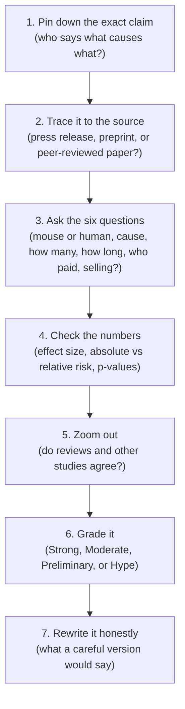

# Chapter 20: Be Your Own Scientist: Reading Health Claims

## Summary

This final chapter turns the Hype Meter and the six claim questions into a complete method you can use on any health claim, gut-brain or not. You will learn how scientists rank different kinds of evidence, why most mouse results don't carry over to people, and what peer review, preprints, and preregistration can and can't promise. Then you'll work through the numbers that headlines love to bend: p-values, "statistically significant," and relative versus absolute risk. You will also learn how supplement marketing is regulated, how to read an abstract, and how to write about science honestly. The chapter ends with a template for your own student research project.

## Concepts Covered

1. Hierarchy of Evidence
2. Mouse-to-Human Translation
3. Peer Review
4. Preprint
5. Conflict of Interest
6. Preregistration
7. Statistical Significance
8. Absolute vs Relative Risk
9. Health Claim Marketing
10. Structure-Function Claim
11. Reading an Abstract
12. Claim-Checking Method
13. Science Communication
14. Student Research Project

## Prerequisites

- [Chapter 1: The Brain in Your Belly (and Why That Phrase Is Misleading)](../01-brain-in-your-belly/index.md) (the Hype Meter and the six questions)
- [Chapter 16: Probiotics, Prebiotics, and "Psychobiotics"](../16-probiotics-psychobiotics/index.md)
- [Chapter 17: Medicine for the Gut-Brain Axis](../17-medicine-gut-brain-axis/index.md)
- Helpful: any of Chapters 2 to 19, since the claims in this chapter come from all of them

!!! mascot-welcome "Your turn to be the scientist"
    { class="mascot-admonition-img" }
    For nineteen chapters, I've been grading claims for you. This chapter hands you the grading pen. The gut-brain axis will keep producing exciting headlines long after you finish this book, and the skills here will let you sort the real advances from the sales pitches on your own. Let's check the evidence, one last time, together.

## 20.1 Three Posts in One Scroll

It's Tuesday night, and Sam should be studying for a chemistry test. Instead, he's scrolling. The first post is from his older cousin: a smiling influencer holding a bottle of gummies. "My anxiety is GONE," the caption says. "These probiotics rewired my gut-brain axis. Backed by science!" The second post is an ad for a small device you clip to your ear. "Activate your vagus nerve. Melt stress in minutes." The third is a news story Riya sent him: "New pill puts Crohn's disease into remission, study finds."

Sam has IBS and test anxiety, so the first two posts are aimed right at him. Riya has Crohn's disease, so the third one could matter for her. All three use the language of science. All three sound hopeful. Which one deserves their trust? (Sam and Riya are fictional students who appear throughout this book.)

The next day at science club, Riya and Sam pitch a project: a claim-checking guide any student could use on posts like these. Their advisor agrees, on one condition: the guide must explain *why* a claim earns its grade. That project is the thread of this chapter.

## 20.2 Thinking Like a Detective

Before any technical terms, picture a detective at a crime scene. Several witnesses tell their stories. One saw the whole thing up close. One heard about it from a friend. One is the suspect's business partner. A good detective doesn't believe everyone equally, and doesn't dismiss everyone either. She asks: How close was this witness to what happened? Do the stories agree? Does anyone have a reason to bend the truth?

Reading a health claim works the same way. The evidence is the witnesses: some strong (a large trial in people), some weak (a single testimonial), some with a motive (a company studying its own product). Your job isn't to be cynical. It's to be **calibrated**: trust strong evidence, doubt weak evidence, and know the difference.

You already have two tools from [Chapter 1, Section 1.12](../01-brain-in-your-belly/index.md#112-the-hype-meter-grading-gut-brain-claims): the four Hype Meter grades and the six questions (refresher on the [Hype Meter page](../../hype-meter.md)). This chapter makes those questions sharper, then combines everything into a step-by-step method in Section 20.12.

## 20.3 Not All Evidence Is Equal: The Hierarchy of Evidence

Does a new pill help IBS? Your aunt took it and felt better. A lab paper shows it changes gut cells in a dish. A study of thousands of people found pill-takers had fewer symptoms. A trial randomly assigned people to the pill or a fake pill. All four are "evidence." They aren't equally convincing.

The **hierarchy of evidence** is the idea that different kinds of studies give different levels of confidence about cause and effect, often drawn as a pyramid with the weakest kinds at the bottom and the strongest at the top. Here is a common version, from bottom to top:

| Level (weakest to strongest) | What it is | What it can show | Main weakness |
|---|---|---|---|
| Testimonials, anecdotes, expert opinion | One person's story or one expert's view | That something is possible or worth studying | No comparison group; memory and hope bias the story |
| Lab and animal studies | Cells in dishes, mice, rats | How something *might* work (mechanism) | Often doesn't carry over to people |
| Case reports and case series | Doctors describe one patient or a handful | Rare events, new patterns | Tiny numbers, no comparison |
| Observational studies | Researchers watch large groups without changing anything | Links (correlations) in real people | Can't rule out reverse causation or hidden third factors |
| Randomized controlled trials (RCTs) | People are randomly assigned to a treatment or a comparison, often a placebo | Whether the treatment *causes* a change | Expensive, often short, may exclude many kinds of patients |
| Systematic reviews and meta-analyses | Researchers gather all the good studies on a question and combine them | The overall picture across many studies | Only as good as the studies inside them |

[The National Center for Complementary and Integrative Health](https://www.nccih.nih.gov/health/know-science/how-to-make-sense-of-a-scientific-journal-article/methods/types-of-research) (NCCIH), part of the US National Institutes of Health, describes a similar ladder from basic research to clinical trials, which give the clearest information about whether a treatment works and is safe in people. When many studies reach the same conclusion, NCCIH notes, the result is more reliable.

Why are randomized trials so powerful? Randomization is like shuffling a deck before dealing two hands. People who choose a pill might already be healthier or more motivated; a coin flip spreads those differences evenly, so the main remaining difference is the treatment. A placebo (a look-alike fake treatment) and "blinding" (people don't know their group) remove the power of expectation, which matters a lot for pain, mood, and gut symptoms.

The pyramid is a starting point, not a law. In 2016, [Murad and colleagues](https://pubmed.ncbi.nlm.nih.gov/27339128/) proposed a "new evidence pyramid" in which systematic reviews act like a lens for viewing the other studies, because a review of ten tiny, biased trials is still weak. And some questions can't be answered by trials at all (you can't assign teens to smoke for 20 years), so for some harms, large observational studies are the best evidence possible. Roughly, Strong grades rest on trials or many consistent human studies, and Hype grades rest on testimonials or a single mouse study dressed up as proof.

## 20.4 The Mouse Problem: Mouse-to-Human Translation

Mice are amazing research partners: scientists can control their diet, genes, and even their microbes. Germ-free mice, mice given human gut bacteria, and mice with a cut vagus nerve taught us how gut-brain signaling *can* work.

But a mouse is not a small person. **Mouse-to-human translation** is the process of testing whether a finding in mice (or other animals) holds true in people, and the frequent failure of animal results to carry over. Here is what the research on translation itself shows:

- **Even famous animal studies usually don't translate.** In 2006, [Daniel Hackam and Donald Redelmeier](https://pubmed.ncbi.nlm.nih.gov/17032985/) looked at 76 highly cited animal studies. In a [2007 article](https://pmc.ncbi.nlm.nih.gov/articles/PMC1782020/), Hackam summarized the result: only about one in three were later confirmed in human randomized trials.
- **Mouse biology can differ in basic ways.** A [2013 study](https://pubmed.ncbi.nlm.nih.gov/23401516/) by Seok and colleagues found that mouse gene responses to serious inflammation (burns, trauma, a bacterial toxin) barely matched human ones, close to chance. That was about inflammation models only, and a 2014 reanalysis of the same data by [Takao and Miyakawa](https://pubmed.ncbi.nlm.nih.gov/25092317/), using a different way of choosing which genes to compare, reached the opposite conclusion. So the finding is debated. It doesn't mean mouse studies never work, only that you can't assume they will.
- **Microbiome mouse studies may be too good to be true.** In 2020, [Walter and colleagues](https://pubmed.ncbi.nlm.nih.gov/31978342/) reviewed studies that moved gut microbes from sick people into germ-free rodents. In 95% of them (36 of 38), the disease trait supposedly "transferred" along with the microbes. The authors called that success rate implausible and warned that it overstates the microbiome's role in human disease.

The clearest example in this book comes from [Chapter 16](../16-probiotics-psychobiotics/index.md). In 2011, [Bravo and colleagues](https://pubmed.ncbi.nlm.nih.gov/21876150/) gave mice a probiotic strain called *Lactobacillus rhamnosus* JB-1. The mice showed less anxiety-like behavior and a lower stress-hormone response, and cutting the vagus nerve blocked the effect. It was exciting, careful work.

Then, in 2017, [Kelly and colleagues](https://pubmed.ncbi.nlm.nih.gov/27865949/) gave the same strain to 29 healthy men in an 8-week randomized, placebo-controlled trial. It did nothing measurable for stress, mood, anxiety, sleep, memory, inflammation, or brain-wave patterns. The paper's title began, "Lost in translation?"

!!! mascot-thinking "A mouse result is a question, not an answer"
    { class="mascot-admonition-img" }
    When I see "a study found" followed by something about mice, I mentally rewrite it as "scientists have a new question to test in people." The JB-1 story shows why: the mouse result was real, and it still didn't hold up in humans.

The Kelly trial didn't prove JB-1 is useless for everyone: it was small and tested healthy men, not people with anxiety disorders. That's how to describe a negative result honestly.

!!! hype-hype "Hype Meter: "This probiotic is proven to lower stress (it worked in a study!)""
    
StrongModeratePreliminaryHype

    **Verdict: Hype.** The best-known "stress probiotic" study, Bravo 2011, was done in mice. When the same strain was tested in 29 healthy men for 8 weeks with a placebo comparison (Kelly 2017), it had no measurable effect on stress, mood, or thinking. Probiotic effects also depend on the exact strain, so a result for one strain doesn't transfer to others.
    **What would change the grade:** Several large, placebo-controlled trials of a specific strain in people with stress or anxiety problems, by independent teams, showing a consistent benefit. That could move the claim for that strain to Preliminary or Moderate.

## 20.5 How Research Gets Published: Preprints and Peer Review

When scientists finish a study, they write it up as a paper. What happens next affects how much you should trust it.

Many researchers first post their paper as a **preprint**: a complete scientific paper shared publicly online before it has been checked by peer review. Preprint servers such as [medRxiv](https://www.medrxiv.org/content/about-medrxiv) (for health research) let anyone read new findings within days. But medRxiv's own website warns that preprints are preliminary reports that haven't been certified by peer review, shouldn't be used to guide health decisions, and shouldn't be reported in news media as established information.

News stories sometimes skip that warning. If a headline cites a preprint, treat the finding as Preliminary at best until it is reviewed and confirmed.

**Peer review** is the process in which a journal sends a submitted paper to independent experts in the same field, who check its methods, reasoning, and conclusions and recommend whether it should be published, revised, or rejected. Think of a building inspector: good at catching cracked foundations, but unable to test every wire behind the walls.

Here's what peer review does and doesn't do:

| Peer review usually checks | Peer review usually can't check |
|---|---|
| Whether the study design fits the question | Whether the raw data are accurate (reviewers rarely see them) |
| Whether the conclusions follow from the results | Whether the result will repeat in another lab |
| Whether important limits are mentioned | Whether all the analyses tried were reported |
| Whether the paper explains its methods clearly | Whether the finding applies to people unlike those studied |

!!! mascot-warning "Published doesn't mean proven"
    { class="mascot-admonition-img" }
    "Published in a peer-reviewed journal" means experts thought a study was worth sharing, not that its conclusion is true. The mouse JB-1 study and the human JB-1 trial were both peer reviewed, and they disagreed. Science moves forward when many studies line up, not when one passes inspection.

## 20.6 Calling Your Shot: Preregistration

Picture a basketball player who shoots from half court, sinks it, and then announces, "I meant to bank it off the glass." You'd be more impressed if she called the shot before she threw.

Research has the same problem. If scientists measure 20 different outcomes and then report only the one that came out well, the "finding" may be pure luck. [Nosek and colleagues](https://pubmed.ncbi.nlm.nih.gov/29531091/), in a 2018 paper, describe this as confusing *postdiction* (explaining results after you see them) with *prediction* (testing an idea you stated in advance). Even honest researchers fall into it, because hindsight makes any pattern look like what you expected.

**Preregistration** means publicly recording a study's question, main outcome, and analysis plan before collecting or looking at the results, so readers can check that the researchers tested what they said they would. For clinical trials, public registries such as ClinicalTrials.gov hold these plans. Each registered trial gets an ID number that starts with "NCT." The International Committee of Medical Journal Editors (ICMJE), whose rules many major medical journals follow, requires trials to be registered at or before the time the first patient enrolls, as a condition for considering the paper.

As a reader, look for the registration number, then compare the registered main outcome with the one the paper headlines. If the registry planned pain scores but the paper trumpets sleep quality, ask why. Preregistration doesn't make a study correct, and exploring surprises is normal science; it just keeps planned tests and surprise findings clearly labeled.

## 20.7 What "Statistically Significant" Really Means

Headlines love the phrase "statistically significant." It sounds like "important." It doesn't mean that.

Flip a fair coin 10 times and you might get 7 heads by luck. Getting 700 heads in 1,000 flips would be shocking. Statistics asks: if the treatment did nothing, how surprising would our results be?

**Statistical significance** is a label researchers give a result when it would be unlikely to occur by chance alone if there were truly no effect, usually judged by a p-value below a cutoff such as 0.05. The **p-value** is a number between 0 and 1. A small p-value means "data like these would be surprising if the treatment did nothing." It does not tell you how big or how useful the effect is.

In 2016, the American Statistical Association (ASA), the largest organization of statisticians, released a [statement](https://www.amstat.org/asa/files/pdfs/p-valuestatement.pdf) with six principles about p-values because they are so often misused. Two of the principles are especially useful for reading headlines:

- A p-value, or statistical significance, does not measure the size of an effect or the importance of a result.
- Scientific conclusions shouldn't be based only on whether a p-value passes a specific cutoff.

In a huge study, a tiny, meaningless difference can be "significant," while a small study can miss a real effect. So after "significant," always ask: **How big was the difference? Would a person notice it?**

!!! mascot-encourage "Stats feel slippery at first"
    { class="mascot-admonition-img" }
    If p-values make your head spin, you're in good company; professional scientists argue about them too. For reading headlines, you only need one habit: whenever you see "significant," look for the actual numbers and ask how big the difference was.

Small studies cause a second problem. In 2013, [Button and colleagues](https://pubmed.ncbi.nlm.nih.gov/23571845/) showed that the average neuroscience study has very low statistical power, meaning it's too small to reliably detect real effects. Low power has a sneaky side effect: when a small study does find something, the effect it reports is more likely to be exaggerated or false.

In 2005, John Ioannidis published a [famous paper](https://pubmed.ncbi.nlm.nih.gov/16060722/) arguing that research findings are less likely to be true when studies are small, effects are small, designs are flexible, and there are financial interests. That paper was a modeling argument, not a count of false studies, so it doesn't mean "most research is wrong." It's a list of warning signs, and the gut-brain field has many of them.

Watch for one more trick: **picking the good number.** In [Chapter 16](../16-probiotics-psychobiotics/index.md), you met a [2024 review](https://pubmed.ncbi.nlm.nih.gov/39245752/) of 12 probiotic trials with 707 people. Probiotics showed a significant benefit on one depression questionnaire (the Beck Depression Inventory) but not on three others. A headline could truthfully say "probiotics significantly reduced depression scores" while leaving out the three scales that showed no significant difference. That's why the book grades "probiotics treat depression" as Preliminary.

## 20.8 Absolute vs Relative Risk: Same Data, Different Headlines

Suppose a store advertises "50% off!" That sounds huge, until you learn the item was a 2-dollar pack of gum. The percentage is real, but the actual savings are a dollar. Risk numbers work the same way.

**Absolute vs relative risk** is the difference between two ways of describing how much a treatment changes the chance of an outcome. **Absolute risk** is the actual chance of the outcome in a group (for example, 12 out of 100 people). The absolute risk difference is the simple subtraction between groups, in percentage points. **Relative risk** compares the two groups as a ratio, so a change can sound large even when the actual numbers are small.

Let's use a real example from [Chapter 17](../17-medicine-gut-brain-axis/index.md). In the [ECOSPOR III trial](https://pubmed.ncbi.nlm.nih.gov/35045228/), published in 2022 in the *New England Journal of Medicine*, 182 adults who had recurrent *C. difficile* (C. diff) infections took either an oral microbiome treatment called SER-109 or a placebo after their antibiotics. Within 8 weeks, the infection came back in 12% of the SER-109 group and 40% of the placebo group (12.4% vs 39.8% before rounding). The FDA [approved SER-109 as Vowst](https://www.fda.gov/news-events/press-announcements/fda-approves-first-orally-administered-fecal-microbiota-product-prevention-recurrence-clostridioides) on April 26, 2023, to prevent C. diff from coming back in adults 18 and older after antibiotic treatment for recurrent infection.

Here are three accurate ways to describe the same result:

| Way of describing it | Calculation | How it sounds |
|---|---|---|
| Absolute risk difference | \( 40\% - 12\% = 28 \) percentage points | "28 fewer people out of every 100 had the infection come back" |
| Relative risk | \( 12\% \div 40\% \approx 0.3 \) (the paper reports 0.32) | "Recurrence risk was about one-third as high" |
| Relative risk reduction | \( 1 - 0.32 = 0.68 \) | "68% lower risk of recurrence" |

Another useful number is the **number needed to treat** (NNT): about how many people need the treatment for one extra person to benefit. It's 1 divided by the absolute risk difference:

$$ \text{NNT} = \frac{1}{0.40 - 0.12} = \frac{1}{0.28} \approx 3.6 $$

So about 4 people would need treatment to prevent one recurrence: a strong effect by either measure.

Relative risk can also mislead. **Practice data (made up for this exercise):** if a rare side effect hits 1 in 10,000 people without a supplement and 2 in 10,000 with it, "doubles your risk!" is technically true, but the absolute difference is 1 extra case per 10,000 people. Only together do the two numbers tell the whole story.

!!! mascot-tip "Always ask: out of how many?"
    { class="mascot-admonition-img" }
    When a headline says "cuts risk by half" or "doubles your risk," hunt for the starting number. Half of 40% is a big deal; half of 0.02% might not change anyone's life.

!!! hype-strong "Hype Meter: "An FDA-approved microbiome pill helps stop C. diff from coming back""
    
StrongModeratePreliminaryHype

    **Verdict: Strong.** A phase 3 (large, late-stage; see [Chapter 17](../17-medicine-gut-brain-axis/index.md)), double-blind, placebo-controlled trial of 182 adults found recurrence of 12% with the treatment versus 40% with placebo at 8 weeks, and the FDA approved it as Vowst in 2023. The approval covers one specific use: preventing recurrence in adults 18 and older after antibiotic treatment for recurrent C. diff.
    **What would change the grade:** Longer follow-up showing safety problems, or failed replication. Note that the Strong grade does not extend to other uses, such as anxiety, autism, or weight; those would need their own trials.

## 20.9 Follow the Money: Conflict of Interest

Imagine a restaurant review written by the owner. It might be accurate; you'd still want a second opinion. A **conflict of interest** is a situation in which a researcher, author, or organization has financial or personal ties (such as funding, a job, stock, or a patent) that could influence, or seem to influence, how research is designed, interpreted, or reported. Good journals require authors to disclose these ties in a funding statement and a conflict-of-interest statement, usually near the end of the paper.

Does funding actually change results? A [2017 Cochrane review](https://pubmed.ncbi.nlm.nih.gov/28207928/) by Lundh and colleagues combined 75 papers that compared drug and device studies by who paid for them. Studies sponsored by the company that made the product more often reported favorable results (relative risk 1.27) and more often reached favorable conclusions (relative risk 1.34) than studies with other funding. The usual quality checks for bias didn't explain the difference. The authors concluded that industry sponsorship itself is linked to more favorable results.

That doesn't make industry-funded research fake. Most new medicines are tested in trials paid for by their makers, because trials are expensive. A conflict of interest is a reason to look harder, not to throw a study away. Ask: Was it preregistered? Blinded? Do independent studies agree?

Here is the ECOSPOR III trial run through the six questions:

!!! claim-box "How to read a gut-brain claim: the ECOSPOR III microbiome pill trial"
    | Question | This study |
    |---|---|
    | Mouse or human? | Human. 182 adults who had had at least three episodes of C. diff infection (counting the current one), whose symptoms had cleared after standard antibiotics. |
    | Correlation or cause? | Cause. It was a randomized, double-blind, placebo-controlled phase 3 trial, the strongest single-study design for testing a treatment. |
    | How many? | 182 enrolled (281 were screened). Large enough to show a big difference, but rare side effects need larger numbers to detect. |
    | How long? | The main outcome was recurrence within 8 weeks. It doesn't show how people did years later. |
    | Who paid for it? | Seres Therapeutics, the company that developed the treatment. Many of the authors worked for Seres. The trial was preregistered ([ClinicalTrials.gov NCT03183128](https://clinicaltrials.gov/study/NCT03183128), submitted in June 2017, before it started in July 2017). |
    | Is something being sold? | Yes. The treatment is now sold as Vowst, approved by the FDA in 2023 for one specific use. |

The verdict: a strong trial with a clear, large effect, which the FDA reviewed before approving the product. Company funding and a product for sale are facts a careful reader notes. Here they're balanced by randomization, blinding, preregistration, and an independent regulatory review. The result applies to adults with recurrent C. diff, not to anyone else.

## 20.10 Selling the Gut: Health Claim Marketing and Structure-Function Claims

Now back to Sam's cousin and those gummies. Why can a supplement company say "supports a healthy gut-brain connection" without the kind of trial Vowst needed?

**Health claim marketing** is the use of health-related promises, such as "boosts immunity," "clinically proven," or "reduces stress," to sell products. It includes labels, ads, websites, and influencer posts. It's regulated, but less strictly than many people assume, and the rules differ for drugs, foods, and supplements.

In the US, most probiotics are sold as dietary supplements. Under a 1994 law called the [Dietary Supplement Health and Education Act (DSHEA)](https://www.fda.gov/food/dietary-supplements), supplements don't need FDA approval before they're sold. Instead of proving that they treat a disease, supplement labels can make a different kind of claim.

A **structure-function claim** is a statement that a supplement or food supports the normal structure or function of the body (for example, "calcium builds strong bones" or "fiber maintains bowel regularity") without claiming to diagnose, treat, cure, or prevent a disease. According to the FDA, these claims aren't preapproved. The maker must have evidence that the claim is truthful and not misleading and must notify the FDA no later than 30 days after first marketing it. A supplement label with such a claim must include a disclaimer saying the FDA hasn't evaluated the claim and that the product isn't intended to "diagnose, treat, cure or prevent any disease." Only a drug can legally make that kind of disease claim.

Compare these pairs:

| Structure-function claim (allowed on a supplement with the disclaimer) | Disease claim (needs drug-level approval) |
|---|---|
| "Supports digestive comfort" | "Treats IBS" |
| "Supports a balanced mood" | "Relieves depression" |
| "Promotes a healthy gut-brain connection" | "Cures anxiety" |
| "Helps maintain healthy immune function" | "Prevents infections" |

The left column sounds almost the same as the right but promises less, and that gap is where a lot of marketing lives. Vague words like "supports" plus the small-print disclaimer mean the product hasn't been shown to treat a disease.

Advertising has its own referee. In December 2022, the US Federal Trade Commission (FTC) published its [Health Products Compliance Guidance](https://www.ftc.gov/business-guidance/resources/health-products-compliance-guidance), replacing its 1998 supplement advertising guide. Health claims in ads generally need "competent and reliable scientific evidence," usually randomized trials in people; animal and lab studies aren't enough alone, and testimonials never count as proof. So "My anxiety is GONE!" in a paid post isn't evidence, even if the person truly feels better.

!!! families "For families"
    Parents and grandparents often share health posts out of love. If a relative sends a gut-health product, thank them for caring and suggest checking it together with the six questions, without mocking the post or the person; the difference between a structure-function claim and a disease claim isn't obvious to anyone. For any supplement, the safest next step is to bring the label to the teen's doctor or pharmacist, especially if the teen takes other medicines.

## 20.11 Reading an Abstract

News stories are written to be read. Scientific papers are written to be checked. The bridge between them is the abstract.

**Reading an abstract** is the skill of extracting a study's question, methods, main results, and limits from the short summary at the top of a scientific paper, and comparing what it actually found with how others describe it. NCCIH advises going to the original source, the journal article, instead of trusting a news story alone. Most papers follow the same plan: abstract, introduction, methods, results, discussion, and references. Abstracts are free on PubMed (pubmed.ncbi.nlm.nih.gov) even when the full paper costs money.

Many medical abstracts use labeled sections. Here's what to pull from each:

| Abstract section | What to look for | Red flags |
|---|---|---|
| Background | What question the study asks | A question much narrower than the headline |
| Methods | Mouse or human; how many; randomized or not; placebo or not; how long; main outcome | Animals, tiny numbers, no comparison group |
| Results | The actual numbers in each group, not just "significant" | Only p-values, no group numbers; a different outcome than the one planned |
| Conclusions | What the authors themselves claim | Words like "may" and "suggests" that become "proves" in the news |
| Funding and registration | Who paid; the trial registry number | No registration for a trial; undisclosed company ties |

Let's practice on the ECOSPOR III abstract (PubMed ID 35045228). Its methods section says it was a phase 3, double-blind, randomized, placebo-controlled trial in patients who'd had three or more C. diff episodes. Its results give the group numbers (12% vs 40%) and the relative risk (0.32). Its conclusion is careful: the treatment was better than placebo at reducing recurrence in patients whose symptoms had resolved after antibiotics. And its last line lists the funder and registration number. In one paragraph, you can answer all six questions.

A **press release** is different: an announcement written by a company's or university's communications staff to get coverage. It isn't peer reviewed and often leads with the most exciting number. When a news story is based on a press release, find the abstract before you believe the headline.

## 20.12 Putting It Together: The Claim-Checking Method

You now have all the pieces. The **claim-checking method** is this book's step-by-step process for judging any health claim: state the exact claim, trace it to its original source, ask the six questions, check the numbers and the money, weigh it against the wider body of evidence, and assign a Hype Meter grade with a careful rewrite.

Three tips matter most. In step 1, "probiotics are good for your brain" is too fuzzy to grade; grade the claim *as stated*, in testable words. In step 5, remember that one study rarely settles anything: NCCIH's health news checklist asks whether this is the first time a study has reported these results, so look for a systematic review or clinical guideline. And in step 7, the rewrite should fit the grade you gave, even if it's "scientists are just starting to test this in people."

Here are the book's grades for some of the most common claims from earlier chapters. Use them to check your calibration:

| Claim | Book's grade | Key reason | Chapter |
|---|---|---|---|
| "More than 90% of your body's serotonin is made in your gut." | Strong | Consistent human and animal evidence | [5](../05-serotonin-myth/index.md) |
| "Implanted vagus nerve stimulation is FDA approved for treatment-resistant depression." | Strong | Approved in 2005 as an add-on for adults after 4 or more failed treatments; the approval is the Strong fact, while evidence of benefit is Moderate | [17](../17-medicine-gut-brain-axis/index.md) |
| "Gut-directed hypnotherapy can ease IBS symptoms." | Moderate | A [2020 analysis](https://pubmed.ncbi.nlm.nih.gov/32276950/) of 41 trials of psychological therapies found benefit, but many had a high risk of bias | [18](../18-sleep-exercise-therapy/index.md) |
| "Poor sleep is linked to later Crohn's flares." | Preliminary | One large patient study found a link; it needs repeating, and cause is not proven | [18](../18-sleep-exercise-therapy/index.md) |
| "Probiotics treat depression." | Preliminary | Mixed results: one questionnaire out of four improved in a 2024 review | [16](../16-probiotics-psychobiotics/index.md) |
| "Vagus nerve stimulation can calm Crohn's disease." | Preliminary | Only small open-label studies (7 and 16 patients) with no comparison group; not approved for Crohn's | [17](../17-medicine-gut-brain-axis/index.md) |
| "70% of your immune system lives in your gut." | Hype | About 70% of antibody-making plasma cells, but only about 3% of all immune cells | [4](../04-immune-sense-organ/index.md) |
| "Leaky gut causes autism." | Hype | No human evidence of cause; autism is a neurodevelopmental difference, not a gut disease | [13](../13-autism-adhd-gut/index.md) |

!!! hype-preliminary "Hype Meter: "A new study found that...""
    
StrongModeratePreliminaryHype

    **Verdict: Preliminary, until you check.** A single new study can be anything from a mouse experiment to a large trial, so the honest starting grade is "it depends." Most first-time findings, especially in mice or small groups, are Preliminary, and NCCIH reminds readers that one study rarely proves anything. A large, preregistered, randomized trial in people can earn more, especially when it agrees with earlier work.
    **What would change the grade:** Tracing the headline to the study. Human, randomized, large, preregistered, and replicated moves it up. Mouse-only, tiny, unregistered, or company-funded with no independent check keeps it at Preliminary or pushes it toward Hype if the headline overstates it.

The MicroSim below lets you practice the grading step on 16 real claims from across the book.

#### Diagram: Hype Meter Sorter
<iframe src="../../sims/ch20-hype-meter-sorter/main.html" height="517px" width="100%" scrolling="no"></iframe>

[Open the Hype Meter Sorter fullscreen](../../sims/ch20-hype-meter-sorter/main.html){ .md-button .md-button--primary }

MicroSim specification: Hype Meter Sorter

Type: microsim
**sim-id:** ch20-hype-meter-sorter 
**Library:** p5.js 
**Status:** Implemented 
**Bloom Level:** Evaluate 
**Bloom Verb:** judge 
**Learning Objective:** The learner will judge popular gut-brain claims by assigning a Hype Meter grade (Strong, Moderate, Preliminary, or Hype) based on the evidence behind each claim as stated, and will check whether their misses lean too generous or too harsh.

**Canvas:** 430 px drawing area plus 85 px controls (iframe 517 px); responsive to about 380 px wide.

**Controls:** Four grade buttons (Strong, Moderate, Preliminary, Hype); Next card; Start over (reshuffles); Show chapter checkbox (hint).

**Cards:** 16 claims from Chapters 1, 4, 5, 7, 11, 13 to 18, spread across all four grades. Each card stores the book's grade, the source chapter, and a one-sentence reason.

**Feedback:** After each choice, a colored panel shows the book's grade, whether the learner's grade matched, was too generous (closer to Strong), or too harsh, and the reason. A tally counts cards by the book's grade, matches, and misses in each direction. A summary screen appears after all 16 cards.

**Provenance:** Grades and numbers match CLAUDE.md canonical values and the verified dossiers for Chapters 1 to 19 (for example [Sender 2023](https://pubmed.ncbi.nlm.nih.gov/37871201/), Rahmannia 2024, Black 2020, Feuerstadt 2022, FDA PMA P970003/S050). Not animated, so it has no Start/Pause button.

Sort all 16 cards without the chapter hint first, running the six questions in your head. When you miss, decide which evidence feature you overlooked. Pay attention to the two vagus nerve cards and the two serotonin cards: in each pair, the topic is the same but the grades differ completely, because the claims say different things.

At the end, check your "too generous" and "too harsh" counts. Claims are written to sound convincing, so it's easy to lean generous; some people overcorrect and call everything Hype. The goal is calibration.

!!! model-limits "What this model leaves out"
    - Real evidence is a sliding scale, not four boxes. Some claims sit on the line between two grades, and careful experts can disagree.
    - Each card gives one sentence of reasoning; a real grade weighs many studies, their quality, and their size.
    - The sim grades claims as of October 2026. New studies can move a grade up or down, which is why the book logs corrections.
    - The sim doesn't test the hardest step in real life: finding and reading the original study behind a post.
    - A grade describes evidence for a claim in general, not what's right for any one person. That's a decision for a person and their doctor.

## 20.13 Science Communication: Saying It Right

Once you can grade a claim, you can do something even more useful: explain it to others. **Science communication** is the practice of explaining scientific findings to non-experts accurately, clearly, and with the right level of certainty, without hiding uncertainty or exaggerating results.

It's not about sounding cautious all the time; it's about matching your words to your evidence. Here's a word ladder:

| Evidence | Words that fit | Words to avoid |
|---|---|---|
| Strong | "shows," "causes," "reduces," "is approved for (specific use)" | Adding uses that weren't tested |
| Moderate | "is linked to," "probably helps," "several studies suggest" | "proves," "cures" |
| Preliminary | "early studies suggest," "in mice," "a small study found," "scientists are testing" | "shows," "breakthrough," "game changer" |
| Hype | "there's no good evidence that," "this stretches a real finding" | Repeating the claim without the correction |

Riya and Sam used this ladder for their club project. Here's how they rewrote Sam's three posts from Section 20.1:

- **The gummy post** became: "Some probiotic trials found small mood improvements, but results are mixed, and testimonials aren't evidence. If anxiety gets in your way, a doctor or counselor can help you find treatments with strong evidence."
- **The ear-clip ad** became: "Implanted vagus nerve stimulators are FDA approved for a few specific conditions. Consumer ear devices for stress haven't been shown to work." (see [Chapter 17](../17-medicine-gut-brain-axis/index.md)).
- **The Crohn's headline** waited until they found the actual study (see At the Bedside below).

One more principle: **correct without shaming.** People share hype out of hope. "Here's what the studies found" works better than "That's fake."

## 20.14 Your Turn: A Student Research Project

The final skill is producing evidence summaries yourself. A **student research project** is a structured investigation in which a student picks one health claim, finds and evaluates the original evidence, assigns a Hype Meter grade, and explains the result in plain language for a real audience. Riya and Sam's club guide used the template below, and you can too. It works for a class assignment, a science fair, or a club presentation.

**Student research project template**

1. **The claim.** Copy it exactly, with where and when you found it, who made it, and whether they sell anything.
2. **The question.** Restate it as "In [which people], does [what] cause [which outcome], compared with [what]?"
3. **Sources.** At least three: the original study (or a note that none exists), a systematic review or guideline if one exists, and a plain-language source such as NIH, NCCIH, CDC, FDA, or MedlinePlus.
4. **Six-question table.** Fill in a claim box for the main study.
5. **The numbers.** Report group results, convert relative to absolute risk if you can, and note whether "significant" was also big.
6. **The grade.** Strong, Moderate, Preliminary, or Hype, with two or three sentences of reasoning and what study would change it.
7. **Plain-language summary.** 100 to 150 words for a 9th grader, using the word ladder in Section 20.13.
8. **Limits and safety.** Say what the project can't tell anyone, and include "talk to your doctor before starting, stopping, or changing any medicine, diet, or supplement."
9. **References.** Every source, with a working link you opened yourself.

!!! living-with "If you're going through this"
    If you live with Crohn's, colitis, IBS, celiac disease, or another condition, you may get flooded with miracle-cure posts, sometimes from people who love you. It's okay to feel hopeful when you read them, and it's okay to feel tired of them. You don't have to evaluate every post alone. Bring the ones that interest you to your care team; many doctors appreciate patients who ask "What's the evidence for this?" And please don't start, stop, or change a medicine, diet, or supplement on your own because of a post. Make that call with your doctor.

## At the Bedside: Reading the Headline Together

!!! note "Meet the patient (fictional)"
    Riya, 16, has had Crohn's disease since 14 and is mostly in remission on a biologic medicine. Her grandmother texts her a news story: "New pill puts Crohn's into remission, study finds." Riya wants to know if she should switch from injections to the pill. She brings the article to her next visit with Dr. Alvarez, her pediatric gastroenterologist.

**What the doctor checks:** Dr. Alvarez first checks on Riya herself: how she's feeling, any new symptoms, how she's handling school, and her recent lab results. Then she asks to see the article. Together they trace it: the news story was based on a company press release, which linked to a conference presentation. A trial registration number led them to the study's entry on ClinicalTrials.gov. (The drug in this case is fictional; we'll call it "Drug X.")

**Connecting the signals:** They compare the documents side by side. The results hadn't been published in a peer-reviewed journal yet, and the registry told a narrower story than the headline:

| What the press release said | What the trial record showed |
|---|---|
| "Puts Crohn's into remission" | Remission on a symptom score at 12 weeks; colonoscopy results not yet reported |
| "Breakthrough pill" | A phase 3 trial; not yet reviewed by the FDA |
| No mention of age | Adults 18 and older only |
| "Patients" | Adults whose disease had not responded to at least one biologic |

**Diagnosis:** Crohn's disease, in remission on her current treatment. The new question isn't a medical diagnosis; it's a case of hopeful headline meets incomplete evidence.

**Why it happens:** Press releases are written to attract attention, and news stories often repeat them. This is the claim-checking method in action: trace the source, check who was studied, compare planned and reported outcomes, and notice what isn't known yet (long-term safety, effects in teens, peer review, FDA review).

**The mind-body side:** Riya admits she felt a rush of hope, then a crash of worry that she was "missing out" on something better. Dr. Alvarez tells her that hope is good, and that checking keeps hope honest. Living with a chronic illness means hearing about many "breakthroughs," and the swing between excitement and disappointment can be exhausting. She suggests Riya keep a list of questions about new treatments for visits, and reminds her that the clinic's psychologist is available if worry starts to affect sleep, school, or mood.

**Treatment today:** Riya's current biologic is working, so the plan stays the same. Crohn's treatment for teens is chosen by the care team based on disease location, severity, past response, growth, and safety, and a drug tested only in adults needs more information before it's considered for a teen. They agree to revisit the question if Drug X is approved and studied in younger patients.

**What's new in research:** New Crohn's medicines do reach patients after this kind of testing. For example, in January 2025, the FDA [approved mirikizumab](https://www.healthday.com/healthpro-news/digestive-system/fda-approves-omvoh-for-moderately-to-severely-active-crohn-disease) for adults with moderately to severely active Crohn's disease, based on results from the phase 3 VIVID-1 trial at one year. **Evidence grade: Strong** for its approved use in adults, because the approval rested on large randomized trials. That grade applies to adults with moderate to severe Crohn's, not to every person with Crohn's, and whether it fits any one patient is a decision for their care team.

??? question "Your turn: reason through a variation"
    A month later, Riya's cousin forwards a different headline: "Gut bacteria trigger Crohn's, scientists discover." The underlying paper is a mouse study in which microbes from people with Crohn's caused gut inflammation in germ-free mice. How should Riya grade the headline?

    **Answer:** The study is in mice, so the honest grade for "gut bacteria trigger Crohn's in people" is Preliminary at best, and the headline's certain tone ("discover") pushes it toward Hype. Walter and colleagues (2020) found that 95% of studies moving human microbes into germ-free rodents reported that disease traits transferred, a rate they called implausible. A careful rewrite: "In a mouse study, microbes from people with Crohn's caused gut inflammation. Scientists still need to learn whether microbes help start Crohn's in humans, or change because of it."

*This is a fictional teaching case. It is not medical advice. If you or someone you know has symptoms like these, talk to a doctor.*

## Common Misconceptions

**Myth:** If a study passed peer review, its conclusion is true.  
**Reality:** Peer review checks whether a study's methods and reasoning look sound, but reviewers rarely see the raw data or repeat the experiment. Peer-reviewed studies can still be wrong, and confidence comes when several independent studies agree.

**Myth:** A single study settles the question.  
**Reality:** One study rarely proves anything. Results from small or first-time studies often shrink or vanish when repeated, and only about one in three highly cited animal studies were later confirmed in human trials. Look for systematic reviews and guidelines.

**Myth:** "Statistically significant" means the effect is big or important.  
**Reality:** Statistical significance only means the result would be unlikely by chance if there were no real effect. The American Statistical Association states that a p-value doesn't measure the size or importance of an effect. A huge study can find a "significant" difference too small to notice.

**Myth:** "Cuts your risk by 50%" tells you how much a treatment will help.  
**Reality:** That's relative risk. If the starting risk is tiny, a 50% cut may mean very few people actually benefit. Always look for the absolute numbers, such as 12% versus 40%.

**Myth:** If a supplement label talks about gut or brain health, the FDA must have checked that it works.  
**Reality:** Supplements don't need FDA approval before they're sold. Structure-function claims like "supports digestive comfort" aren't preapproved, and the label must say the FDA hasn't evaluated the claim.

## Your Gut Check

Test yourself. Try each one before you open the answer.

??? question "1. Claim Check: "9 out of 10 users say our gut-brain gummies cut their anxiety in half! Backed by science. Doctors don't want you to know.""
    **Grade: Hype.** "9 out of 10 users say" is a customer survey, a form of testimonial, and the FTC says testimonials never prove a health product works. "Backed by science" with no study named can't be checked, and "doctors don't want you to know" is a sales tactic. The best probiotic evidence for mood is mixed (one depression questionnaire out of four improved in a 2024 review), and that's for specific strains, not this product. A careful version: "Some probiotic strains have shown small, inconsistent mood effects in early trials. This product hasn't been tested in a published trial."

??? question "2. Predict: Sam's cousin posts, "New study: a gut bacterium reversed anxiety in mice! This is the cure!" Sam wonders whether the result will hold up in people. What would you predict, and why?"
    The odds are against a smooth translation. Only about one in three highly cited animal studies were later confirmed in human trials, and JB-1, which calmed anxious mice, had no effect in 29 healthy men. Mouse "anxiety" is measured with behaviors like avoiding open spaces, a rough stand-in for human anxiety. The honest prediction: possibly, but probably less dramatically, and it needs human trials. Calling it a cure is Hype.

??? question "3. Explain: A study of 50,000 adults finds that people who take a certain supplement have "statistically significantly" lower stress scores (p < 0.001). The difference was 0.3 points on a 40-point scale. Explain why this result might not matter."
    With 50,000 people, even a tiny difference can reach significance. A p-value says the difference is unlikely to be pure chance, not that it's large; 0.3 points on a 40-point scale is probably too small for anyone to notice. It's also observational, so supplement takers might differ in other ways (income, exercise, sleep) that explain the gap. Significant, tiny, and not proof of cause.

??? question "4. Apply: An ad says a gut supplement "reduces the risk of getting a cold by 50%." The fine print says 4% of people taking a placebo got a cold during the study, compared with 2% of people taking the supplement. Calculate the absolute risk difference and the number needed to treat, and rewrite the claim honestly."
    The absolute risk difference is \( 4\% - 2\% = 2 \) percentage points, and the number needed to treat is \( 1 \div 0.02 = 50 \): about 50 people take it for one extra person to avoid a cold. The 50% figure is the relative risk reduction, accurate but bigger-sounding. An honest version: "In one study, 2 out of 100 people taking the supplement caught a cold, compared with 4 out of 100 taking a placebo." You'd still want the study's size, length, and funding. (These numbers are made up for practice.)

**5. Read the data.** Here are the main results from the ECOSPOR III trial of the oral microbiome treatment SER-109 (later approved as Vowst), from the 2022 *New England Journal of Medicine* abstract (Feuerstadt et al.):

| Measure | SER-109 group | Placebo group |
|---|---|---|
| Patients enrolled (total) | 182 across both groups | |
| C. diff came back within 8 weeks | 12% | 40% |
| Relative risk (SER-109 vs placebo) | 0.32 (95% confidence interval, the range the true value likely falls in: 0.18 to 0.58) | |
| Adverse events (side effects and other health problems during the trial) | Mostly mild to moderate, mostly gut-related, similar numbers in both groups | |

??? question "5. What does this data show, and what can't it show?"
    In adults with recurrent C. diff whose symptoms had cleared after antibiotics, the treatment caused a large drop in recurrence: 28 fewer people out of 100, and about one-third the placebo group's risk. Because the trial was randomized and double-blind, we can say the treatment caused the difference. It can't show long-term safety, effects in children or in a first infection, or any effect on other conditions like anxiety or IBS. The maker paid for the trial, so independent studies or longer real-world follow-up would add confidence.

## Exercises

### Remember

1. List the levels of the hierarchy of evidence from weakest to strongest, as shown in Section 20.3.

??? note "Answer"
    Testimonials, anecdotes, and expert opinion; lab and animal studies; case reports and case series; observational studies; randomized controlled trials; systematic reviews and meta-analyses.

2. What is a preprint, and what warning does the medRxiv server give about preprints?

??? note "Answer"
    A preprint is a complete scientific paper posted publicly before peer review. medRxiv warns that preprints are preliminary, haven't been certified by peer review, shouldn't guide health decisions, and shouldn't be reported in the news as established information.

### Understand

3. Explain the difference between a structure-function claim and a disease claim, using one example of each.

??? note "Answer"
    A structure-function claim says a product supports normal body function, such as "supports digestive comfort." It isn't preapproved by the FDA and needs a disclaimer on supplement labels. A disease claim says a product treats, cures, or prevents a disease, such as "treats IBS," and only an approved drug can legally make it.

4. Explain why preregistration makes a study's results more trustworthy.

??? note "Answer"
    Preregistration records the question, main outcome, and analysis plan before the results are known. That stops researchers, even honest ones, from picking whichever outcome happened to look good afterward, and it lets readers check whether the reported outcome matches the planned one.

### Apply

5. Find a real gut-health product ad or post (on social media, in a store, or online). Identify whether its claims are structure-function claims or disease claims, find the FDA disclaimer if there is one, and grade the main claim using the Hype Meter. Record where and when you found it.

6. A headline says, "Drinking kombucha linked to 40% lower risk of depression." Using the claim-checking method, list the first four questions you'd ask and which answers would raise or lower your grade.

### Analyze

7. Fill in the six questions for the Bravo 2011 mouse study and the Kelly 2017 human trial of JB-1. Analyze why both can be good science despite different conclusions.

8. The book grades "Implanted vagus nerve stimulation is FDA approved for treatment-resistant depression" as Strong and "Vagus nerve stimulation can calm Crohn's disease" as Preliminary. Analyze why the same technology earns two grades.

### Evaluate

9. A classmate argues: "Industry-funded studies are always biased, so we should ignore them." Using the Lundh 2017 review and the ECOSPOR III trial, write a paragraph judging this argument. Where is it partly right, and where does it go too far?

10. Pick one claim from the table in Section 20.12 and decide whether you agree with the book's grade. Defend your judgment using at least three of the six questions, and describe one future study that would change your mind.

### Create

11. Complete a full student research project (Section 20.14) on a gut-brain claim you've seen online. Include the claim, at least three sources, a six-question table, the numbers, your grade, a 100- to 150-word plain-language summary, and a reference list.

12. Design a 30-second video script or a one-page poster that teaches younger students (grades 6 to 8) one skill from this chapter, such as relative versus absolute risk or spotting a structure-function claim. Use the science communication word ladder so your own claims match the evidence.

## Key Takeaways

- The hierarchy of evidence ranks studies by how well they test cause in people: testimonials and animal studies near the bottom, randomized trials and good systematic reviews near the top. A review is only as good as the studies inside it.
- Mouse-to-human translation often fails: only about one in three highly cited animal studies were confirmed in human trials, and the stress probiotic that calmed mice did nothing in healthy men.
- Peer review is a quality check, not a guarantee. Preprints haven't been reviewed yet. Preregistration makes studies more trustworthy by fixing the plan in advance.
- "Statistically significant" doesn't mean big or important. Always ask for the actual group numbers, and convert relative risk into absolute differences and the number needed to treat.
- Conflicts of interest are linked to more favorable results, so they're a reason to look harder, not a reason to dismiss a study automatically.
- Supplement labels can make structure-function claims without FDA approval, and testimonials never prove a health product works.
- The claim-checking method (pin down the claim, trace the source, ask the six questions, check the numbers, zoom out, grade, rewrite) works on any health claim, and good science communication matches words to evidence.

!!! mascot-celebration "You're a scientist now"
    { class="mascot-admonition-img" }
    You've traveled the whole gut-brain axis with me, from enteric neurons to clinical trials, and now you can grade claims on your own. That's the end of our trip together, but not the end of the science: keep using the method, try the [Hype Meter Sorter](../../sims/ch20-hype-meter-sorter/index.md) again, and let's keep checking what the gut is really telling the brain!
