# List of MicroSims

Every chapter has one interactive simulation built with p5.js. Each sim has its own page with instructions, a lesson plan, and code to embed it in a class website. Every sim is a simplified teaching model; its chapter lists what the model leaves out.

-   **[Peristalsis Builder](ch01-peristalsis-builder/index.md)**

    ---

    [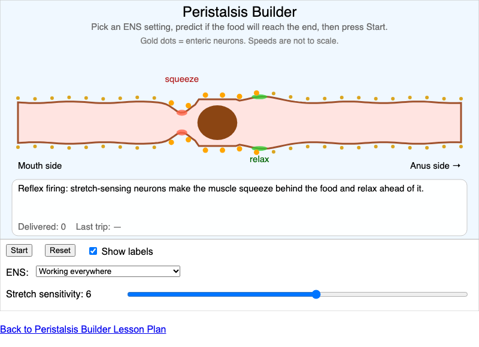](ch01-peristalsis-builder/index.md)

    Switch the enteric nervous system on, off, or missing at the end of the gut and watch the peristaltic reflex push food along, or fail.

    *Chapter 1: [The Brain in Your Belly](../chapters/01-brain-in-your-belly/index.md)*

-   **[Vagus Signal Router](ch02-vagus-signal-router/index.md)**

    ---

    [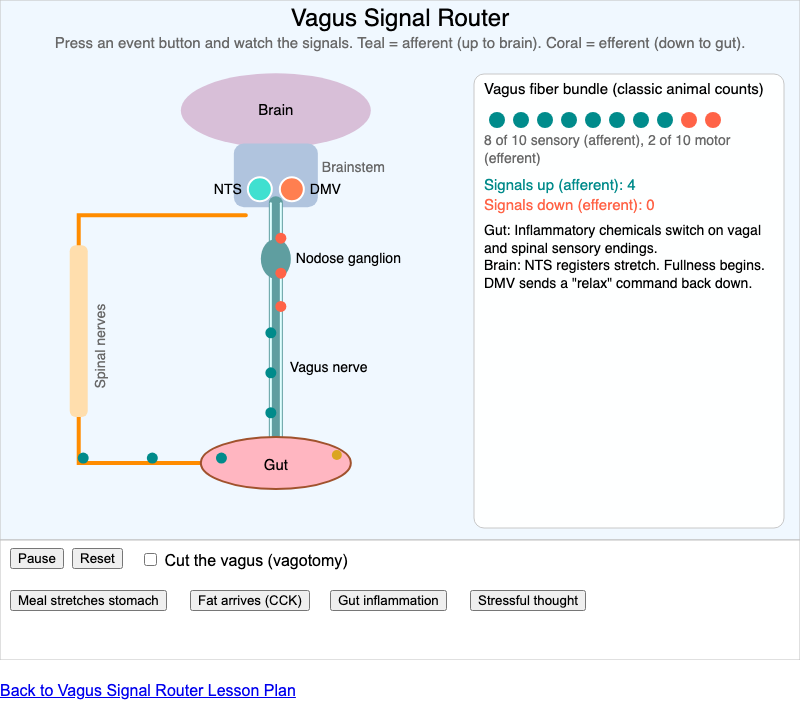](ch02-vagus-signal-router/index.md)

    Trigger a meal, fat arriving, gut inflammation, or a stressful thought and watch signals travel up and down the vagus nerve and the spinal route.

    *Chapter 2: [The Vagus Highway](../chapters/02-vagus-highway/index.md)*

-   **[Microbiome Balance](ch03-microbiome-balance/index.md)**

    ---

    [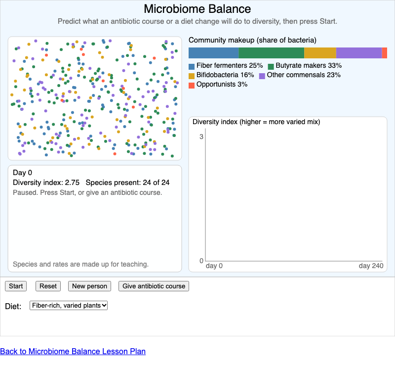](ch03-microbiome-balance/index.md)

    Give a cartoon gut community an antibiotic course or a diet change and watch diversity fall, opportunists bloom, and recovery that is often partial.

    *Chapter 3: [Meet the Microbiome](../chapters/03-meet-the-microbiome/index.md)*

-   **[Cytokine Feedback Loop](ch04-cytokine-feedback-loop/index.md)**

    ---

    [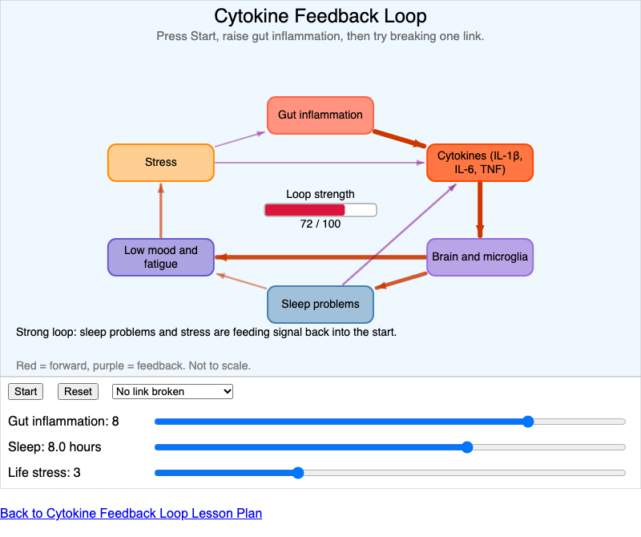](ch04-cytokine-feedback-loop/index.md)

    Raise gut inflammation, cut sleep, or add stress and watch immune signals loop through the brain, sleep, mood, and back; then break one link.

    *Chapter 4: [The Immune System as a Sense Organ](../chapters/04-immune-sense-organ/index.md)*

-   **[Serotonin: Where Does It Go?](ch05-serotonin-where/index.md)**

    ---

    [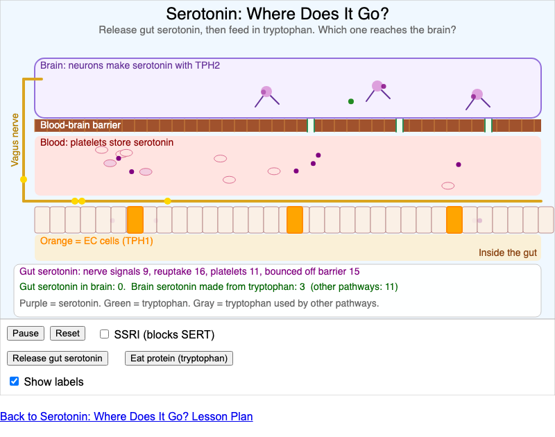](ch05-serotonin-where/index.md)

    Release serotonin from gut cells and feed in tryptophan from food to see which one gets past the blood-brain barrier, and what an SSRI changes.

    *Chapter 5: [Chemical Messengers and the Serotonin Myth](../chapters/05-serotonin-myth/index.md)*

-   **[Fiber to Butyrate](ch06-fiber-to-butyrate/index.md)**

    ---

    [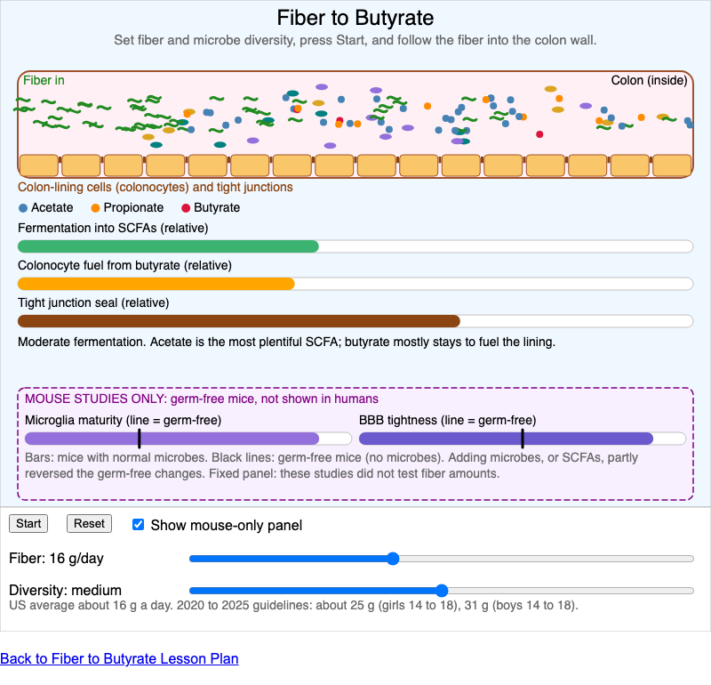](ch06-fiber-to-butyrate/index.md)

    Trace fiber through bacterial fermentation to acetate, propionate, and butyrate, see butyrate fuel the colon lining, and keep mouse-only brain findings separate.

    *Chapter 6: [Fiber, Fatty Acids, and the Blood-Brain Barrier](../chapters/06-fiber-fatty-acids-bbb/index.md)*

-   **[HPA Axis Stress Dial](ch07-hpa-stress-dial/index.md)**

    ---

    [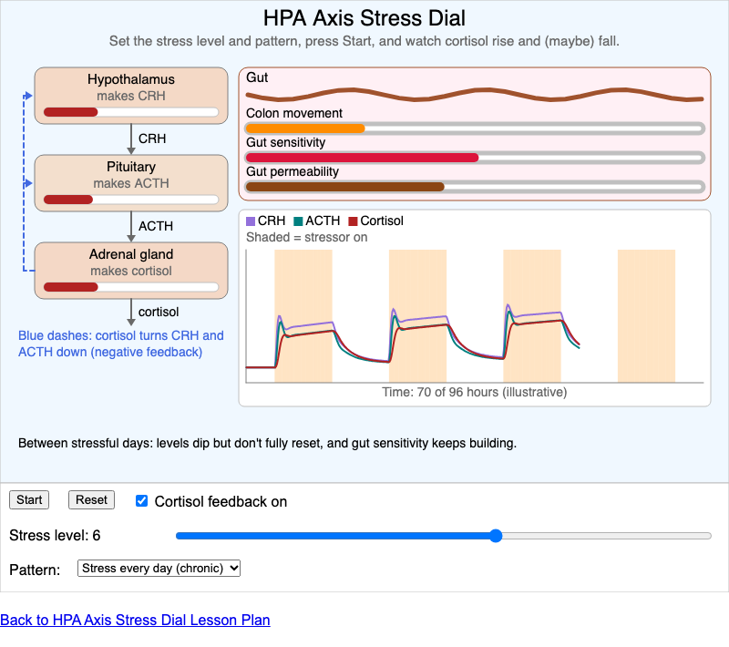](ch07-hpa-stress-dial/index.md)

    Dial up stress, watch CRH, ACTH, and cortisol rise, and see how negative feedback resets the system after acute stress but not chronic stress, along with gut effects.

    *Chapter 7: [Stress and the Gut](../chapters/07-stress-and-the-gut/index.md)*

-   **[Pain Amplifier](ch08-pain-amplifier/index.md)**

    ---

    [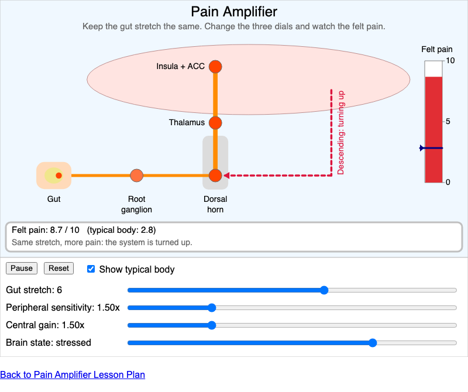](ch08-pain-amplifier/index.md)

    Keep a gut stretch the same and change peripheral sensitivity, central gain, and the brain's descending control to see how the felt pain changes.

    *Chapter 8: [Pain, Sensitivity, and the Gut](../chapters/08-pain-and-sensitivity/index.md)*

-   **[IBD Flare Timeline](ch09-ibd-flare-timeline/index.md)**

    ---

    [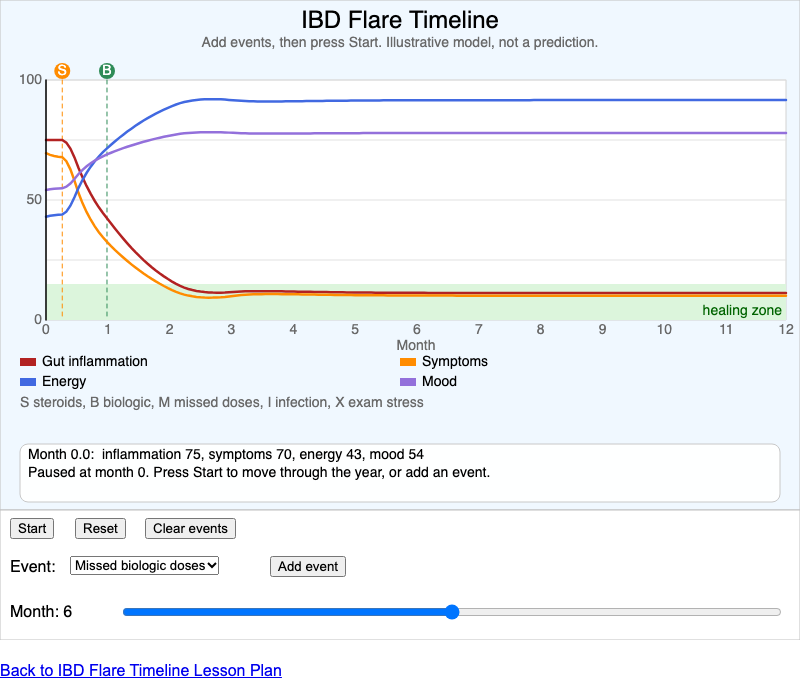](ch09-ibd-flare-timeline/index.md)

    Place treatment and life events on a 12-month timeline and see how gut inflammation, symptoms, energy, and mood respond in an illustrative model of Crohn's disease.

    *Chapter 9: [Inflammatory Bowel Disease](../chapters/09-inflammatory-bowel-disease/index.md)*

-   **[Rome IV Criteria Explorer](ch10-rome-criteria-explorer/index.md)**

    ---

    [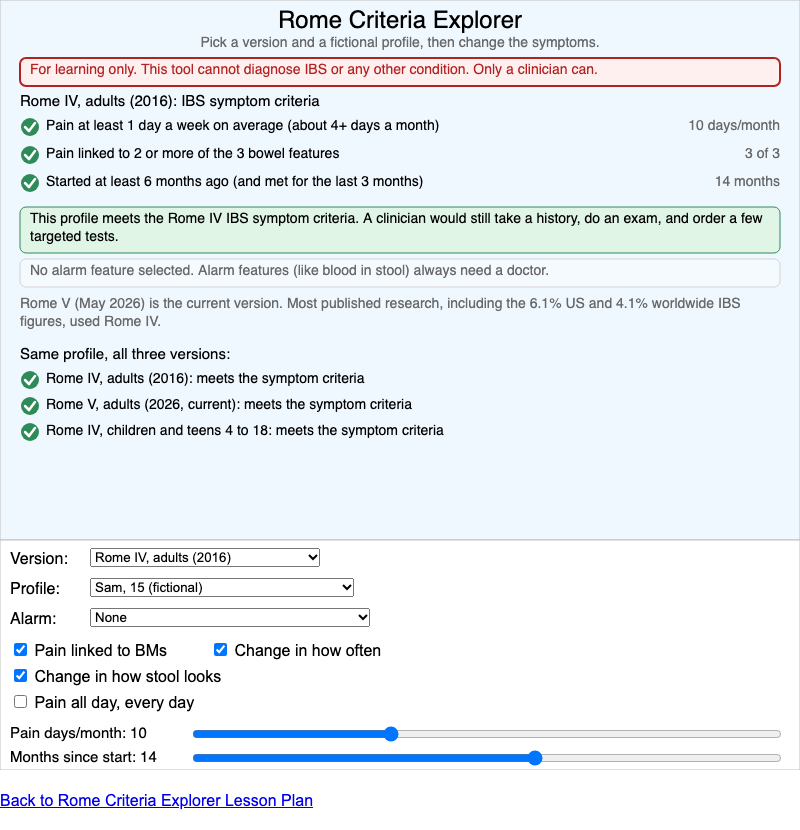](ch10-rome-criteria-explorer/index.md)

    An educational checklist that applies the Rome IV, Rome V, and child and teen criteria for IBS to fictional symptom profiles. It cannot diagnose.

    *Chapter 10: [IBS and Disorders of Gut-Brain Interaction](../chapters/10-ibs-and-dgbi/index.md)*

-   **[The Two-Way Street](ch11-two-way-street/index.md)**

    ---

    [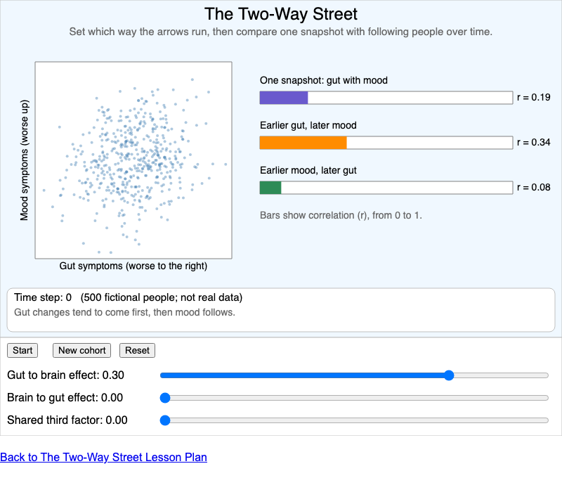](ch11-two-way-street/index.md)

    Simulate 500 fictional people and see why gut-to-brain effects, brain-to-gut effects, or a shared cause can all produce the same gut-mood correlation.

    *Chapter 11: [Anxiety, Depression, and the Gut](../chapters/11-anxiety-depression-gut/index.md)*

-   **[Villi Explorer](ch12-villi-explorer/index.md)**

    ---

    [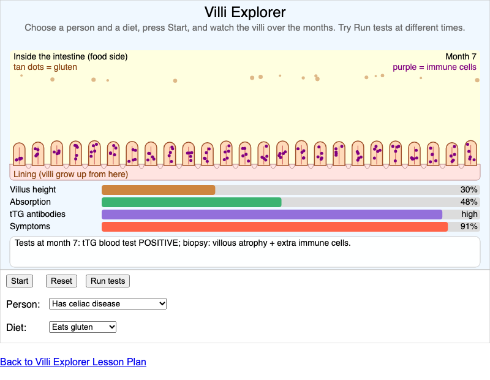](ch12-villi-explorer/index.md)

    Toggle celiac disease and gluten exposure over months and watch the villi of the small intestine shrink, heal, and change test results.

    *Chapter 12: [Celiac Disease and Food Reactions](../chapters/12-celiac-and-food-reactions/index.md)*

-   **[Confounder Detective](ch13-confounder-detective/index.md)**

    ---

    [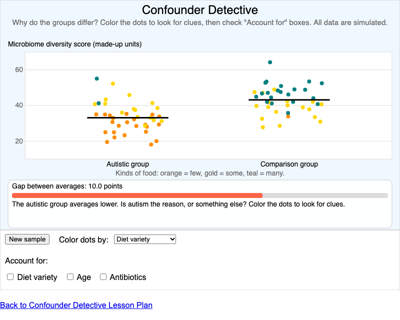](ch13-confounder-detective/index.md)

    Find the hidden variable: color simulated data by diet, age, and antibiotics and watch a microbiome difference between groups shrink when diet is accounted for.

    *Chapter 13: [Autism, ADHD, and the Gut](../chapters/13-autism-adhd-gut/index.md)*

-   **[Gut-First or Brain-First?](ch14-two-routes/index.md)**

    ---

    [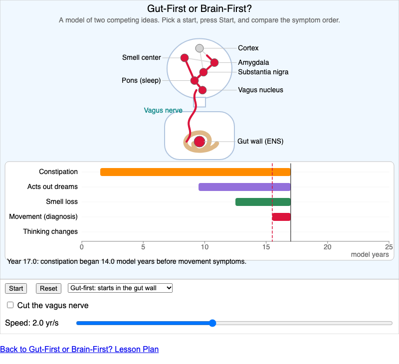](ch14-two-routes/index.md)

    A model of two competing hypotheses about Parkinson's disease. Choose where misfolded alpha-synuclein starts and compare the order of early symptoms each idea predicts.

    *Chapter 14: [Parkinson's, Alzheimer's, and the Gut](../chapters/14-parkinsons-alzheimers-gut/index.md)*

-   **[Diet Pattern Explorer](ch15-diet-pattern-explorer/index.md)**

    ---

    [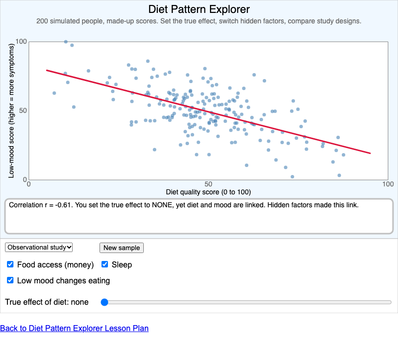](ch15-diet-pattern-explorer/index.md)

    Study 200 simulated people to see how hidden factors can create a link between diet and mood, and how a randomized trial removes that confounding.

    *Chapter 15: [Food and Mood](../chapters/15-food-and-mood/index.md)*

-   **[Probiotic Trial Reader](ch16-trial-reader/index.md)**

    ---

    [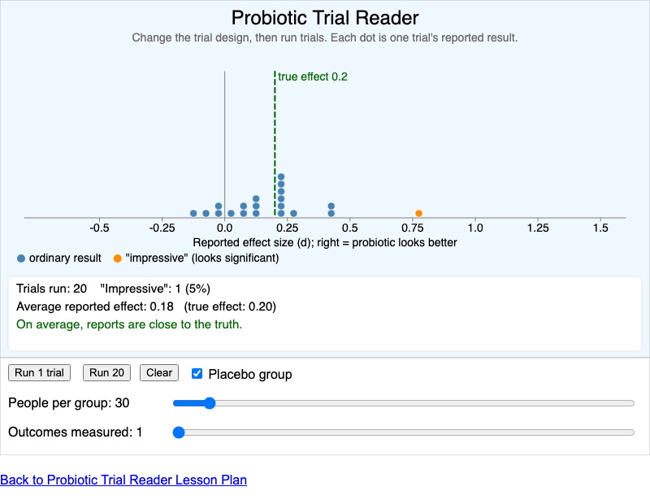](ch16-trial-reader/index.md)

    Run pretend probiotic trials and see how trial size, the number of outcomes measured, and a placebo group change how big and how trustworthy the results look.

    *Chapter 16: [Probiotics, Prebiotics, and Psychobiotics](../chapters/16-probiotics-psychobiotics/index.md)*

-   **[Treatment Evidence Map](ch17-treatment-evidence-map/index.md)**

    ---

    [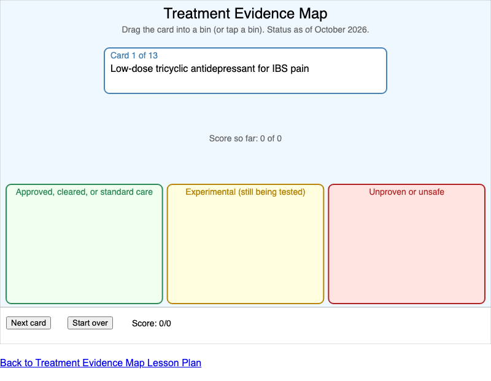](ch17-treatment-evidence-map/index.md)

    Sort 13 gut-brain treatments, from fecal transplants to vagus nerve stimulators, into approved or standard care, experimental, or unproven, and see the evidence behind each.

    *Chapter 17: [Medicine for the Gut-Brain Axis](../chapters/17-medicine-gut-brain-axis/index.md)*

-   **[Gut and Sleep Diary](ch18-gut-sleep-diary/index.md)**

    ---

    [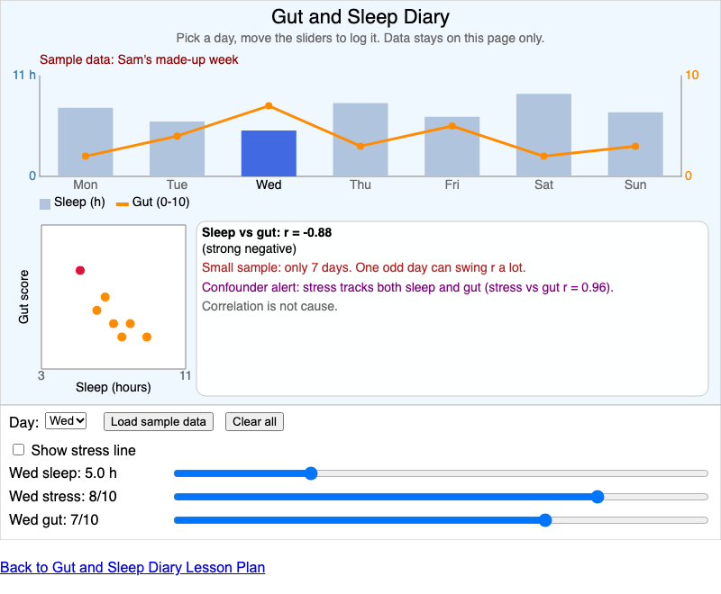](ch18-gut-sleep-diary/index.md)

    Log a week of sleep, stress, and gut symptoms (or explore a sample week), see the correlation, and learn why a week of personal data can't prove cause.

    *Chapter 18: [Sleep, Exercise, and Therapy](../chapters/18-sleep-exercise-therapy/index.md)*

-   **[Conversation Practice](ch19-conversation-practice/index.md)**

    ---

    [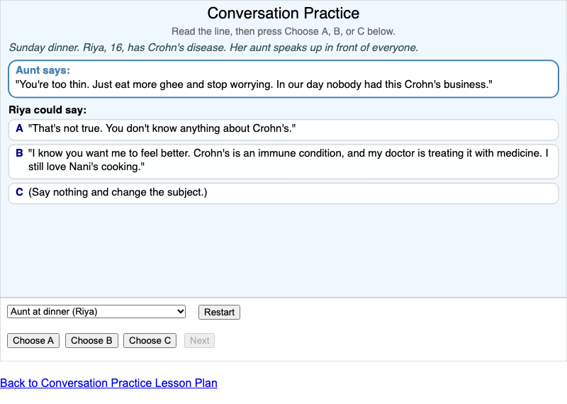](ch19-conversation-practice/index.md)

    Practice answering mistaken or stigmatizing comments about gut and mental health in four branching scenarios, and see how each reply might land.

    *Chapter 19: [Culture, Food, Family, and Stigma](../chapters/19-culture-family-stigma/index.md)*

-   **[Hype Meter Sorter](ch20-hype-meter-sorter/index.md)**

    ---

    [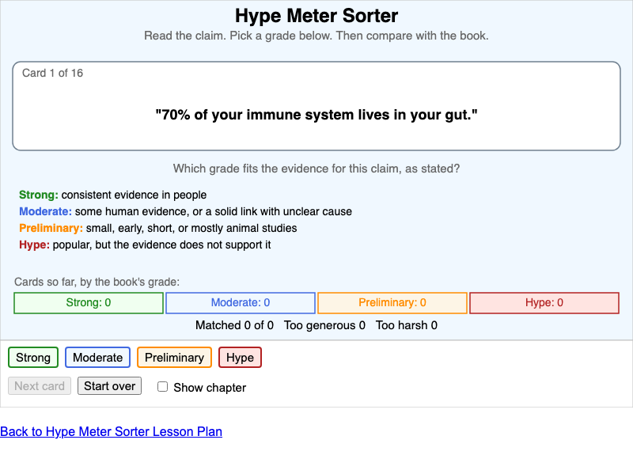](ch20-hype-meter-sorter/index.md)

    Sort 16 real gut-brain claims from across the book into Strong, Moderate, Preliminary, or Hype, then compare your grade with the book's.

    *Chapter 20: [Be Your Own Scientist](../chapters/20-be-your-own-scientist/index.md)*

-   **[Learning Graph Viewer](graph-viewer/index.md)**

    ---

    Explore all 337 concepts in the book and how they connect.

